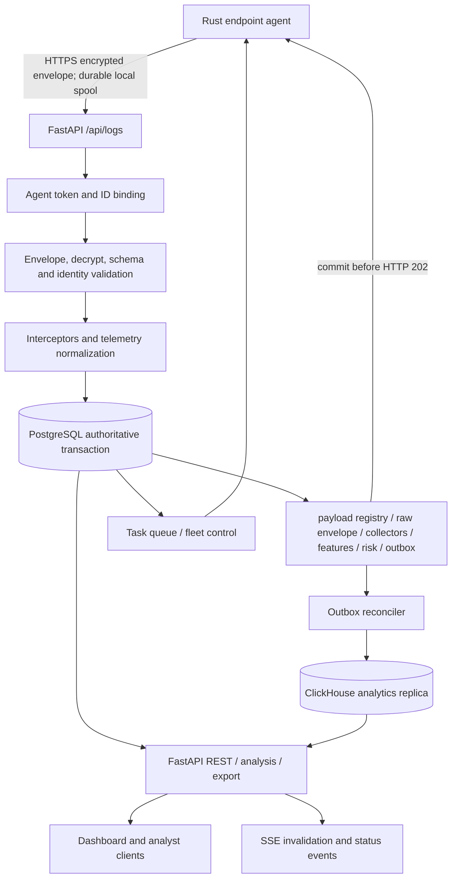

# Backend audit and redesign — 2026-10-25

## Scope and confidence

This report records a source audit of the current Server checkout, the Rust
agent's durable-spool acknowledgement contract, deployment configuration, and
focused local tests. It is an engineering review, not a production penetration
test or capacity certification. No live PostgreSQL/ClickHouse target was
available, no target-host load run was performed, and no retention deletion or
schema migration was executed in this pass. The earlier
[`INSIEDR_SERVER_PIPELINE_AUDIT.md`](INSIEDR_SERVER_PIPELINE_AUDIT.md),
[`TELEMETRY_PERFORMANCE_AUDIT.md`](TELEMETRY_PERFORMANCE_AUDIT.md), and
[`RELIABILITY_ROLLOUT.md`](RELIABILITY_ROLLOUT.md) remain useful historical
reports; findings below distinguish the current implementation from those
earlier baselines.

## A. Executive summary

The backend has a conventional, understandable core: FastAPI routes, synchronous
PostgreSQL storage behind repositories, an authoritative PostgreSQL transaction
and outbox for accepted telemetry, optional ClickHouse analytical replication,
and a Rust agent that retains each envelope until it receives the matching
durable acknowledgement. That is a sound base for a modest-to-medium fleet.
There is no evidence that a broker, microservice split, or replacement database
is required for 500 endpoints.

This pass fixed four concrete correctness/security/resource issues:

1. Analysis routes returned fleet and user telemetry without operator
   authorization. They now inherit `operator:read` at the router boundary.
2. Those async routes ran synchronous database calls on the event loop and
   exposed exception text. Reads now run in AnyIO worker threads; errors are
   logged server-side and returned generically.
3. Legacy log and collector reads could silently switch from ClickHouse to
   PostgreSQL when an analytics page was empty or failed, which can mix two
   sources during pagination. Reads now stay on the configured source and
   surface analytics unavailability.
4. Hybrid ingestion performed a duplicate agent upsert and performed a
   pre-read-before-insert for PostgreSQL idempotency. Fleet updates now occur in
   the durable transaction; migrated PostgreSQL uses the atomic payload
   registry result. Training exports now bulk-load fallback features by page
   rather than performing one feature query per row.

Collection APIs now have explicit maximum page sizes. The API specification was
corrected for the actual encrypted envelope and HTTP 202 agent ACK. No evidence
from local tests establishes the requested 500-endpoint performance target.
Retention durations still differ between PostgreSQL and ClickHouse and remain a
policy decision because changing them can delete security evidence.

## B. Current architecture



The actual application is a FastAPI factory with a lifespan that initializes
configuration, storage/migrations, task processing, optional outbox replication,
optional maintenance, and an operations monitor. PostgreSQL is synchronous
psycopg2 storage using a threaded connection pool. ClickHouse is optional and is
not the durable ACK authority. Redis is used for task/webhook queue functions;
SSE is used for live notifications. The application uses two Uvicorn workers in
the supplied Docker runtime configuration. Worker-local semaphores, caches,
monitors and background threads are therefore per process, not shared globally.

## C. Representative telemetry path

| Boundary | Current implementation | Input/output and invariant |
|---|---|---|
| Agent | Rust service durable SQLite spool | Persists the exact encrypted envelope and retries the same payload ID until accepted. |
| HTTP | `server/api/logs.py` → `server/api/ingest.py` | `POST /api/logs` (and versioned alias), encrypted JSON envelope plus agent/payload/crypto/protocol/key headers and token. |
| Identity/auth | Ingest authentication and payload checks in `server/api/ingest.py` | Binds header agent ID, credential, envelope and decrypted agent/payload IDs; encryption alone is not sender authentication. |
| Validation/decrypt | `server/api/ingest.py`, shared protocol and crypto plugins | Validates envelope, decrypts, parses JSON, validates telemetry/collector shape, schema, age and header/body identity. |
| Normalization | `HybridStorage` interceptors and PostgreSQL transaction | Applies configured pre-storage interceptors, updates fleet identity, writes payload and child rows, normalized features, risk state and outbox. |
| Durable write | `PostgresStorage.store_raw_payload` | Transaction commits the payload registry identity and raw/collector/feature/risk/outbox writes. Duplicate same-content payload IDs return an idempotent result; conflicting identity/content is rejected. |
| ACK | `_process_encrypted_request` | Responds HTTP 202 with `{ok:true,payload_id,status:"accepted"}` only after persistence returns. Rust agent checks status and matching ID before deleting its spool item. |
| Replication | `ReplicationReconciler` | Claims leased outbox rows, sends bounded batches to ClickHouse, completes only rows still owned by the lease. At-least-once; bounded ClickHouse retry dedupe is not an exactly-once guarantee. |
| Query/display | telemetry, analysis, dashboard, export routers and frontend | REST filtering/pagination reads configured telemetry source; SSE is notification/invalidation, not durable event replay. |

One important latency caveat remains: the ingest handler runs risk evaluation in
a worker thread after the PostgreSQL commit but before returning 202. This does
not block the event loop, but it retains the request/ingestion slot and increases
agent acknowledgement latency. Moving it after the durable ACK requires a
durable, idempotent work handoff and failure/replay tests; an in-memory task is
not sufficient.

## D. Database and data semantics

| Relation/family | Role and write pattern | Main reads / growth risk |
|---|---|---|
| `agents`, `agent_heartbeats` | Current endpoint identity and liveness; upsert/heartbeat writes | Fleet listing/status; not a tenant directory. No universal immutable user/device identity mapping is defined. |
| `payload_registry` | Unique payload identity and content hashes | Ingest idempotency; must be retained as long as retry/conflict policy requires. |
| `raw_payloads` | Envelope metadata and optional encrypted/raw content, partitioned in PostgreSQL | Legacy logs, payload lookup and provenance; large JSON/envelope and retention can dominate storage. |
| `collector_results` | Per-collector observation/result snapshots, partitioned | Explorer, collector-specific queries, latest-state derivation; mixed semantics mean not every row is an individual security event. |
| `normalized_features` | Feature name/value rows derived during ingest | Model/training and feature lookups; can have multiple rows per payload and grows with feature cardinality. |
| `risk_events`, `anomalies`, `model_outputs`, daily model scores | Derived detection and model results | Risk history, analyst review, dashboard enrichment; not interchangeable with original event evidence. |
| `clickhouse_outbox`, quarantine and maintenance tables | Durable PostgreSQL-to-ClickHouse delivery and operations | Pending age/depth and replay state; outbox storage requires bounded cleanup of completed records, never pending work. |
| ClickHouse raw/collector/features/risk/model/anomaly and rollups | Analytical replicas/projections | Time/filter/aggregate/export reads; TTLs vary and replica completeness depends on outbox age, schema version and privacy policy. |
| `task_queue`, `agent_tasks`, command audit, heartbeats | Fleet task/control-plane state and audit | Poll/claim/ack and operator review; control-plane delivery needs explicit task ownership and retry behavior. |

Telemetry must be interpreted by meaning, not simply deduplicated by JSON:

| Category | Examples in this platform | Storage rule |
|---|---|---|
| Event | Individual process/file/network/logon activity when a collector emits event records | Preserve each legitimate event and stable identity; never suppress only because values repeat. |
| State/snapshot | Collector result reporting ETW state or current process counts | Latest-state projection can be separate from history; keep history only where audit/trend value requires it. Current collector result storage is generic and can include snapshots. |
| Gauge/counter | Process count vs daily accumulated unique count | Treat gauge as replaceable observation; counter needs reset/window semantics before aggregation. Do not infer semantics from the field name alone. |
| Metadata | Hostname, OS, agent version, user identity | Prefer an endpoint/identity reference with update history where schema supports it. Current code repeats some routing metadata and does not provide a complete tenant/SID identity model. |
| Derived feature | `normalized_features`, risk/model/anomaly output | Keep provenance and model/schema version; do not treat derived output as original evidence. |

Current ClickHouse TTLs and PostgreSQL retention settings are not aligned across
all representations (notably payload/collector, features, risk/model/anomaly).
The deployments and existing audits report PostgreSQL payload/collector cleanup
around 30 days and features around 90 days, while ClickHouse table TTLs differ
from 30 through 365 days. This can produce either analytics-only remnants or
missing join metadata. Do not shorten or harmonize retention until evidence,
privacy, legal and measured disk-growth requirements are approved. No data was
deleted in this pass.

## E. API, query and resource audit

The route surface is broad and grouped by responsibility: ingestion/logs,
telemetry explorer/events/histograms, stats/snapshots, analysis/risk, agents and
fleet control, SSE, exports, health/operations, crypto key discovery, model
review, and configuration-gated scenario replay. Runtime OpenAPI remains the
authoritative detailed inventory; the API specification has been updated to
describe these route families instead of listing stale/nonexistent examples.

| API family | Consumer and query shape | Pagination/resource finding |
|---|---|---|
| `POST /api/logs` | Agents; authenticate, validate/decrypt and transactionally persist envelope and derived rows | Durable one-envelope ACK contract preserved. Concurrent ingest is limited per worker; risk evaluation still extends request duration. |
| `GET /api/telemetry`, explorer, event detail, histogram, collector states | Dashboard/analysts; filtered time, endpoint, collector, user and search queries | Telemetry endpoint supports cursor or offset and optional count; cursor is preferable for append-heavy deep traversal. Exact count and payload search remain more expensive. |
| `GET /api/logs`, `/api/agents`, risk events/user risk, agent tasks/tamper alerts | Legacy clients and dashboard | Added maximum page limits: logs 1000; agent/task/tamper 500; risk/user risk 500. These are resource safety ceilings, not benchmark-derived capacity claims. |
| `/api/stats`, dashboard summary/snapshots | Dashboard | Purpose-built aggregates and snapshot cache reduce repeated work; no target DB latency is claimed. |
| `/api/export/*` | Analyst/model-training/SIEM clients | Log/threat export caps and collector export cap are present. Training exports now bulk-load fallback vectors per page. XLSX remains memory-heavier than streaming CSV/JSONL. |
| SSE streams | Dashboard | Notifications/invalidation; callers recover via REST. Not a durable queue or replay log. |
| `/api/health/*`, operations, queue metrics | Orchestrator/operator | Liveness/readiness are different; operations snapshots are per process and do not replace DB host monitoring. |
| `/api/agents/*` control | Operator and agent control plane | Operator roles and agent credential binding exist in current route dependencies; this pass did not change task delivery protocol. |
| `/api/v1/detection/ml/*`, scenario replay | Analyst / staging operators | Role/config gated; scenario replay remains deployment-conditional. |

Newly fixed: every route in `server/api/analysis.py` now requires
`operator:read`, including aliases and future routes added to the router. Its
synchronous reads use AnyIO worker threads, and raw exception strings are not
returned. Legacy log and collector page reads now stay on the explicitly
selected backend. A configured ClickHouse outage produces an analytics-unavailable
error instead of an empty response or a PostgreSQL page splice. ClickHouse query
errors likewise no longer masquerade as a valid empty page.

## F. Artificial/arbitrary logic and changes

| Location | Previous behavior | Engineering problem | Change or disposition |
|---|---|---|---|
| `server/api/analysis.py` | Sensitive analysis endpoints had no router auth; synchronous DB calls in async handlers; raw `str(exception)` in 500s | Data exposure, event-loop stalls and internal detail leakage | Router-wide `operator:read`; cohesive sync reads offloaded; server logs retain diagnostics and client receives generic error. |
| `server/storage/hybrid_storage.py` + PG write path | Fleet upsert before the authoritative payload transaction, then PG upsert again during storage | Duplicate write and a partial fleet update could survive failed telemetry persistence | Removed pre-transaction upsert; transaction owns fleet and telemetry state. |
| `server/api/ingest.py` | Read-before-write duplicate policy even when PG registry transaction already arbitrates identity | Extra query and concurrency race at a hot ingest boundary | Migrated PostgreSQL uses atomic registry result. RAM/SQLite replay compatibility keeps required pre-read. |
| `TelemetryRepository.list_logs/list_collector_results` | Empty/error ClickHouse result fell back to PostgreSQL | A single pagination sequence could mix consistency, freshness and sort domains | Explicit source routing; error is visible and retryable. |
| `server/api/export.py` | Feature fallback could issue a feature lookup for each row | N+1 query pattern on a training export page | Bulk `get_feature_vectors` methods in PG/CH/repository and page-level export preparation. |
| Collection API query parameters | Several list endpoints had no upper bound | Caller could request unbounded memory/DB/response work | Added explicit upper limits. Limits are intentionally documented as safety ceilings pending workload tuning. |
| `docs/API_SPECIFICATION.md` | Described inaccurate header names, HTTP 200 success and stale endpoint inventory | Agents/operators could implement against a false contract | Updated to actual headers, envelope, HTTP 202 durable ACK and current route families. |
| Retention constants/TTL | Different defaults across stores and representations | Arbitrarily “fixing” them could delete forensic evidence or break joins | Kept existing behavior; reconcile only after approved retention matrix and per-table measured growth. |

Other constants such as worker count, DB pool sizes, ingestion slots, export
batch sizes, outbox leases, ClickHouse batch bytes/rows and retry backoff already
exist as operational configuration/defaults. Treat each as a tuning input, not
proof of capacity. This pass did not centralize every legacy limit because
duplicating configuration layers without a specific ownership need would add
abstraction rather than improve operations.

## G. Performance and 500-agent assessment

Let `T` be average payload interval in seconds per agent, `C` be collector
observations per payload, `B` be average compressed/encrypted request bytes,
`F` be normalized feature rows per payload, and `R` be the fraction producing a
risk row. For 500 agents:

```text
requests/s              = 500 / T
collector observations/s = 500 * C / T
ingress bytes/s          = 500 * B / T
daily payloads           = 500 * 86,400 / T
daily collector rows     = 500 * C * 86,400 / T
approx PG row writes/payload = registry + raw + outbox + C collectors + F features + (0 or 1) risk
```

Example only: if each agent sends once per 10 seconds and each payload contains
20 collector observations, that is 50 requests/s and about 1,000 collector
observations/s before features, risk rows, indexes, WAL, outbox and ClickHouse
replication. The project does not provide a verified fleet cadence or
representative payload-size distribution, so this is arithmetic, not a
capacity result.

The handler currently admits a small configured number of concurrent ingests
per worker process; with two Uvicorn workers, effective request concurrency is
approximately the per-worker limit multiplied by two. PostgreSQL writes are
synchronous and transactional; event-loop offload protects loop responsiveness
but does not increase DB throughput beyond pool and storage capacity. Every
payload produces several row writes and indexes. On mechanical disks, WAL and
ClickHouse parts/merges can dominate. Agent local spooling and idempotent retries
provide recovery when the service cannot acknowledge.

**Verdict:** the architecture may be sufficient for 500 endpoints at a modest
cadence, but current evidence does not prove it. No p50/p95/p99, error rate,
host CPU/RAM, disk await/IOPS, DB connection saturation, bytes/event, DB growth,
or 500-agent test result was obtained here. Previous capacity audit records the
target-host harness and required metrics. Production readiness therefore remains
conditional on those measurements and failure tests.

## H. Current versus target architecture

| Area | Current | Target for this fleet | Reason / gate |
|---|---|---|---|
| Ingestion | Encrypted single-envelope request; PG durable commit before 202; bounded local agent spool | Keep contract; measure representative payloads and agent cadence; add protocol batching only as versioned agent/server work | Preserves compatibility and loss recovery. |
| Writes | One PostgreSQL transaction writes payload and derived relations plus outbox | Preserve transaction; consider group commit only after profiling and only if individual ACK resolves after commit | No per-event commit reduction should weaken durability. |
| ClickHouse | At-least-once replica from PG outbox | Keep one replication path and monitor age/depth/duplicates/parts | Simpler than broker introduction; replica lag is explicit. |
| Reads | PostgreSQL default; ClickHouse opt-in; legacy repository now honors one selected source | Keep stable cursor source; benchmark the chosen backend and use count-free/keyset pages for explorer | Prevents mixed-source pagination. |
| Dashboard | Aggregate/snapshot endpoints plus telemetry queries and SSE invalidations | Keep purpose-built responses; inspect browser call waterfall and payload sizes under target deployment | No evidence that the browser is the current bottleneck. |
| Exports | Capped/streamed formats; XLSX workbook path | Keep streaming formats for large jobs; bulk page fallback lookups | Avoid row-by-row DB queries and uncontrolled export rows. |
| Identity | Agent IDs, usernames/hostnames and credential binding | Define stable tenant, Windows SID/user and endpoint lifecycle model if multi-tenant identity is required | Do not infer identity from mutable username/hostname. |
| Retention | PG maintenance/partition cleanup and independent CH TTLs | Approved evidence matrix by relation, legal basis and measured growth; align join dependencies | No destructive change until policy and storage budget are explicit. |
| Infrastructure | PostgreSQL, optional ClickHouse, Redis and FastAPI | Keep; do not add Kafka/RabbitMQ/microservices absent measured bottleneck | Existing outbox and agent spool already provide durable recovery boundaries. |

## I. Priority and implementation status

| Priority | Finding | Status |
|---|---|---|
| P0 | Analysis API exposed user/fleet data without operator authorization | Fixed in this pass; focused route/dependency tests pass. |
| P1 | Sync database reads blocked async analysis handlers and raw exception text escaped | Fixed in this pass. |
| P1 | Telemetry page could switch read source on empty/error | Fixed in this pass; explicit backend error behavior unit-tested. |
| P1 | Duplicate fleet upsert and avoidable pre-read in ingestion | Fixed for hybrid PG atomic path; SQLite/RAM compatibility behavior retained. |
| P1 | Training export fallback feature lookup could become N+1 | Fixed with per-page bulk API; unit-tested. |
| P1 | Ingest ACK waits for risk evaluation | Still present; move only with durable idempotent work contract and failure recovery. |
| P1 | 500-agent capacity, DB/CH physical metrics and recovery under target hardware | Unmeasured; target deployment run required. |
| P1 | PostgreSQL/ClickHouse retention mismatch and identity/tenant ambiguity | Policy/schema decision pending; no deletion or speculative migration. |
| P2 | Exact totals, full payload substring search and deep offset pages cost more than bounded metadata/cursor queries | Existing cursor/count-free options are present; use them in explorer and benchmark before changing defaults. |
| P2 | Full API response models and a single uniform error contract remain inconsistent | Not broadly rewritten; expand compatibly with contract tests. |

Earlier queue, outbox, ClickHouse batcher, DLQ and maintenance defects are
tracked in the linked pipeline/reliability audits. The 9 October reliability
rollout documents the outbox lease, bounded replication batches, durable PG ACK
boundary and maintenance behavior. Those changes are not re-certified against a
live service by this report.

## J. Implementation plan and rollout

| Phase | Work | Compatibility, risk and verification |
|---|---|---|
| 0 — Baseline | Run 500-agent normal, burst/reconnect, DB slowdown and dashboard-under-ingest cases on a disposable deployment; record payload template, T/C/B, p50/p95/p99, error rate, DB/WAL/CH/host metrics | No production writes. Capacity remains unclaimed until measured. |
| 1 — Security/correctness | Keep analysis auth, sanitized errors, exact payload identity and durable ACK; add HTTP-level regression coverage when Windows TestClient environment is fixed | Agent ACK contract unchanged. Exercise invalid token, duplicate and conflicting payload identity. |
| 2 — Write path | Keep single PG transaction and outbox; profile repeated normalized rows and per-payload query count; only batch across requests with explicit durable group-commit design | No schema migration needed for present changes. Avoid double enqueue or pre-commit ACK. |
| 3 — Query/export | Keep fixed page source; profile query plans, row width, exact count, search and deep-page behavior; grow bulk export path if metrics show remaining N+1 | Existing aliases remain. New query ceilings may require clients to paginate. |
| 4 — Dashboard | Trace browser API waterfall, bytes, render cost, cache hit and SSE invalidation rate | No cache/library addition absent evidence. |
| 5 — Reliability | Fault-inject PG/CH outage, process restart, disk pressure, request loss, replay and shutdown; verify ACKed PG payload count and eventual outbox convergence | Preserve pending outbox/DLQ; deploy compatible workers together. |
| 6 — Retention | Approve evidence/privacy matrix, measure physical bytes/table/day, partition and TTL lag; stage policy and backup/restore | Additive/non-destructive validation first. No delete migration until signoff and rollback plan. |
| 7 — Capacity signoff | Run 500 normal agents, peak event rate, reconnect storm, DB slowdown and concurrent dashboard/export cases on target hardware | Retain reproducible templates, reports, configuration and DB snapshots. No average-only pass criterion. |

Rollback for this pass is application-image rollback; all present schema changes
are none. Keep outbox leases/migrations and retained telemetry intact if rolling
back broader prior deployment changes. Do not roll back to externally reachable
unauthenticated analysis routes.

## K. Verification performed

- Focused changed-path suite: **32 passed**, 1 Starlette/httpx deprecation warning.
- `compileall` on modified Python modules and focused tests: passed.
- `git diff --check`: passed (Git reports the repository's expected LF-to-CRLF
  working-copy conversion warning for the API specification).
- The broader reliability/performance test batch stopped making progress and
  was interrupted; it is not counted as passed.
- FastAPI `TestClient` integration tests stall in this Windows Python 3.13
  environment while initializing the asyncio socket-pair/portal, before request
  dispatch. Existing tests have the same environment limitation. Focused tests
  therefore inspect route dependencies/limits and storage behavior without
  claiming full HTTP integration coverage.
- No live PostgreSQL/ClickHouse, target deployment, restore, security
  penetration, or load test was available. Prior performance audit explains the
  target-host harness and operational metrics to capture.

Pre-existing working-tree edits to fleet data and scenario replay files were
preserved and are outside this redesign pass.

## L. Final verdict

```text
BACKEND HEALTH
Overall: Solid durable foundation; several API and query-path defects fixed; operational certification incomplete.
Ingestion: Durable PostgreSQL ACK and agent spool are good; ACK latency still includes risk scoring.
Database: Clear PG authority/outbox model; row/index amplification and retention alignment need target measurements/policy.
API: Broad useful surface; analysis authorization, bounds and source consistency improved; response contracts remain mixed.
Dashboard: Purpose-built summaries and cursor options exist; client waterfall and target query latency not measured.
Reliability: Agent retry, idempotency and leased outbox provide recovery; bounded target fault tests still required.
Security: Analysis data reads now require operator:read; deployment credential enforcement and broader route tests remain essential.
Maintainability: Repository boundaries are understandable; some legacy response/adapter compatibility remains.
500-Endpoint Readiness: Plausible for a modest cadence; NOT DEMONSTRATED without target-host load and failure testing.

TOP BOTTLENECKS
1. Synchronous multi-row PostgreSQL transaction and index/WAL write amplification per envelope.
2. Risk evaluation before HTTP ACK increases request occupancy and tail latency.
3. Large exact-count, payload-search, deep-offset and export work competes with ingestion.

TOP ARCHITECTURAL RISKS
1. Retention mismatch can break evidence joins or retain data beyond intended policy.
2. No measured physical bytes/event or target-host capacity envelope for 500 agents.
3. Username/hostname/agent ID do not constitute a complete tenant and immutable user identity model.

KEEP AS-IS
1. Agent durable spool and matching HTTP 202 payload-ID ACK.
2. PostgreSQL transaction as durable authority with transactional outbox to ClickHouse.
3. REST recovery after SSE invalidation; no new broker or microservice without measured need.

RESTRUCTURE
1. Move risk scoring after ACK only with durable idempotent work handoff.
2. Approve and align evidence retention across all relations and replicas.
3. Define stable tenant/user/device identity if deployment requires multi-tenancy or SID-level mapping.

REMOVE / SIMPLIFY
1. Removed duplicate fleet upsert from hybrid ingestion.
2. Removed PostgreSQL pre-read dedupe on the atomic registry path.
3. Removed silent mixed-source fallback for paginated telemetry reads and per-row export feature fetches.

IMPLEMENT FIRST
1. Run the 500-agent target-host workload and failure matrix with representative payloads.
2. Measure DB query plans, WAL, ClickHouse part/merge debt, disk I/O and bytes per accepted observation.
3. Select and document approved retention/identity policy before any destructive or schema-level redesign.
```
