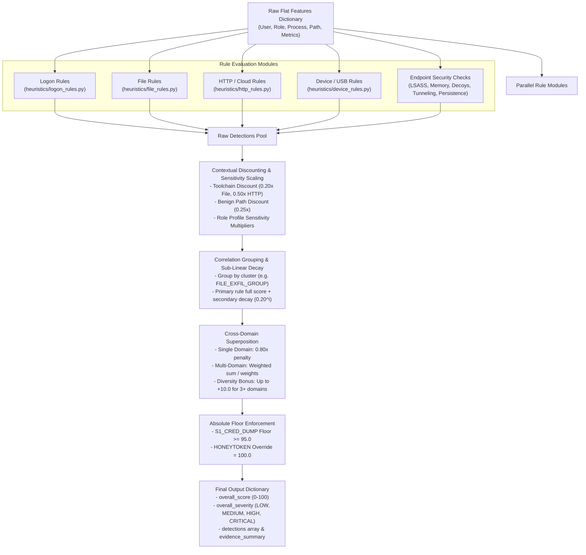

# InsiEDR Deterministic Heuristics Engine: Complete Documentation

> **Module Path**: `InsiEDR_Server/heuristics/`  
> **Source Files**: `detector.py`, `logon_rules.py`, `file_rules.py`, `http_rules.py`, `device_rules.py`  
> **Current Version**: 2.0 (Active Production Implementation)

---

## 1. Overview & Core Philosophy

The InsiEDR Heuristics Engine is a **deterministic, explainable, rule-based detection system**. It accepts a flat feature dictionary derived from endpoint telemetry and evaluates indicators of compromise (IOCs) and indicators of attack (IOAs) without requiring statistical training or machine learning inference.

### Key Architectural Tenets:
1. **Explainability**: Every detection provides explicit triggers, parameter values, scenario IDs, and confidence ratings.
2. **Anti-Score Stacking (Correlation Grouping)**: Rules operating on the same underlying phenomenon (e.g., multiple file collection rules) are clustered into correlation groups with sub-linear decay so that scores do not falsely accumulate linearly.
3. **Workload Context Awareness**: Rule sensitivity adapts dynamically based on the endpoint role profile (`DEVELOPER`, `SYSADMIN`, `DATA_ENGINEER`, `MEDIA_CREATOR`, `OFFICE_WORKER`).
4. **Noise Discounting**: Known build toolchains (`cargo.exe`, `node.exe`, `git.exe`, etc.) and benign high-I/O file paths (`node_modules`, `target`, `.git`, `Temp`) apply automated discount factors.
5. **Cross-Domain Superposition**: A single elevated activity (e.g., file activity alone) is penalized by $0.80\times$, whereas multi-domain corroborated attacks receive a diversity bonus.
6. **Risk Floor Guarantee**: In the central InsiEDR Risk Aggregator, deterministic heuristics act as an **un-dilutable risk floor**; an absent or low-scoring ML model cannot wash out a confirmed heuristic alert.

---

## 2. Heuristics Pipeline Execution Flow



---

## 3. Input Data Contract & Consumed Features

The heuristics engine accepts a flat Python dictionary `features: Dict[str, Any]` and an optional `system_profile: Optional[str]`.

### Primary Consumed Feature Fields

| Category | Field Name | Type | Description |
| :--- | :--- | :---: | :--- |
| **Identity & Context** | `username` | String | Active primary session username |
| | `system_profile` / `user_role` | String | Role context: `DEVELOPER`, `SYSADMIN`, `DATA_ENGINEER`, `MEDIA_CREATOR`, `OFFICE_WORKER`, `DEFAULT` |
| | `process_name` / `active_process`| String | Image path or binary name generating the activity |
| | `target_path` / `file_path` | String | Directory path or file path involved in the event |
| **Authentication & Logon** | `successful_logons` / `logon_count` | Float | Count of successful logons |
| | `failed_logons` | Float | Count of failed authentication attempts |
| | `after_hours_logon` | Float | Count of logons outside normal operational hours |
| | `daily_after_hours_logon_ratio`| Float | Ratio of after-hours logons over total logons $[0.0, 1.0]$ |
| | `daily_unique_pc_count` / `unique_pc_count` | Float | Count of distinct workstations accessed |
| | `edr_failed_auth_ratio_window` / `auth_fail_rate_300s` | Float | 5-minute rolling window failed authentication ratio |
| | `edr_failed_auth_events_per_minute_window` | Float | Failure rate per minute in short window |
| **File Activity** | `file_access_count` | Float | Total file accesses (`open + write + delete`) |
| | `daily_unique_filename_count` / `unique_filename_count` | Float | Count of distinct filenames touched |
| | `daily_new_filename_count` | Float | Count of previously unseen filenames accessed |
| | `daily_file_delete_count` / `file_delete_count` | Float | Confirmed file deletion operations |
| | `sensitive_file_access` | Float | Count of hits on classified/sensitive files |
| | `daily_files_to_removable_count` / `usb_file_transfer_count` | Float | Files copied to removable storage |
| **Network & HTTP** | `file_sharing_site_visits` | Float | Hits on watchlisted cloud storage sites (Drive, Dropbox, etc.) |
| | `cloud_storage_uploads` / `large_uploads` | Float | Count of outbound upload operations to cloud services |
| | `upload_bytes` / `cloud_upload_bytes` / `large_upload_bytes` | Float | Total bytes uploaded |
| **Device & USB** | `usb_connect_count` / `daily_device_connect_count` | Float | USB peripheral connection events |
| | `unauthorized_usb_detected` | Bool/Str | True if a non-whitelisted Vendor/Product ID connected |
| | `external_drive_file_copy` / `large_usb_transfer` | Float | Volume or count of files written to USB |
| **Security & Deception** | `credential_dumping_suspected`| Bool/Str | True if LSASS memory dumping was detected |
| | `unbacked_executable_regions` | Float | Number of unbacked executable memory allocations |
| | `threats_detected` | Bool/Str | True if memory threat scanner flagged malicious code |
| | `tunneling_process_count` | Float | Active tunneling utilities (`ngrok`, `chisel`, etc.) |
| | `tunneling_detected` | Bool/Str | True if DNS tunneling was flagged |
| | `threat_triggered` | Bool/Str | True if canary decoy / honeytoken file was touched |
| | `modifications_detected` | Bool/Str | True if persistence / service modifications occurred |

---

## 4. Comprehensive Rule Catalog by Domain

### A. Logon Rules (`heuristics/logon_rules.py`)

#### 1. After-Hours Logon Anomaly
- **Scenario ID**: `S1_PRECURSOR`
- **Rule Logic**: Triggered when after-hours logons $\ge 2$, after-hours logon ratio $\ge 0.50$, and total successful logons $\ge 3$.
- **Severity & Score**: `MEDIUM` (Score: 40, Confidence: `MEDIUM`)
- **Domain**: `LOGON`
- **Correlation Group**: `LOGON_TIME_GROUP`
- **Rationale**: Isolated after-hours logins happen occasionally; this rule requires that after-hours activity constitutes at least 50% of the user's sessions to avoid single accidental off-hour false alarms.

#### 2. Multi-PC Access Anomaly
- **Scenario ID**: `AUTH_LATERAL`
- **Rule Logic**: Triggered when distinct workstations $\ge 3$ and total successful logons $\ge 3$.
- **Severity & Score**: `MEDIUM` (Score: 40, Confidence: `MEDIUM`)
- **Domain**: `LOGON`
- **Correlation Group**: `LOGON_ASSET_GROUP`
- **Rationale**: Detects potential lateral movement or account credential sharing across multiple physical endpoints.

#### 3. Failed Authentication Activity
- **Scenario ID**: `AUTH_BURST`
- **Rule Logic**: Triggered when failed logons $\ge 5$ and failure ratio $\ge 0.50$.
- **Severity & Score**: `MEDIUM` (Score: 45, Confidence: `MEDIUM`)
- **Domain**: `LOGON`
- **Correlation Group**: `LOGON_AUTH_GROUP`
- **Rationale**: Identifies anomalous spikes in failed password attempts indicative of brute-force or credential spraying.

---

### B. File Rules (`heuristics/file_rules.py`)

#### 1. Bulk File Collection
- **Scenario ID**: `S2`
- **Rule Logic**: Triggered when `file_access_count >= 500` AND `distinct_files >= 100`.
- **Severity & Score**: `HIGH` (Score: 75, Confidence: `HIGH`)
- **Domain**: `FILE`
- **Correlation Group**: `FILE_EXFIL_GROUP`
- **Rationale**: High-volume, wide-breadth file harvesting across the filesystem.

#### 2. Broad File Collection
- **Scenario ID**: `S2`
- **Rule Logic**: Triggered when `distinct_files >= 50` AND `new_files >= 25`.
- **Severity & Score**: `MEDIUM` (Score: 45, Confidence: `MEDIUM`)
- **Domain**: `FILE`
- **Correlation Group**: `FILE_EXFIL_GROUP`
- **Rationale**: Collection of unfamiliar/new documents beyond typical daily workflow.

#### 3. Sensitive File Collection
- **Scenario ID**: `S2`
- **Rule Logic**: Triggered when `sensitive_file_access > 0` AND (`file_access_count >= 50` OR `distinct_files >= 20`).
- **Severity & Score**: `HIGH` (Score: 70, Confidence: `HIGH`)
- **Domain**: `FILE`
- **Correlation Group**: `FILE_EXFIL_GROUP`
- **Rationale**: Targeted collection focusing on proprietary, financial, or security-classified assets.

#### 4. Mass File Deletion
- **Scenario ID**: `FILE_DELETE`
- **Rule Logic**: Triggered when confirmed file deletion operations $\ge 10$.
- **Severity & Score**: `MEDIUM` (Score: 50, Confidence: `MEDIUM`)
- **Domain**: `FILE`
- **Correlation Group**: `FILE_SABOTAGE_GROUP`
- **Rationale**: Precursor signal for IT sabotage or ransomware wiping activity.

#### 5. File Transfer to Removable Media
- **Scenario ID**: `S3`
- **Rule Logic**: Triggered when `files_to_removable > 0` (sum of `daily_files_to_removable_count`, `external_drive_file_copy`, `usb_file_transfer_count`).
- **Severity & Score**: `HIGH` (Score: 80, Confidence: `HIGH`)
- **Domain**: `FILE` / `DEVICE`
- **Correlation Group**: `DEVICE_USB_GROUP`
- **Rationale**: Confirmed movement of files onto an external physical storage device.

---

### C. HTTP & Cloud Rules (`heuristics/http_rules.py`)

#### 1. Cloud Upload Correlated with File Collection
- **Scenario ID**: `S4`
- **Rule Logic**: Triggered when upload activity exists (`uploads > 0` or `upload_count > 0`) AND is correlated with either:
  - `sensitive_file_access > 0`, OR
  - File burst ($\ge 50$ unique or new files).
- **Severity & Score**: `HIGH` (Score: 80, Confidence: `HIGH`)
- **Domain**: `HTTP`
- **Correlation Group**: `HTTP_EXFIL_GROUP`
- **Rationale**: Distinguishes true exfiltration from routine web browsing by correlating file collection with outbound cloud storage transfers.

#### 2. File-Sharing Site Visit
- **Scenario ID**: `S4_PRECURSOR`
- **Rule Logic**: Triggered when `file_sharing_site_visits > 0` without upload evidence.
- **Severity & Score**: `LOW` (Score: 10, Confidence: `LOW`)
- **Domain**: `HTTP`
- **Correlation Group**: `HTTP_PRECURSOR_GROUP`
- **Rationale**: Navigating to Google Drive, Dropbox, or OneDrive is weak context and serves only as an unconfirmed precursor.

---

### D. Device & USB Rules (`heuristics/device_rules.py`)

#### 1. Bulk USB File Transfer
- **Scenario ID**: `S3`
- **Rule Logic**: Triggered when `transfer_count > 0`.
  - If `transfer_count >= 20`: Score: 80, Severity: `HIGH`, Confidence: `HIGH`
  - If `transfer_count < 20`: Score: 60, Severity: `MEDIUM`, Confidence: `HIGH`
- **Domain**: `DEVICE`
- **Correlation Group**: `DEVICE_USB_GROUP`
- **Rationale**: High-confidence physical data egress based on confirmed file writes.

#### 2. Unapproved USB Device
- **Scenario ID**: `S3_PRECURSOR`
- **Rule Logic**: Triggered when `unauthorized_usb_detected == True` with no file transfer evidence.
- **Severity & Score**: `MEDIUM` (Score: 40, Confidence: `MEDIUM`)
- **Domain**: `DEVICE`
- **Correlation Group**: `DEVICE_USB_GROUP`
- **Rationale**: Non-whitelisted mass storage hardware plugged into endpoint.

#### 3. USB Device Activity
- **Scenario ID**: `S3_PRECURSOR`
- **Rule Logic**: Triggered when `connects > 0` for approved devices without file transfer evidence.
- **Severity & Score**: `LOW` (Score: 10, Confidence: `LOW`)
- **Domain**: `DEVICE`
- **Correlation Group**: `DEVICE_USB_GROUP`
- **Rationale**: Normal hardware connection event; logged as a baseline precursor.

---

### E. Direct Endpoint Security & Deception Rules (`heuristics/detector.py`)

#### 1. LSASS Credential Dumping Suspected
- **Scenario ID**: `S1_CRED_DUMP`
- **Rule Trigger**: `credential_dumping_suspected` is `True`, `"1"`, or `"yes"`.
- **Severity & Score**: `CRITICAL` (Score: 100, Confidence: `VERY_HIGH`)
- **Domain**: `CREDENTIAL`
- **Floor Guarantee**: Enforces an absolute minimum risk floor of **95.0** across all workload profiles and discounts.
- **Rationale**: Confirmed kernel/EDR detection of memory harvesting targeting `lsass.exe` (Mimikatz / ProcDump pattern).

#### 2. Unbacked Executable Memory
- **Scenario ID**: `S1_INJECTION`
- **Rule Trigger**: `unbacked_executable_regions > 0` OR `threats_detected == True`.
- **Severity & Score**: `HIGH` (Score: 85, Confidence: `HIGH`)
- **Domain**: `EXECUTION`
- **Rationale**: Identifies code injected into memory without backing on-disk binaries (reflective DLL injection, Cobalt Strike beacons).

#### 3. Network Tunneling Indicator
- **Scenario ID**: `NETWORK_TUNNELING`
- **Rule Trigger**: `tunneling_process_count > 0` OR `tunneling_detected == True`.
- **Severity & Score**: `HIGH` (Score: 80, Confidence: `HIGH`)
- **Domain**: `HTTP`
- **Rationale**: Unauthorized tunneling utilities (`chisel`, `ngrok`, `frp`) or high-entropy DNS tunneling channels.

#### 4. Honeytoken Access
- **Scenario ID**: `HONEYTOKEN`
- **Rule Trigger**: `threat_triggered == True`.
- **Severity & Score**: `CRITICAL` (Score: 100, Confidence: `VERY_HIGH`)
- **Domain**: `DECEPTION`
- **Floor Guarantee**: Forces final heuristic risk directly to **100.0** regardless of discounts.
- **Rationale**: A planted canary file (e.g., `Admin_Passwords.xlsx`) was accessed or modified.

#### 5. After-Hours Persistence Tampering
- **Scenario ID**: `S1`
- **Rule Trigger**: `modifications_detected == True` AND (`after_hours_logon >= 2` OR `auth_burst` where failure ratio $\ge 0.8$ with $\ge 5$ failures).
- **Severity & Score**: `HIGH` (Score: 85, Confidence: `HIGH`)
- **Domain**: `FILE` / `EXECUTION`
- **Correlation Group**: `SABOTAGE_GROUP`
- **Rationale**: Service/Registry persistence changes occurring during unusual hours or coupled with authentication anomalies confirm IT sabotage.

---

## 5. Anti-Stacking Math: Correlation Clusters & Sub-Linear Decay

When an attacker performs mass data collection, multiple rules inevitably fire simultaneously (e.g., `Bulk File Collection` + `Broad File Collection` + `Sensitive File Collection`). Summing them directly ($75 + 45 + 70 = 190$) would create artificial, runaway risk scores.

### A. Correlation Group Mapping (`CORRELATION_GROUPS`)

```python
CORRELATION_GROUPS = {
    # File Exfiltration & Access
    "Bulk File Collection": "FILE_EXFIL_GROUP",
    "Broad File Collection": "FILE_EXFIL_GROUP",
    "Sensitive File Collection": "FILE_EXFIL_GROUP",
    "File Transfer to Removable Media": "DEVICE_USB_GROUP",
    "Mass File Deletion": "FILE_SABOTAGE_GROUP",
    "Honeytoken Access": "HONEYTOKEN_GROUP",
    "After-Hours Persistence Tampering": "SABOTAGE_GROUP",
    "Rapid File Modification": "FILE_RANSOM_GROUP",

    # Network / HTTP
    "Cloud Upload Correlated with File Collection": "HTTP_EXFIL_GROUP",
    "File-Sharing Site Visit": "HTTP_PRECURSOR_GROUP",
    "Restricted Domain Access": "SUSPICIOUS_HTTP_GROUP",
    "High Network Traffic": "HTTP_EXFIL_GROUP",
    "After-Hours Browsing": "SUSPICIOUS_HTTP_GROUP",

    # Logon & Authentication
    "After-Hours Midnight Access": "LOGON_TIME_GROUP",
    "Multi-PC Lateral Movement": "LOGON_ASSET_GROUP",
    "Short Repeated Sessions": "LOGON_SESSION_GROUP",
    "Possible Account Sharing": "LOGON_ASSET_GROUP",
    "Weekend Logon Activity": "LOGON_TIME_GROUP",
    "Failed Authentication Activity": "LOGON_AUTH_GROUP",
    "After-Hours Logon Anomaly": "LOGON_TIME_GROUP",
    "Multi-PC Access Anomaly": "LOGON_ASSET_GROUP",

    # Removable Media / USB
    "USB Storage Device Inserted": "DEVICE_USB_GROUP",
    "Unapproved USB Device": "DEVICE_USB_GROUP",
    "Bulk USB File Transfer": "DEVICE_USB_GROUP",
}
```

### B. Sub-Linear Decay Formula

Inside each correlation group:
1. Rules are ranked by their **effective weighted score**:
   $$\text{Weight}(r) = \text{Effective Score}(r) \times \text{Confidence Weight}(r)$$
2. The primary rule ($r_0$) provides 100% of its contribution:
   $$\text{Primary Score} = \text{Effective Score}(r_0) \times \text{Confidence Weight}(r_0)$$
3. Secondary rules apply an exponential decay factor of $0.20$ raised to the index:
   $$\text{Group Score} = \min\left(100.0, \; \text{Primary Score} + \sum_{i=1}^{M-1} \left(\text{Effective Score}(r_i) \times \text{Confidence}(r_i)\right) \times 0.20^i\right)$$

*Example*: If two file exfiltration rules fire with scores 70 (primary) and 45 (secondary):
$$\text{Group Score} = (70 \times 0.90) + (45 \times 0.70) \times 0.20^1 = 63.0 + 31.5 \times 0.20 = 63.0 + 6.3 = 69.3$$
The secondary rule adds evidence (+6.3) without duplicating the primary alert.

---

## 6. Workload Context, Profile Scaling & Noise Discounting

### A. Role Profile Sensitivity Matrix (`PROFILE_SENSITIVITY`)

Different technical roles naturally generate distinct telemetry profiles. InsiEDR scales raw rule scores according to the user's registered role profile:

| Endpoint Profile | `FILE` | `HTTP` | `LOGON` | `DEVICE` | `CREDENTIAL` | `EXECUTION` | `DECEPTION` |
| :--- | :---: | :---: | :---: | :---: | :---: | :---: | :---: |
| **`OFFICE_WORKER`** | 1.00 | 1.00 | 1.00 | 1.00 | 1.00 | 1.00 | 1.00 |
| **`DEVELOPER`** | **0.35** | **0.60** | **0.70** | **0.80** | 1.00 | 1.00 | 1.00 |
| **`SYSADMIN`** | **0.60** | **0.70** | **0.30** | **0.70** | 1.00 | 1.00 | 1.00 |
| **`DATA_ENGINEER`** | **0.40** | **0.30** | **0.60** | **0.70** | 1.00 | 1.00 | 1.00 |
| **`MEDIA_CREATOR`** | **0.40** | **0.50** | **0.80** | **0.30** | 1.00 | 1.00 | 1.00 |
| **`DEFAULT`** | 0.80 | 0.80 | 0.80 | 0.80 | 1.00 | 1.00 | 1.00 |

*Note*: Security-critical domains (`CREDENTIAL`, `EXECUTION`, `DECEPTION`) **always retain a 1.00 multiplier** across every role profile. A developer dumping LSASS is just as dangerous as an office worker.

### B. Trusted Build Toolchains Discounting
If the active process is a compiler, package manager, or developer tool:
- **Binaries**: `git.exe`, `cargo.exe`, `rustc.exe`, `msbuild.exe`, `cl.exe`, `javac.exe`, `npm.cmd`, `node.exe`, `yarn.cmd`, `pnpm.cmd`, `docker.exe`, `dockerd.exe`, `mvn.cmd`, `gradlew.bat`, `python.exe`, `pytest.exe`, `go.exe`, `code.exe`.
- **Discounts**:
  - `FILE` Domain: Multiplied by **$0.20\times$** (80% reduction for compiler build outputs).
  - `HTTP` Exfiltration Domain: Multiplied by **$0.50\times$** (for package installations / Docker pulls).

### C. Benign Path Regex Discounting
If the touched file path matches development temporary directories:
- **Paths**: `\node_modules\`, `\.git\`, `\target\`, `\build\`, `\dist\`, `\.m2\`, `\.cargo\`, `\.cache\`, `\AppData\Local\Temp\`
- **Discount Factor**: Multiplied by **$0.25\times$** (75% reduction).

---

## 7. Cross-Domain Superposition & Diversity Bonus

After computing peak group scores for each domain, the engine combines them:

### A. Domain Priority Weights (`DOMAIN_BASE_WEIGHTS`)
- `FILE`: **0.35**
- `DEVICE`: **0.30**
- `LOGON`: **0.20**
- `HTTP`: **0.15**
- `CREDENTIAL`: **0.25**
- `EXECUTION`: **0.25**
- `DECEPTION`: **0.25**

### B. Superposition Rules
1. **Zero Active Domains**: Final risk = `0.0`.
2. **Single Active Domain**:
   - Single-domain activity is subject to an **isolation penalty ($0.80\times$)**:
     $$\text{Final Risk} = \text{Domain Peak Score} \times 0.80$$
   - *Rationale*: A massive file collection spike without any network upload, USB insertion, or credential anomaly is frequently a benign archive or backup task.
3. **Multi-Domain Corroboration**:
   - If 2 or more domains are active, compute the weighted mean:
     $$\text{Base Risk} = \frac{\sum_{d \in \text{domains}} \text{Domain Peak}(d) \times \text{Weight}(d)}{\sum_{d \in \text{domains}} \text{Weight}(d)}$$
4. **Diversity Bonus**:
   - If **3 or more distinct domains** are active AND $\text{Base Risk} \ge 35.0$:
     $$\text{Bonus} = \min\left(10.0, \; (\text{active\_domains} - 2) \times 5.0\right)$$
     $$\text{Final Risk} = \min(100.0, \; \text{Base Risk} + \text{Bonus})$$

### C. Hard Risk Overrides & Floors
- **Decoy Interaction Override**: If `threat_triggered == True`, `Bounded Risk = 100.0` (Forces absolute maximum).
- **Credential Dumping Floor**: If `S1_CRED_DUMP` is present, `Bounded Risk = max(95.0, Final Risk)` (Cannot be discounted below 95.0 by any role profile).

---

## 8. Severity Classification Bands

The overall heuristic risk score is mapped into standardized operational bands:

```python
def calculate_overall_severity(score: float) -> str:
    if score >= 90.0:
        return "CRITICAL"
    if score >= 70.0:
        return "HIGH"
    if score >= 40.0:
        return "MEDIUM"
    return "LOW"
```

| Score Range | Severity | Operational Meaning |
| :---: | :---: | :--- |
| **0.0 – 39.9** | `LOW` | Routine operational baseline activity; no alert generated. |
| **40.0 – 69.9** | `MEDIUM` | Noticeable deviation or isolated precursor signal; tracked on dashboard. |
| **70.0 – 89.9** | `HIGH` | High-confidence malicious activity or multi-domain correlation; analyst alert. |
| **90.0 – 100.0** | `CRITICAL` | Severe verified breach (LSASS dump, honeytoken trip, multi-stage attack). |

---

## 9. Output Schema & JSON Contract

The entry point `detect_insider_threat(features, system_profile)` returns a structured dictionary:

```json
{
  "overall_score": 85.0,
  "short_term_risk": 85.0,
  "overall_severity": "HIGH",
  "scenario_count": 2,
  "detections": [
    {
      "scenario": "LSASS Credential Dumping Suspected",
      "scenario_id": "S1_CRED_DUMP",
      "severity": "CRITICAL",
      "score": 100,
      "confidence": "VERY_HIGH",
      "confidence_weight": 0.95,
      "reasons": [
        "LSASS monitor reported suspected credential dumping"
      ],
      "domain": "CREDENTIAL",
      "effective_score": 100.0,
      "group_id": "GROUP_LSASS Credential Dumping Suspected"
    },
    {
      "scenario": "Broad File Collection",
      "scenario_id": "S2",
      "severity": "MEDIUM",
      "score": 45,
      "confidence": "MEDIUM",
      "confidence_weight": 0.70,
      "reasons": [
        "distinct_files=60",
        "new_files=30"
      ],
      "domain": "FILE",
      "effective_score": 15.75,
      "group_id": "FILE_EXFIL_GROUP"
    }
  ],
  "evidence_summary": [
    {
      "group_id": "GROUP_LSASS Credential Dumping Suspected",
      "primary_scenario": "LSASS Credential Dumping Suspected",
      "domain": "CREDENTIAL",
      "group_score": 95.0,
      "rule_count": 1
    },
    {
      "group_id": "FILE_EXFIL_GROUP",
      "primary_scenario": "Broad File Collection",
      "domain": "FILE",
      "group_score": 11.03,
      "rule_count": 1
    }
  ],
  "active_domains": [
    "CREDENTIAL",
    "FILE"
  ],
  "active_groups": [
    "GROUP_LSASS Credential Dumping Suspected",
    "FILE_EXFIL_GROUP"
  ],
  "system_profile": "DEVELOPER"
}
```

---

## 10. Summary Cheat-Sheet of All Heuristic Rules

| Rule Name | File | Scenario ID | Domain | Base Score | Base Conf | Primary Condition |
| :--- | :--- | :--- | :--- | :---: | :---: | :--- |
| **After-Hours Logon Anomaly** | `logon_rules.py` | `S1_PRECURSOR` | `LOGON` | 40 | `MEDIUM` | `after_hours >= 2`, `ratio >= 0.50`, `logons >= 3` |
| **Multi-PC Access Anomaly** | `logon_rules.py` | `AUTH_LATERAL` | `LOGON` | 40 | `MEDIUM` | `unique_pcs >= 3`, `logons >= 3` |
| **Failed Authentication Activity**| `logon_rules.py` | `AUTH_BURST` | `LOGON` | 45 | `MEDIUM` | `failed >= 5`, `failed_ratio >= 0.50` |
| **Bulk File Collection** | `file_rules.py` | `S2` | `FILE` | 75 | `HIGH` | `accesses >= 500`, `unique_files >= 100` |
| **Broad File Collection** | `file_rules.py` | `S2` | `FILE` | 45 | `MEDIUM` | `unique_files >= 50`, `new_files >= 25` |
| **Sensitive File Collection** | `file_rules.py` | `S2` | `FILE` | 70 | `HIGH` | `sensitive > 0` AND (`accesses >= 50` or `files >= 20`) |
| **Mass File Deletion** | `file_rules.py` | `FILE_DELETE` | `FILE` | 50 | `MEDIUM` | `deletes >= 10` |
| **File Transfer to Removable** | `file_rules.py` | `S3` | `DEVICE` | 80 | `HIGH` | `to_removable > 0` |
| **Cloud Upload Correlated** | `http_rules.py` | `S4` | `HTTP` | 80 | `HIGH` | `uploads > 0` AND (`sensitive > 0` or `burst >= 50`) |
| **File-Sharing Site Visit** | `http_rules.py` | `S4_PRECURSOR` | `HTTP` | 10 | `LOW` | `sharing_visits > 0` without upload evidence |
| **Bulk USB File Transfer** | `device_rules.py`| `S3` | `DEVICE` | 80 / 60 | `HIGH` | `transfer_count >= 20` (80) or `< 20` (60) |
| **Unapproved USB Device** | `device_rules.py`| `S3_PRECURSOR` | `DEVICE` | 40 | `MEDIUM` | `unauthorized_usb == True` without transfer |
| **USB Device Activity** | `device_rules.py`| `S3_PRECURSOR` | `DEVICE` | 10 | `LOW` | `connects > 0` without transfer |
| **LSASS Credential Dumping** | `detector.py` | `S1_CRED_DUMP` | `CREDENTIAL` | 100 | `VERY_HIGH`| `credential_dumping_suspected == True` (Floor: 95) |
| **Unbacked Executable Memory** | `detector.py` | `S1_INJECTION` | `EXECUTION` | 85 | `HIGH` | `unbacked_executable_regions > 0` or threats |
| **Network Tunneling Indicator** | `detector.py` | `NETWORK_TUNNELING`| `HTTP` | 80 | `HIGH` | `tunneling_processes > 0` or DNS tunneling |
| **Honeytoken Access** | `detector.py` | `HONEYTOKEN` | `DECEPTION` | 100 | `VERY_HIGH`| `threat_triggered == True` (Override: 100.0) |
| **Persistence Tampering** | `detector.py` | `S1` | `FILE` | 85 | `HIGH` | `modifications_detected` + (`after_hours >= 2` or auth burst) |
