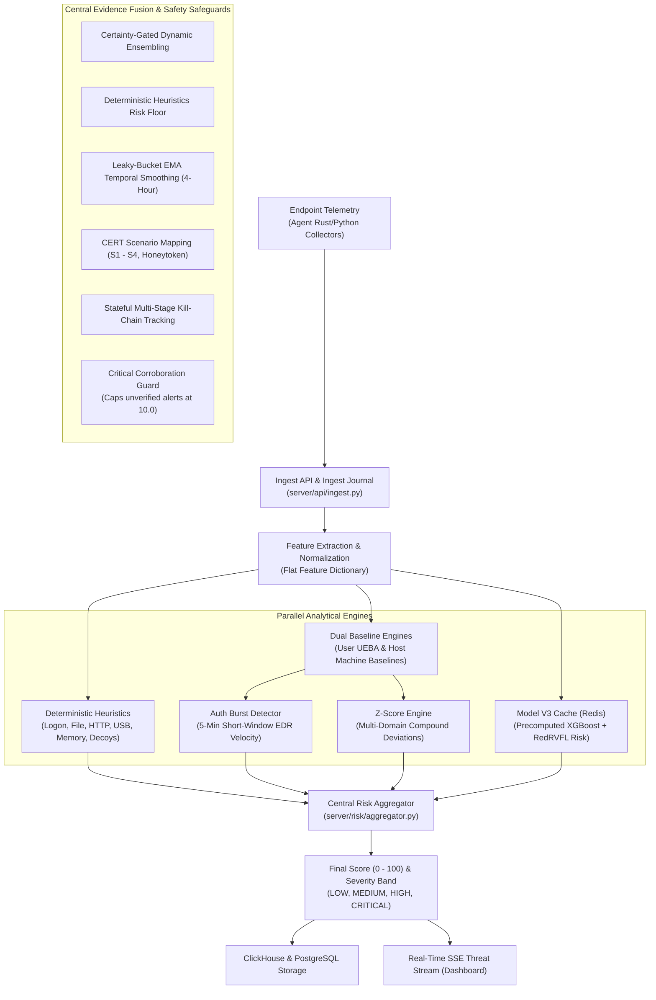
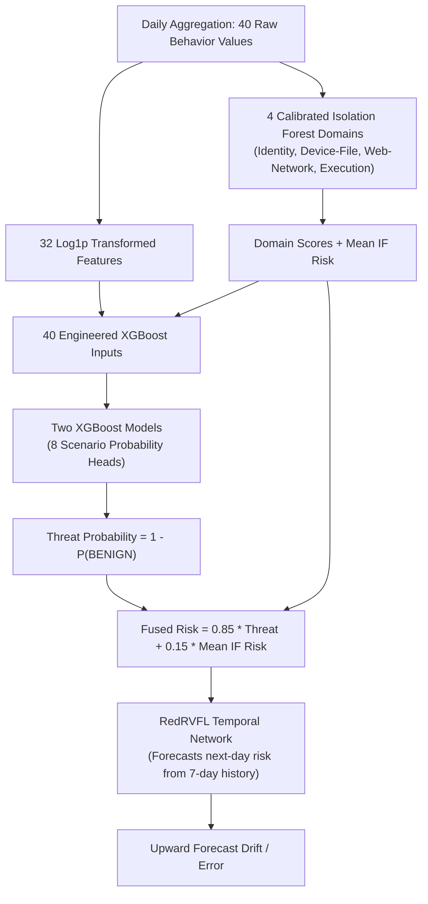
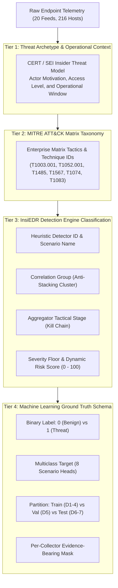
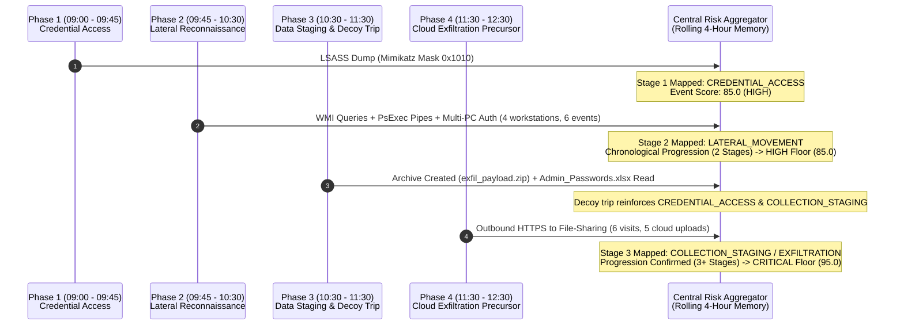

# InsiEDR Detection Pipeline: Complete Technical Architecture & Guide

> **Version**: 2.0  
> **Target Systems**: `InsiEDR_Server` & `InsiEDR-agent`  
> **Scope**: Telemetry Ingestion, Heuristics, Dual Baselines (UEBA & Host), Z-Scores, Auth Burst Analysis, Machine Learning (Model V3), Central Risk Aggregation, and Edge Autonomous Containment.

---

## 1. Executive Summary & Pipeline Flow

InsiEDR utilizes a **defense-in-depth, hybrid detection architecture**. Rather than relying on a single detection paradigm or a black-box model, it merges **instant explainable heuristics**, **statistical behavioral baselines (Z-Scores)**, **short-window authentication burst analysis**, and an **isolated daily Machine Learning (ML) model**.

### End-to-End Architecture



---

## 2. Telemetry Ingestion & Feature Normalization

Telemetry is received from endpoints via the `/api/v1/telemetry/submit` route.

### Key Normalization Principles (`server/risk/pipeline.py`)

1. **Root Identity Authority**:
   - The root payload attributes (`username`, `hostname`, `agent_id`) define the active session.
   - For user-scoped metrics, nested collector maps are unpacked **only** when their key matches the root username (case-insensitive). If no user matches, data is discarded rather than attributed to the wrong account.
   - Host-wide collectors (e.g., machine hardware changes, system event logs) intentionally omit the username and are tracked under the host scope.
2. **Canonical Aliases**:
   - Discrepancies between collector versions are standardized using `FEATURE_ALIASES`:
     - `daily_device_connect_count` $\leftarrow$ `usb_connect_count`
     - `daily_unique_filename_count` $\leftarrow$ `unique_filename_count`
     - `daily_new_filename_count` $\leftarrow$ `new_filename_count`
     - `daily_http_request_count` $\leftarrow$ `http_request_count`, `http_count`
     - `persistence_modification_count` $\leftarrow$ `modifications_detected`
3. **No Synthetic Zeroes**:
   - Missing fields are left missing. The engine never inserts synthetic `0` values for absent sensors, preventing baseline distortion and false negatives.
4. **Composite Features**:
   - Computes aggregated counters on the fly (e.g., `file_access_count = open_count + write_count + delete_count`).

---

## 3. Deterministic Heuristics Engine

Located in `heuristics/detector.py`, the heuristics engine evaluates explainable rules across five domains without machine learning inference.

### A. Core Rule Domains

| Domain | Rule Name | Trigger Condition | Severity & Score | CERT Tag |
| :--- | :--- | :--- | :--- | :--- |
| **Logon** | *After-Hours Logon Anomaly* | After-hours logons $\ge 2$, after-hours ratio $\ge 0.5$, total logons $\ge 3$ | `MEDIUM` (40) | `S1_PRECURSOR` |
| **Logon** | *Multi-PC Access Anomaly* | Unique workstations $\ge 3$, total logons $\ge 3$ | `MEDIUM` (40) | `AUTH_LATERAL` |
| **Logon** | *Failed Authentication Activity*| Failed logons $\ge 5$, failure ratio $\ge 0.5$ | `MEDIUM` (45) | `AUTH_BURST` |
| **File** | *Bulk File Collection* | File accesses $\ge 500$, unique files $\ge 100$ | `HIGH` (75) | `S2` |
| **File** | *Broad File Collection* | Unique files $\ge 50$, new files $\ge 25$ | `MEDIUM` (45) | `S2` |
| **File** | *Sensitive File Collection* | Sensitive file accesses $> 0$, total accesses $\ge 50$ or unique files $\ge 20$ | `HIGH` (70) | `S2` |
| **File** | *Mass File Deletion* | Sampled file deletions $\ge 10$ | `MEDIUM` (50) | `FILE_DELETE` |
| **File** | *File Transfer to Removable* | Files to removable media $> 0$ | `HIGH` (80) | `S3` |
| **HTTP** | *Cloud Upload Correlated* | Upload bytes $> 0$ correlated with sensitive files or file burst $\ge 50$ | `HIGH` (80) | `S4` |
| **HTTP** | *File-Sharing Site Visit* | Cloud drive visited (Drive, Dropbox) without upload evidence | `LOW` (10) | `S4_PRECURSOR` |
| **Device**| *Bulk USB File Transfer* | Removable media file transfers $\ge 20$ | `HIGH` (80) | `S3` |
| **Device**| *Unapproved USB Device* | Unauthorized USB connected without transfer evidence | `MEDIUM` (40) | `S3_PRECURSOR` |
| **Device**| *USB Device Activity* | Normal USB device connected without transfer evidence | `LOW` (10) | `S3_PRECURSOR` |
| **Security**| *LSASS Credential Dumping* | LSASS access violation reported by agent | `CRITICAL` (100) | `S1_CRED_DUMP` |
| **Security**| *Unbacked Executable Memory*| Unbacked executable memory regions $> 0$ | `HIGH` (85) | `S1_INJECTION` |
| **Security**| *Network Tunneling* | DNS tunneling or tunneling process detected | `HIGH` (80) | `NETWORK_TUNNELING` |
| **Deception**| *Honeytoken Access* | Canary decoy file accessed (`threat_triggered=true`) | `CRITICAL` (100) | `HONEYTOKEN` |

### B. Correlation Clusters & Sub-Linear Decay

When multiple related rules trigger concurrently within the same domain (e.g., `Bulk File Collection` and `Sensitive File Collection`), scores are not summed linearly.
1. Detections are assigned to **Correlation Groups** (e.g., `FILE_EXFIL_GROUP`, `LOGON_TIME_GROUP`).
2. The primary rule supplies its full effective score.
3. Secondary rules within the same cluster apply exponential decay:
   $$\text{Group Score} = \text{Primary} + \sum_{i=1}^{N} \left(\text{Secondary}_i \times 0.20^i\right)$$

### C. Workload Context & Discounting

* **Role Profiles (`PROFILE_SENSITIVITY`)**:
  - `DEVELOPER`: Multipliers `FILE: 0.35`, `HTTP: 0.60`, `LOGON: 0.70`, `DEVICE: 0.80`.
  - `SYSADMIN`: Multipliers `FILE: 0.60`, `HTTP: 0.70`, `LOGON: 0.30`, `DEVICE: 0.70`.
  - `OFFICE_WORKER`: Multipliers `1.00` across all domains.
* **Trusted Toolchains**: Binaries such as `cargo.exe`, `git.exe`, `node.exe`, `python.exe`, `docker.exe` receive a $0.20\times$ discount on file operations.
* **Benign High-I/O Paths**: Regex matching on `node_modules`, `target`, `.git`, `build`, `dist`, or `AppData\Local\Temp` applies a $0.25\times$ discount.

### D. Cross-Domain Superposition & Diversity Bonus

* **Single Domain Discount**: If detections occur in only one behavioral domain, the peak group score is scaled by $0.80\times$ to avoid elevating normal isolated spikes.
* **Diversity Bonus**: If 3 or more distinct domains trigger with a base risk $\ge 35.0$, a corroboration bonus is added:
  $$\text{Bonus} = \min(10.0, (\text{active\_domains} - 2) \times 5.0)$$

---

## 4. Dual Baseline Engines (User UEBA & Host Machine)

Implemented in `server/baseline/engine.py`, the system maintains two separate baselines:
1. **User Baseline**: Keyed by root username (`baseline_scope = 'user'`).
2. **Host Baseline**: Keyed by agent ID (`baseline_scope = 'host'`).

### A. Mathematical Formulation
* **Exponential Moving Average (EMA)**:
  Configured with a 30-day window ($N = 30$):
  $$\alpha = \frac{2}{N + 1} = \frac{2}{31} \approx 0.0645$$
  $$\mu_{t} = (1 - \alpha)\mu_{t-1} + \alpha \cdot x_{\text{daily}}$$
  $$\sigma_{t} = (1 - \alpha)\sigma_{t-1} + \alpha \cdot |x_{\text{daily}} - \mu_{t-1}|$$

* **Standard Deviation Floors (`_std_floor`)**:
  Prevents division-by-zero on static metrics:
  - For ratios/rates: $\sigma_{\text{min}} = \max(0.1 \times |\mu|, 0.05)$
  - For counts/volumes: $\sigma_{\text{min}} = \max(0.1 \times |\mu|, 1.0)$

### B. Cold Start & Role Cohort Fallback
Before an entity accumulates $\ge 5$ observations, it falls back gracefully:
1. **User Profile**: Used if sample count $\ge 5$.
2. **Role Cohort Profile (`__role_{role_name}__`)**: Used if user has $< 5$ samples but their role peer group (e.g., `__role_standard_user__`) has $\ge 5$ samples. Concurrency is handled with PostgreSQL transaction-level advisory locks (`pg_advisory_xact_lock`).
3. **Safe Organizational Priors (`DEFAULT_FEATURE_PRIORS`)**: Built-in conservative $(\mu, \sigma)$ values (e.g., `bytes_sent: (5MB, 15MB)`, `file_access_count: (30, 50)`). Normal behavior produces $Z \le 0$; massive spikes trigger immediately.

### C. Anti-Poisoning & Update Policies
* **Risk Score Gating**: Baselines are updated **only** when final risk is below **40.0** (`LOW`).
* **Host Anomaly Gating**: Host baselines reject updates if any `auth_burst` anomaly is present or critical flags (`credential_dumping_suspected`, `threats_detected`) fired.
* **Hourly Throttling**: Observations are sampled at most **once per hour** per user/host.
* **Host Winsorization**: Host baseline inputs are clamped to $[\mu, \mu + 3.0\sigma]$ once mature to prevent single-event distortion.

---

## 5. Authentication Burst Detector (`detect_auth_burst`)

Located in `server/risk/signals.py`, this detector analyzes short-term 5-minute rolling window authentication events from the Windows Security log.

### Monitored Short-Window Telemetry
- `edr_auth_event_count_window`: Successful logons in the last 5 minutes.
- `edr_failed_auth_events_per_minute_window`: Failure velocity.
- `edr_failed_auth_ratio_window`: Failed attempts / Total attempts.
- `unique_workstations_300s`: Count of distinct endpoints accessed in 5 minutes.
- `off_hours_auth_count`: Logons occurring outside normal business hours.

### Burst Archetypes

| Burst Type | Criteria | Severity | Score | Confidence |
| :--- | :--- | :---: | :---: | :---: |
| **`MULTI_WORKSTATION_BURST`** | Workstations $\ge 3$, Failed count $\ge 4$, Failure ratio $\ge 50\%$ | `HIGH` | 85 | 0.90 |
| **`HIGH_FAILURE_BURST`** | Failure ratio $\ge 75\%$, Failed count $\ge 5$ | `HIGH` | 85 | 0.90 |
| **`MULTI_WORKSTATION_BURST`** | Workstations $\ge 3$, Total attempts $\ge 4$ *(unless expected by host baseline)* | `HIGH` | 75 | 0.85 |
| **`VELOCITY_BURST`** | Rate $\ge 3.0$/min with ratio $\ge 50\%$, or raw rate $\ge 5.0$/min | `MEDIUM`| 60 | 0.75 |
| **`OFF_HOURS_BURST`** | Off-hours count $\ge 2$, Total attempts $\ge 3$ *(unless expected)* | `MEDIUM`| 35 | 0.60 |

> **Adaptive Host Calibration**: If an endpoint is a jump-box or bastion server where multi-workstation traversal is normal ($Z < 2.0$ on `unique_workstations_300s`), benign traversal alerts are suppressed. High-failure spikes and credential spray patterns continue to alert at `HIGH`/`CRITICAL`.

---

## 6. Z-Score Anomaly Engine (`score_zscore`)

The Z-score detector calculates standard deviations from baseline:
$$Z = \frac{x - \mu}{\sigma}$$

### A. Calibrated Piecewise Scoring Curve
Statistical deviations are mapped to an operational risk score $[0, 100]$:

```text
Score
 100 |                                              *--- (8σ, 100)
  95 |                                        *-----
  70 |                              *--------- (5σ, 70)
  40 |                    *--------- (3σ, 40)
   0 +--------------------* (2σ, 0)
     +--------------------+---------+---------+-----+----> Z-Score
     0                   2.0       3.0       5.0   8.0
```

- $Z \le 2.0\sigma \implies \text{Score } 0$ (Normal baseline noise)
- $Z = 3.0\sigma \implies \text{Score } 40$ (`MEDIUM` threshold)
- $Z = 5.0\sigma \implies \text{Score } 70$ (`HIGH` threshold)
- $Z \ge 8.0\sigma \implies \text{Score } 100$ (`CRITICAL` threshold)

### B. Multi-Domain Compound Anomaly Norm
Features are classified into 4 orthogonal domains: `logon`, `file`, `network`, and `device`.

When 2 or more domains exceed $2.0\sigma$:
1. Compute the **Euclidean distance** of excess deviations:
   $$\text{Excess}_d = \max(0, Z_d - 2.0)$$
   $$\text{Compound Excess} = \sqrt{\sum_{d \in \text{domains}} \text{Excess}_d^2}$$
2. Apply the **multi-domain corroboration multiplier**:
   $$\text{Boost} = 1.0 + 0.15 \times (k - 1) \quad (\text{where } k = \text{number of active domains})$$
3. Scale across the calibration threshold:
   $$\text{Compound Score} = \min\left(100.0, \; \text{Compound Excess} \times \frac{100.0}{\text{Threshold} - 2.0} \times \text{Boost}\right)$$

This mechanism surfaces subtle multi-vector coordinated attacks where no single metric reaches extreme deviation on its own.

---

## 7. Machine Learning Model (Model V3)

Model V3 (`model/`) provides asynchronous, daily batch risk evaluation.

### A. Model Architecture



* **Isolation Forest**: 4 domain-specific models detect unclassified anomalies.
* **XGBoost Ensemble**: Evaluates 8 insider threat scenarios (`BENIGN`, `IT_SABOTAGE`, `DATA_HOARDING`, `USB_EXFILTRATION_PRECURSOR`, `CLOUD_EXFILTRATION_PRECURSOR`, `CREDENTIAL_DUMP`, `HONEYTOKEN_TRIP`, `KILL_CHAIN_APT`).
* **RedRVFL**: Random Vector Functional Link neural network predicting next-day risk from a 7-day rolling window to identify abrupt temporal drift.

### B. Operational Contract & Server Caching
* **22-Day Consecutive Complete History**: Requires 7 warmup days + 15 target days (**22 complete consecutive days** per endpoint) before scores are eligible.
* **Batch Worker (`server/risk/ml_worker.py`)**: Runs scheduled daily batch jobs, writing scores to Redis key `insiedr:ml:endpoint:{agent_id}`.
* **Sub-20ms Redis Cache (`server/risk/ml_cache.py`)**:
  - `score = threat_probability * 100.0`
  - `confidence = 0.85`
  - `is_anomaly = threat >= 0.525 or drift >= 0.376`
* **Shadow Mode**: Controlled via `config.enable_model_pipeline`. When disabled, the ML detector runs in shadow mode (`is_shadow=True`), recording telemetry without impacting enforcement.

---

## 8. Central Risk Aggregator & Evidence Fusion

The Risk Aggregator (`server/risk/aggregator.py`) fuses all signals into a finalized incident score.

### A. Certainty-Gated Dynamic Ensembling
Base weights:
- **ML Pipeline**: 0.70
- **Heuristics**: 0.15
- **Z-Score**: 0.10
- **Auth Burst**: 0.05

Dynamic Weight Adjustment:
1. Detectors that did not run or abstained are assigned weight `0.0`. Remaining active weights are renormalized.
2. If a detector reports a strong score ($S \ge 40$), its weight is boosted based on conviction:
   $$\text{Conviction Boost} = 1.0 + 2.0 \times \left(\frac{S - 40}{60}\right)^2 \times \text{Confidence}$$
3. **Heuristics Floor**: Deterministic heuristics establish a floor:
   $$\text{Raw Aggregated Score} = \max(\text{Weighted Ensemble Score}, \; \text{Heuristics Score})$$

### B. Leaky-Bucket EMA Temporal Smoothing
Inspects the user's past 4 hours of risk events:
$$\text{Smoothed Score} = \max\left(\text{Raw Score}, \; 0.85 \times \text{Raw Score} + 0.15 \times \min(100.0, \text{Past Max Score})\right)$$
Prevents multi-stage attacks from dropping to zero risk during brief pauses between actions.

### C. CERT Scenario Mapping
Translates low-level counters into standardized CERT scenarios:
- **`S1` (IT Sabotage)**: $\ge 10$ deletions accompanied by system/privilege modifications, after-hours logons, or auth bursts.
- **`S2` (Data Hoarding)**: High file volume/breadth, sensitive file access, or file baseline deviations.
- **`S3` (Removable Media Exfiltration)**: Confirmed file-to-removable transfer counters.
- **`S4` (Cloud Exfiltration)**: Outbound cloud uploads correlated with sensitive or unusual file access.
- **`HONEYTOKEN`**: Interaction with decoy files (`CRITICAL`, score 100).

### D. Stateful 4-Hour Tactical Kill-Chain Progression
Monitors chronological attack stage progression for the same agent over a 4-hour window:
$$\text{CREDENTIAL\_ACCESS} \longrightarrow \text{LATERAL\_MOVEMENT} \longrightarrow \text{EXECUTION\_PERSISTENCE} \longrightarrow \text{COLLECTION\_STAGING} \longrightarrow \text{EXFILTRATION\_SABOTAGE}$$
- **Progression Requirement**: Must observe an initial stage in an earlier event and a **different stage newly appearing in the current event**.
- **Floors**:
  - 2 stages observed in sequence: Enforces an **85.0 (`HIGH`)** floor.
  - 3+ stages observed in sequence: Enforces a **95.0 (`CRITICAL`)** floor.

### E. Critical Corroboration Guard
To eliminate single-sensor false positives from triggering disruptive containment actions:
**No event can reach $\ge 70.0$ (`HIGH` or `CRITICAL`) without meeting at least one corroboration condition:**
1. **Cross-Paradigm**: High ML score ($\ge 75$) confirmed by heuristics ($\ge 10$), Z-score ($\ge 25$), or a CERT scenario.
2. **Multi-Domain Heuristics**: Heuristic score $\ge 60$ spanning $\ge 2$ distinct domains.
3. **High-Confidence Auth Burst or Z-Score**: Independent score $\ge 85$ with confidence $\ge 0.85$.
4. **Confirmed CERT High/Critical Scenario**: Confirmed file exfiltration or sabotage.
5. **Multi-Stage Kill-Chain**: Confirmed sequential progression across the rolling window.

> **Safeguard Cap**: If an uncorroborated single signal produces a score $\ge 70$, it is **capped at 10.0 (`LOW`)**.

---

## 9. All Threat Scenarios Used in InsiEDR

InsiEDR classifies threats through a **4-tier scenario taxonomy** spanning operational context, industry-standard MITRE ATT&CK techniques, internal heuristic and aggregator rules, and machine learning target labels.



---

### A. Operational CERT Scenario IDs & Supporting Signals

The InsiEDR server uses canonical identifiers shared between the heuristics engine and the risk aggregator:

| Scenario ID | Name & Description | Evidence Required to Confirm | Default Severity & Score Floor | Tactical Stage |
| :--- | :--- | :--- | :---: | :--- |
| **`S1`** | **IT Sabotage** | Mass file deletion ($\ge 10$ confirmed deletes) corroborated by service/driver/privilege modifications, after-hours access, or an auth burst. Deletions alone remain a precursor. | `HIGH` (70.0 - 85.0) | `EXFILTRATION_SABOTAGE` |
| **`S1_CRED_DUMP`** | **OS Credential Dumping** | Explicit LSASS handle request with suspicious access mask (e.g. `0x1FFFFF` `PROCESS_ALL_ACCESS`), memory dump attempt, or Mimikatz signature. Bypasses profile discounts. | `CRITICAL` (100.0, floor 95.0) | `CREDENTIAL_ACCESS` |
| **`S1_INJECTION`** | **Unbacked Executable Memory** | Unbacked memory regions or thread injection reported by the memory scanner. | `HIGH` (85.0) | `EXECUTION_PERSISTENCE` |
| **`S2`** | **Data Hoarding / Broad Staging** | Bulk file access ($\ge 500$ accesses, $\ge 100$ files), breadth ($\ge 50$ unique, $\ge 25$ new), clipboard burst, or sensitive-file collection backed by UEBA baseline anomaly. | `HIGH` (70.0 - 75.0) | `COLLECTION_STAGING` |
| **`S3`** | **Removable Media Exfiltration** | Confirmed file-to-removable transfer counters ($\ge 1$ file). Transfers $\ge 20$ files elevate to score 80. | `HIGH` (80.0) | `EXFILTRATION_SABOTAGE` |
| **`S3_PRECURSOR`** | **Unapproved USB Device** | USB device insertion or non-whitelisted Vendor/Product ID without confirmed file transfer evidence. | `MEDIUM` (40.0) | `EXFILTRATION_SABOTAGE` |
| **`S4`** | **Cloud Exfiltration** | Outbound cloud upload bytes/counts correlated with sensitive-file access or unusual file collection bursts. | `HIGH` (80.0) | `EXFILTRATION_SABOTAGE` |
| **`S4_PRECURSOR`** | **File-Sharing Site Visit** | Hits on watchlisted cloud storage/file-sharing domains (e.g., Google Drive, Dropbox, Mega) without upload evidence. | `LOW` (10.0 - 45.0) | `COLLECTION_STAGING` |
| **`NETWORK_TUNNELING`** | **Network Tunneling Indicator** | DNS tunneling queries or unauthorized tunneling processes (e.g. `chisel`, `ngrok`). Distinct from web exfiltration. | `HIGH` (80.0) | `EXFILTRATION_SABOTAGE` |
| **`HONEYTOKEN`** | **Canary Decoy Interaction** | Decoy monitor reports `threat_triggered=true` on attractive planted honeypot assets. Forces risk to 100 immediately. | `CRITICAL` (100.0) | `CREDENTIAL_ACCESS` |

#### Supporting Signal Tags (Not Confirmed CERT Scenarios)
- **`AUTH_BURST`**: Spike in authentication failure ratios or velocity over 5 minutes.
- **`AUTH_LATERAL`**: Rapid interactive logons across $\ge 3$ distinct workstations.
- **`FILE_DELETE`**: Sampled deletion operations $\ge 10$ without confirmed sabotage corroboration.
- **`S1_PRECURSOR`**: After-hours access or mass deletion awaiting system-change evidence.

---

### B. Machine Learning (Model V3) 8 Target Classes

The ML research model (`model/`) evaluates 8 discrete scenario hypotheses across daily endpoint feature vectors:

| ML Class Name | Target Hypothesis | Server Meaning & Evidence Preserved |
| :--- | :--- | :--- |
| **`BENIGN`** | Normal expected endpoint behavior | Model normal hypothesis; not verified benign ground truth. |
| **`IT_SABOTAGE`** | Deliberate data destruction or sabotage | Corresponds to `S1`; preserves required destructive/system change corroboration. |
| **`DATA_HOARDING`** | Excessive collection or staging | Corresponds to `S2`; does not equate an ordinary audit event with copying. |
| **`USB_EXFILTRATION_PRECURSOR`** | Physical media connected for egress | Corresponds to `S3_PRECURSOR`; never promoted to `S3` without transfer evidence. |
| **`CLOUD_EXFILTRATION_PRECURSOR`** | Cloud drive accessed for egress | Corresponds to `S4_PRECURSOR`; never promoted to `S4` without upload evidence. |
| **`CREDENTIAL_DUMP`** | Memory-based credential harvesting | Corresponds to `S1_CRED_DUMP`; distinct from general sabotage. |
| **`HONEYTOKEN_TRIP`** | Deception canary triggered | Corresponds to `HONEYTOKEN`; preserves independent deterministic trigger. |
| **`KILL_CHAIN_APT`** | Multi-phase advanced campaign | Corresponds to multi-stage sequence; requires same-agent temporal progression. |

---

### C. The 7 Core Empirical Attack Scenarios (Dataset Specification)

InsiEDR's ground truth evaluation and simulation dataset models 7 end-to-end attack scenarios across 216 monitored hosts:

#### Scenario 1: `SIM_CREDENTIAL_DUMP` (LSASS Credential Dumping)
* **Target Host & Account**: Workstation `SOCL2-64` (`AGENT-SOCL2-64`), account `Administrator`.
* **Active Window**: Day 1, 60 minutes (`[10:45:00, 11:45:00)`), 726 evidence rows per feed.
* **Threat Archetype**: Credential Compromise & Memory Harvesting.
* **MITRE ATT&CK**: **[T1003.001](https://attack.mitre.org/techniques/T1003/001/)** (OS Credential Dumping: LSASS Memory).
* **Telemetry Signatures**:
  - `lsass-monitor`: `credential_dumping_suspected=True`, `mimikatz_signatures=1`, `suspicious_access_mask="0x1FFFFF"` (`PROCESS_ALL_ACCESS`), `handle_requests=16`, `memory_dump_attempts=2`.
  - `process-watcher`: Rogue administrative process targeting `lsass.exe`.
  - `memory-scanner`: Unbacked executable memory regions identified.
* **Engine Output**: Scenario `S1_CRED_DUMP`, Stage `CREDENTIAL_ACCESS`, Severity `CRITICAL` (Score 100.0).

#### Scenario 2: `SIM_USB_PRECURSOR` (Removable Storage Egress Precursor)
* **Target Host & Account**: Workstation `DSL-174` (`AGENT-DSL-174`), account `DSL-174`.
* **Active Window**: Day 2, 90 minutes (`[08:30:00, 10:00:00)`), 1,072 evidence rows per feed.
* **Threat Archetype**: Physical Media Exfiltration Precursor.
* **MITRE ATT&CK**: **[T1052.001](https://attack.mitre.org/techniques/T1052/001/)** (Exfiltration Over Physical Medium: Removable Storage).
* **Telemetry Signatures**:
  - `devices`: Unauthorized USB flash device insertion (`vendor_id="1058"`, `product_id="0748"`, Western Digital Storage).
  - `file-integrity-monitor`: File copy staging directed to removable drive mount `E:\`.
  - `usn-monitor`: Elevated USN journal change records on external volume `E:\`.
* **Engine Output**: Scenario `S3_PRECURSOR`, Stage `EXFILTRATION_SABOTAGE`, Severity `HIGH` (Score 75.0).

#### Scenario 3: `SIM_IT_SABOTAGE` (Hostile IT Sabotage & Data Destruction)
* **Target Host & Account**: Workstation `DATASL-173` (`AGENT-DATASL-173`), account `DSL-173`.
* **Active Window**: Day 2, 120 minutes (`[09:00:00, 11:00:00)`), 1,306 evidence rows per feed.
* **Threat Archetype**: Disgruntled Insider Sabotage & Security Impairment.
* **MITRE ATT&CK**: **[T1485](https://attack.mitre.org/techniques/T1485/)** (Data Destruction), **[T1562.001](https://attack.mitre.org/techniques/T1562/001/)** (Impair Defenses: Disable Tools).
* **Telemetry Signatures**:
  - `file-integrity-monitor`: 13 sampled operations populate with `"DELETE"` (`integrity_events_0_op` through `12_op`) targeting `.mdf`, `.bak`, and volume shadow copies (`file_delete_count = 13.0`).
  - `persistence-monitor`: `modifications_detected=True`, command `sc stop WinDefend & sc config WinDefend start= disabled`.
  - `process-watcher`: `admin_process_count=3`, `executables_from_temp_folder=2`.
* **Engine Output**: Scenario `FILE_DELETE` / `S1`, Stage `EXECUTION_PERSISTENCE`, Severity `MEDIUM` (Score 50.0).

#### Scenario 4: `SIM_CLOUD_PRECURSOR` (Off-Hours Web Exfiltration Precursor)
* **Target Host & Account**: Workstation `MCALAB1-07` (`AGENT-MCALAB1-07`), account `MCAL1-07`.
* **Active Window**: Day 4, 60 minutes (`[03:15:00, 04:15:00)`), 1,357 evidence rows per feed.
* **Threat Archetype**: Off-Hours Unauthorized Cloud Storage Access.
* **MITRE ATT&CK**: **[T1567](https://attack.mitre.org/techniques/T1567/)** (Exfiltration Over Web Service), **[T1078.003](https://attack.mitre.org/techniques/T1078/003/)** (Valid Accounts: Local Accounts).
* **Telemetry Signatures**:
  - `http`: `cloud_storage_uploads=4`, `large_uploads=3`, `file_sharing_site_visits=5`, `watchlisted_domain_hits=3`, `post_requests=28`, `http_after_hours=1.0`.
  - `network`: Outbound HTTPS connections to unauthorized public storage domains (`outbound_connections=18`).
  - `short-term_edr_feature`: Off-hours interactive access (`off_hours_auth_count=3`).
* **Engine Output**: Scenario `S4_PRECURSOR`, Stage `COLLECTION_STAGING`, Severity `MEDIUM` (Score 45.0).

#### Scenario 5: `SIM_DATA_HOARDING` (Data Staging & Clipboard Hoarding)
* **Target Host & Account**: Workstation `SOCL8-53` (`AGENT-SOCL8-53`), account `DSL-189`.
* **Active Window**: Day 4, 120 minutes (`[08:00:00, 10:00:00)`), 1,262 evidence rows per feed.
* **Threat Archetype**: Pre-Departure Intellectual Property Collection.
* **MITRE ATT&CK**: **[T1074](https://attack.mitre.org/techniques/T1074/)** (Data Staged), **[T1115](https://attack.mitre.org/techniques/T1115/)** (Clipboard Data).
* **Telemetry Signatures**:
  - `clipboard-monitor`: Abnormal copy burst (`clipboard_copy_count=48`, sequence index 112).
  - `file-integrity-monitor`: Breadth metrics (`daily_unique_filename_count=68.0`, `daily_new_filename_count=35.0`, access entropy 4.85), creation of container `archive_staged.7z`.
  - `activity-monitor`: Interactive user active (`user_idle_seconds=0`).
* **Engine Output**: Scenario `S2`, Stage `COLLECTION_STAGING`, Severity `HIGH` (Score 75.0).

#### Scenario 6: `SIM_HONEYTOKEN_TRIP` (Canary Decoy Interaction)
* **Target Host & Account**: Workstation `SOCL8-03` (`AGENT-SOCL8-03`), account `Administrator`.
* **Active Window**: Day 7, 90 minutes (`[06:00:00, 07:30:00)`), 1,061 evidence rows per feed.
* **Threat Archetype**: Deception Defense Trigger / Canary File Access.
* **MITRE ATT&CK**: **[T1083](https://attack.mitre.org/techniques/T1083/)** (File and Directory Discovery), **[T1552](https://attack.mitre.org/techniques/T1552/)** (Unsecured Credentials).
* **Telemetry Signatures**:
  - `decoy-monitor`: `threat_triggered=True`, `events_recorded=True`, monitored paths `"C:\Users\Public\Admin_Passwords.xlsx;C:\Decoys\Financial_Decoy.docx"`.
  - `file-integrity-monitor`: Explicit `READ` operation on `Admin_Passwords.xlsx`.
  - `logon`: Early-morning interactive session with 3 failed logon attempts.
* **Engine Output**: Scenario `HONEYTOKEN`, Stage `CREDENTIAL_ACCESS`, Severity `CRITICAL` (Score 100.0).

---

### D. Scenario 7: `SIM_KILL_CHAIN` (Multi-Phase APT Campaign)

Scenario 7 models a sustained, coordinated attack across a **3.5-hour duration** on workstation `SOCL4-61` (`AGENT-SOCL4-61`), account `admin`. It demonstrates the stateful kill-chain progression across a 4-hour temporal window:



#### Detailed Phase Breakdown

| Phase | Time Window | Active Feeds & Evidence | MITRE ATT&CK | Engine Classification & Tactical Evolution |
| :--- | :--- | :--- | :--- | :--- |
| **Phase 1: Credential Access** | `09:00:00` to `09:45:00` | `lsass-monitor` (540 rows)<br/>`short-term_edr_feature` (540 rows) | **[T1003.001](https://attack.mitre.org/techniques/T1003/001/)** | **Detector ID**: `S1_CRED_DUMP`<br/>**Aggregator Stage**: `CREDENTIAL_ACCESS`<br/>**Score**: `85.0` (`HIGH`) |
| **Phase 2: Lateral Reconnaissance** | `09:45:00` to `10:30:00` | `wmi-activity` (540 rows)<br/>`named-pipe-monitor` (540 rows)<br/>`short-term_edr_feature` (540 rows) | **[T1047](https://attack.mitre.org/techniques/T1047/)** (WMI)<br/>**[T1021.002](https://attack.mitre.org/techniques/T1021/002/)** (SMB/Named Pipe) | **Detector ID**: `MULTI_WORKSTATION_BURST`<br/>**Aggregator Stage**: `LATERAL_MOVEMENT`<br/>**Progression**: Confirmed 2-stage sequence $\implies$ **85.0 Floor** |
| **Phase 3: Staging & Canary Trip** | `10:30:00` to `11:30:00` | `file-integrity-monitor` (698 rows)<br/>`decoy-monitor` (698 rows)<br/>`short-term_edr_feature` (698 rows) | **[T1074](https://attack.mitre.org/techniques/T1074/)** (Staging)<br/>**[T1083](https://attack.mitre.org/techniques/T1083/)** (Decoy Discovery) | **Detector ID**: `HONEYTOKEN`<br/>**Aggregator Stage**: `CREDENTIAL_ACCESS` + `COLLECTION_STAGING`<br/>**Score**: `100.0` (`CRITICAL`) |
| **Phase 4: Cloud Exfiltration** | `11:30:00` to `12:30:00` | `http` (720 rows)<br/>`network` (720 rows)<br/>`short-term_edr_feature` (720 rows) | **[T1567](https://attack.mitre.org/techniques/T1567/)** (Web Exfiltration) | **Detector ID**: `S4_PRECURSOR`<br/>**Aggregator Stage**: `EXFILTRATION_SABOTAGE`<br/>**Final Result**: **3-Stage Progression Confirmed** $\implies$ **CRITICAL (Score: 95.0)** |

---

### E. Master Scenarios Cross-Comparison Matrix

| # | Scenario ID | Multiclass ML Target | Threat Archetype | MITRE ATT&CK | InsiEDR Heuristic ID | Tactical Stage | Severity Floor | Partition Split |
| :-: | :--- | :--- | :--- | :--- | :--- | :--- | :---: | :-: |
| **1** | `SIM_CREDENTIAL_DUMP` | `CREDENTIAL_DUMP` | Credential Theft | T1003.001 | `S1_CRED_DUMP` | `CREDENTIAL_ACCESS` | `CRITICAL` (100.0) | Train (Day 1) |
| **2** | `SIM_USB_PRECURSOR` | `USB_EXFILTRATION_PRECURSOR` | Removable Storage Egress | T1052.001 | `S3_PRECURSOR` | `EXFILTRATION_SABOTAGE` | `HIGH` (75.0) | Train (Day 2) |
| **3** | `SIM_IT_SABOTAGE` | `IT_SABOTAGE` | Data Destruction | T1485 / T1562 | `FILE_DELETE` / `S1` | `EXECUTION_PERSISTENCE` | `MEDIUM` (50.0) | Train (Day 2) |
| **4** | `SIM_CLOUD_PRECURSOR` | `CLOUD_EXFILTRATION_PRECURSOR` | Off-Hours Web Exfil | T1567 / T1078 | `S4_PRECURSOR` | `COLLECTION_STAGING` | `MEDIUM` (45.0) | Train (Day 4) |
| **5** | `SIM_DATA_HOARDING` | `DATA_HOARDING` | Intellectual Property Theft | T1074 / T1115 | `S2` | `COLLECTION_STAGING` | `HIGH` (75.0) | Train (Day 4) |
| **6** | `SIM_HONEYTOKEN_TRIP` | `HONEYTOKEN_TRIP` | Canary Honeypot Breach | T1083 / T1552 | `HONEYTOKEN` | `CREDENTIAL_ACCESS` | `CRITICAL` (100.0) | Test (Day 7) |
| **7** | `SIM_KILL_CHAIN` | `KILL_CHAIN_APT` | Multi-Stage APT Campaign | T1003/T1021/T1074/T1567 | Multi-Detector Progression | 3+ Stage Evolution | `CRITICAL` (95.0) | Test (Day 7) |

---

## 10. Risk Severity Bands & Triggered Actions

| Score Range | Severity Band | System & Operational Action |
| :---: | :---: | :--- |
| **0 – 39** | `LOW` | Stored in telemetry history; eligible to update baselines. |
| **40 – 69** | `MEDIUM` | Flagged on dashboard; updates to baselines are blocked. |
| **70 – 89** | `HIGH` | Added to priority analyst queue; outbound webhook notifications dispatched. |
| **90 – 100** | `CRITICAL` | Real-time SSE alert; eligible for automated edge containment actions. |

---

## 11. Edge Autonomous Containment (Agent Side)

In addition to server-side analysis, the Rust agent (`InsiEDR-agent/src/engine/evaluator.rs`) executes instant local containment:
* **ETW Process Start**: Inspects process commands against local pattern rules (e.g., volume shadow copy deletion via `vssadmin`, suspicious PowerShell execution).
* **Canary Decoy Tampering**: Detects file writes or deletions on canary decoy paths.
* **Memory Threat Scanner**: Detects unbacked executable code and memory injection.
* **Autonomous Containment Actions**:
  - `terminate_process_by_pid`: Immediately terminates offending processes.
  - `lock_workstation`: Locks the active desktop session.
  - `isolate_host`: Disables network adapters while preserving the secure connection to the InsiEDR server.
  - *Dry-Run Mode*: Enabled by default or via `INSIEDR_CONTAINMENT_DRY_RUN=true` to audit containment actions safely prior to live deployment.

---

## 12. Complete Component Comparison

| Component | Execution Timing | Scope | Primary Objective | Key Logic / Formula |
| :--- | :--- | :--- | :--- | :--- |
| **Ingest Normalizer** | Real-time | Host & User | Feature extraction & flattening | Canonical aliasing; user-matching unwrap |
| **Heuristics Engine** | Real-time | Session / Host | Immediate explainable rules | Group clusters, sublinear decay, role discounting |
| **User UEBA Baseline** | 30-Day EMA | Root Username | Individual habit tracking | 1-hr throttle, 5-sample maturity, cohort fallback |
| **Host Baseline** | 30-Day EMA | Agent ID | Machine auth & device tracking | Gated on `risk < 40`, no auth anomaly, Winsorization |
| **Auth Burst Detector** | 5-Min Rolling | Host | Brute-force & traversal detection | 5 burst archetypes; adaptive baseline suppression |
| **Z-Score Engine** | Real-time | User & Host | Statistical deviation scoring | $2\sigma \to 0$ up to $8\sigma \to 100$; compound Euclidean norm |
| **Model V3 (ML)** | Daily Batch | Host | Multi-scenario risk & drift | Isolation Forest + XGBoost + RedRVFL (22-day warmup) |
| **Risk Aggregator** | Real-time | Unified Event | Score fusion & safety checks | Dynamic ensembling, 4-hr Leaky EMA, Corroboration Guard |
| **Agent Edge Engine** | Real-time | Endpoint Local | Sub-second threat containment | ETW rules, canary monitor, process termination, isolation |
