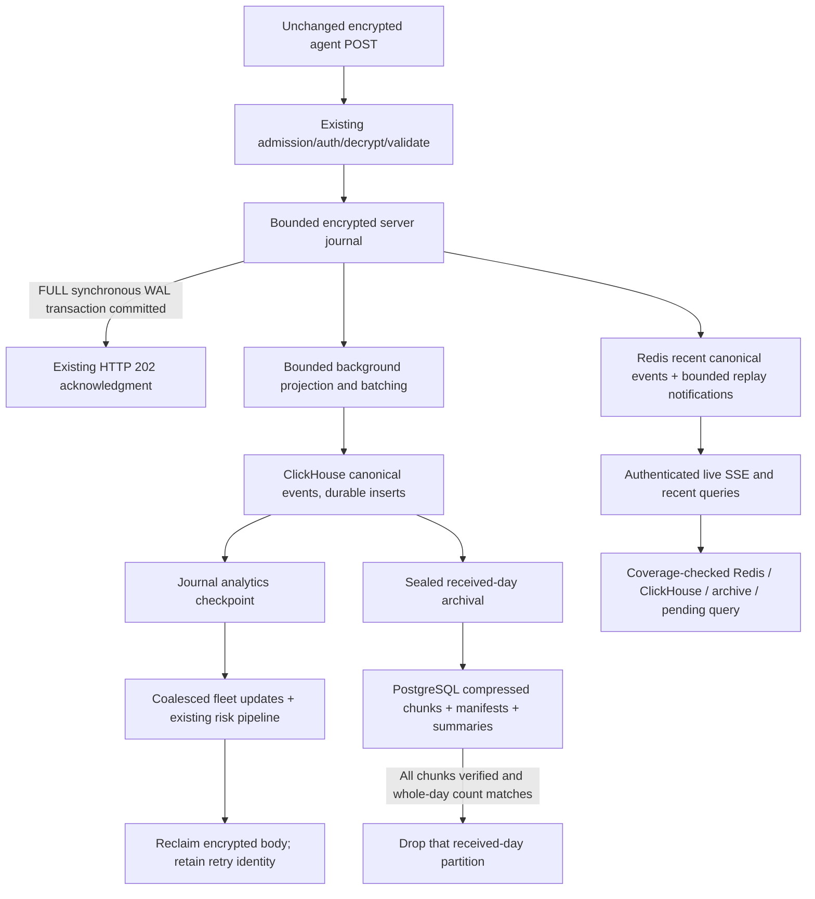

# Server telemetry architecture: 12 cores, 16 GB RAM, slow 512 GB storage

Status: implemented as an **opt-in telemetry plane**, not enabled or deployed by
this change. Hardware throughput, IOPS, actual compression and browser latency
have not been measured. Database integration and migration on the target server
are release gates, not implied by unit-test success.

## Boundaries and compatibility

Only server files change. The authentication/decryption/validation path, agent
headers, encrypted envelope format, POST endpoints, HTTP 202 body, and agent retry
behavior remain unchanged. No collection-interval commands are sent to agents.
Existing operator RBAC is global; this change does not claim tenant isolation.

The default deployment retains its PostgreSQL transactional-outbox ingestion.
The optional `docker-compose.ram.yml` profile selects one API worker and a
separate canonical ClickHouse table. A filesystem ownership lock rejects a second
process using the same journal. Threaded acceptance, group commit and background
processing use bounded concurrency; ClickHouse gets four CPU cores for its own
query/compression/merge threads. Multiple API processes must not each invent a
journal owner or an independent global memory budget.



## Acceptance and recovery algorithm

`IngestJournal` uses SQLite WAL with `synchronous=FULL`, one group-commit writer,
a bounded queue, a 64 MiB SQLite cache, and a persistent AES-256-GCM key. This
reuses a transactional recovery engine instead of introducing an untested custom
ring-file format. Journal contents are compressed before encryption; original
payloads and encrypted envelopes are not stored as unencrypted SQLite blobs.

1. Existing authentication and all protocol/identity/time checks run first.
2. Required storage interceptors must succeed before acceptance.
3. Requests join a bounded commit group, up to 64 submissions or 20 ms. Queue
   admission itself never produces a success response.
4. A FULL synchronous SQLite commit atomically persists the encrypted record and
   its identity and its already sanitized canonical projection. Replay uses this
   captured projection, so a later enrichment/configuration change cannot mutate
   an accepted event. The sanitized payload remains encrypted for existing risk
   logic; the original envelope and original identity hash preserve retry checks.
   Only completed commits release HTTP acknowledgments.
5. A bounded 256-entry bridge queues identifiers only. Its separate worker
   reconstructs redacted/sanitized projections and publishes notifications.
   Slow Redis calls never block the durable acknowledgment. Queue overflow
   requests a fresh snapshot; it does not discard accepted logs.
6. Background replay inserts bounded canonical blocks synchronously into
   ClickHouse. Table settings explicitly require `fsync_after_insert=1` and
   `fsync_part_directory=1`; startup checks engine, keys, columns and absence of TTL.
7. A separate durable analytics checkpoint prevents repeated ClickHouse inserts
   when PostgreSQL fleet updates are temporarily unavailable.
8. Fleet writes are coalesced per agent in one transaction per replay batch. Small
   operational payload pointers (identity, time, host/user and hashes, no envelope
   body) preserve existing risk joins and foreign keys. They do not create collector,
   feature or telemetry-outbox copies in PostgreSQL. Existing risk processing
   runs outside the agent response path. Once required consumers complete, the
   journal releases the encrypted body while retaining retry identity for the
   full retained-data horizon (at least 90 days and the protocol replay window),
   plus a one-hour margin. Identity cleanup also waits until every retained store
   has advanced beyond the receipt's received-day. This prevents an old payload
   ID from being reused while its earlier logs are still retained.

On process termination, SQLite recovers committed transactions; replay resumes
from the persisted consumer stages. A crash between a destination insert and its
journal checkpoint can repeat inserts. IDs, original acceptance time and sequence
are stable, and readers deduplicate before pagination/counting. Deduplication
correctness does not depend on the finite ClickHouse block-deduplication window.

The guarantee assumes a filesystem, virtual disk and physical device that honor
flush requests. Process-exit tests do not simulate electrical power loss or disk
failure. All copies share one physical failure domain; this is not an HA system.

### Why this journal instead of another durable queue

| Acceptance option | Tradeoff on the shared slow disk |
|---|---|
| Redis memory / Pub/Sub | Not a durable acceptance boundary. Redis is expendable here. |
| Redis AOF every second | Can lose acknowledged writes before the persistence boundary. |
| Redis AOF always | Can support durability with correct settings, but adds persistence/rewrite costs to a service already serving cache traffic. |
| Direct PostgreSQL commit | A valid durability option; group commit is possible. The current multi-table/index/outbox path is the I/O cost to avoid. |
| Encrypted SQLite WAL journal | Selected bounded acceptance store: indexed identity and group commit, with recovery already implemented. It still writes WAL, indexes and checkpoints; it is **not zero IOPS**. |

## Redis and fast display

One Redis instance stores expendable data only; there is no uncommitted durable
queue to protect from eviction. The optional profile disables AOF/snapshots and
uses `allkeys-lru`, a 1536 MiB dataset limit, and a 2304 MiB process limit.
Logical database numbers are not treated as memory isolation.

Canonical recent events live once in a hash; a sorted set stores event IDs and
collection-time scores. Lua updates, trimming and reference deletion are atomic.
A contiguous acceptance sequence records coverage even when concurrent requests
publish out of order. A missing hash/index, sequence gap, eviction, expired key,
or an uncovered interval forces a persistent-store read. Coverage checks never
interpret an absent index as an empty complete result.

Warmup seeds at most 10,000 newest events from verified source coverage. Steady
arrivals grow the cache up to 150,000 entries; pressure lowers that cap to 80,000
or 40,000. Queries scan at most 10,001 cached references. Selective queries that
cannot be answered completely within that budget fall back to storage.
Large canonical rows are also constrained by Redis maxmemory and process limits.

The cache is a **variable event window**, not a guaranteed duration:

| Rate | 150,000 events cover |
|---:|---:|
| 83 events/s | about 30 minutes |
| 300 events/s | about 8.3 minutes |
| 500 events/s | 5 minutes |

Actual memory per event includes canonical bytes, features, hashes, sorted-set
entries, allocator overhead and fragmentation. Measure `MEMORY USAGE`/RSS before
changing the caps. Entry count alone is not a byte or RSS guarantee.

The existing broadcaster still receives post-acceptance telemetry notifications,
so the existing UI can refresh immediately. V3 REST caches are keyed by journal
revision; ingest does not scan/delete Redis key patterns on every event.
The optional `/api/events/live-telemetry` endpoint adds Redis Stream IDs,
`Last-Event-ID`, replay across arbitrary 100-entry pages, gap notifications and
identifier-only notifications behind operator authorization. It continues from
the last delivered ID rather than resetting to `$`. Expired cursors and Redis
failure explicitly request a REST resync. At most 64 connections are admitted;
each generator retains one bounded page, not an accumulating client queue.
Runtime SSE uses asynchronous Redis connections, so blocked live readers do not
consume ingestion's thread pool. Bootstrap and replay completion request an
authoritative snapshot, covering commits whose ephemeral notification was lost.
Warmup also emits resync notifications after a bridge overflow or cache restart.
Recent-event and result keys have a persistent per-journal namespace to prevent
cross-deployment cache collisions. Event-detail locators retain only time/day
metadata, allowing a clicked historical row to use a bounded lookup.

States are `received`, durably `accepted`, ClickHouse `searchable`, and `archived`.
An accepted live event can precede completion of the ClickHouse batch.

## ClickHouse and query algorithm

`server_telemetry_v3` is the single canonical event copy. It uses
ReplacingMergeTree, daily **received-time** partitions, time/ID sorting and
ZSTD(1) string compression. Fleet-wide time queries and ordered archive cursors
match the sorting key. No unconditional projection or duplicated telemetry tables
are added. Normalized metrics are compact values with metadata reconstructed on
read, rather than repeated full feature rows in the hot storage path.

The existing interceptor policy applies before projection. Disabling plaintext
bodies redacts the raw event body; normalized metrics retained by the existing
policy remain available. The encrypted journal is a separate protected transport
record, not a plaintext bypass. Keep its key separate from its files and include
both in the approved recovery procedure. Changing the plaintext policy does not
retroactively erase data previously retained under another policy.

Normal batching uses 8,000 events, 8 MiB serialized bytes, or a two-second replay
interval; whichever limit is encountered first bounds each insert. Pressure uses
12,000/12 MiB/four seconds; critical uses 16,000/16 MiB/six seconds. Receipt replay
also has its own 1,024-record and byte ceilings. No accepted event is dropped to
enforce a cap. Existing ClickHouse query memory/time limits remain active; large
sort/group operations cannot spill without a deliberate configuration change.

Pagination binds filters, acceptance sequence, acceptance timestamp, and the
last `(collected_at, UUID)` tuple. New arrivals, including those in the same
millisecond, cannot enter an existing cursor snapshot. Actual cache coverage and
archive manifests determine routing, not an assumed 45-minute boundary:

1. Try a revision-matched result cache, then a complete recent-event cache page.
2. Otherwise query ClickHouse, eligible archive chunks and the bounded pending
   journal projection under a consistent replay/archive lock.
3. Deduplicate IDs, apply deterministic ordering, take `limit + 1`, and emit the
   next cursor. A missing/unavailable tier produces an error, not an empty success.
4. Default to a 24-hour event range. Payload search requires six hours or less and
   collector or hostname. Offset pages are bounded; exports use cursor pagination.
5. Exact totals are optional. Enrichment failure is explicitly reported while
   canonical logs remain readable. Database reads and decompression are still
   required for uncached history.

Normal recent-page reads avoid blanket `FINAL`. Offline archive scans use `FINAL`
for one sealed day; aggregate counts also use ordered replacement semantics.
Existing legacy data is backfilled into a separate table; no old partition/sort
key is silently changed in place.

## PostgreSQL archive algorithm

Cold data is compressed canonical JSON in chunks bounded by **1,000 events and
4 MiB uncompressed bytes**, using zlib level 3 (no new production dependency).
This is a deliberate alternative to per-event PostgreSQL rows and their indexes.
Old queries first select time/ID metadata, validate an aggregate 32 MiB / 128-chunk
read budget, fetch one BYTEA at a time, verify its checksum/size/count, decompress,
and apply filters. Queries exceeding the budget must narrow their range; they do
not return partial results labeled complete. Arbitrary old payload search remains
more expensive than ClickHouse filtering.

Archival is incremental and yields after a 20-second work slice. It pauses under
pressure. Source pages follow the table's `(collected_at, ID)` order; large source
pages are retried with fewer rows. Restart resumes from durable chunk cursors.
Each chunk is committed, read back, decompressed and SHA-256 checked before its
verified checkpoint commits. The day manifest records an ordered hash of chunk
checksums/counts, enabling bounded restart without rereading a whole copied prefix.

Before dropping a **whole received-day partition**, the worker verifies all
chunks, the complete source-day count, summary counts, and persisted latest-state
pointers. There is **no ClickHouse TTL racing this operation**. An hourly chunk
never authorizes deletion of a weekly partition. Arrival-time partitioning and
pending-replay checks prevent late event timestamps from reopening a sealed day.

PostgreSQL also stores small day/collector/status summaries and latest archived
collector pointers, so dashboard totals and sparse collector states do not require
decompressing every old log. During partial archival, reads merge/deduplicate both
stores. Counts exclude archived copies while their complete source day still exists.
Verified received-days wholly older than 90 days expire incrementally. Deleted
PostgreSQL space is reusable; it is not assumed to be instantly returned to the OS.

## Resource budget

These are starting limits for a dedicated Linux host, not measured consumption.

| Memory consumer | MiB |
|---|---:|
| Redis process, including overhead | 2304 |
| ClickHouse process, including tracked/untracked memory | 4608 |
| PostgreSQL, connections and buffers | 2048 |
| One backend, journal cache, bounded staging, projection/decompression | 2560 |
| Nginx | 256 |
| Kernel, support processes and page-cache allowance | 2304 |
| Emergency allowance | 1024 |
| **Total** | **15104 MiB (15.84 decimal GB)** |

Container limits total 11776 MiB. PostgreSQL retains 512 MiB shared buffers,
4 MiB work_mem and a bounded pool; work_mem is per operation, not per server.
ClickHouse tracks at most 3.5 GiB inside its 4.5 GiB process limit. Redis maxmemory
is below its RSS limit. The backend budget includes up to 512 MiB of worst-case
journal queue input. Production derives the record cap from four times the
configured request limit (at least 16 MiB), and reduces the entry cap to keep
serialized queue capacity at or below 512 MiB. With the existing 10 MiB request
limit this is twelve 40 MiB records, including projections. Input admission also
reserves 24 times declared wire bytes within a 384 MiB parse/copy allowance;
unknown-length requests reserve the configured maximum. These allowances are
inside the backend budget, not additional allocations.
Extra memory on a host reporting 16 GiB can remain available to the OS. Additional
applications and monitoring agents must fit this budget. Limits and pressure
handling reduce OOM risk; they cannot guarantee that OOM never occurs.

| CPU limit | Cores |
|---|---:|
| Backend and journal/replay work | 4 |
| ClickHouse | 4 |
| PostgreSQL | 2 |
| Redis | 1 |
| Nginx | 1 |
| **Total quota** | **12** |

These are scheduler quotas, not exclusive CPU pinning. OS activity shares them.

| Shared disk allocation | Decimal GB |
|---|---:|
| OS, images, bounded operational logs | 30 |
| PostgreSQL operational data | 15 |
| WAL/checkpoints and incidental temporary files | 10 |
| Journal (20 GiB configured cap) | 21.5 |
| ClickHouse active data | 150 |
| PostgreSQL cold data | 150 |
| Merge/archive overlap and migration work | 60 |
| Free-space reserve and filesystem overhead | 75.5 |
| **Total** | **512** |

The admission reserve is 50 GiB, inside the free-space allowance. Journal identity
indexes and SQLite WAL count against its cap. Migration staging, backups and merge
overlap must fit the budget; no backup location is assumed to exist on this disk.

Capacity must be calculated, not promised:

```
active_bytes  = events_per_second * measured_CH_bytes_per_event * 86400 * active_days
archive_bytes = events_per_second * measured_PG_bytes_per_event * 86400 * archive_days
max_rate = min(active_budget / (CH_bytes_per_event * 86400 * 30),
               archive_budget / (PG_bytes_per_event * 86400 * 60),
               receipt_budget * events_per_payload /
                   (measured_receipt_bytes_per_payload * 86400 * 90),
               measured_sustainable_drain_rate)
burst_seconds = remaining_journal_bytes / max(1, arrival_bytes_s - drain_bytes_s)
```

For illustration only, 200 CH bytes/event and 300 archive bytes/event permit about
289 events/s in the active budget, but only **96 events/s** in the cold budget.
At 500 events/s, even 60 archive bytes/event require 155.5 GB for 60 days, before
overhead. This profile does not promise 500 events/s for 90-day retention.
The receipt budget shares the journal's 20 GiB cap with pending encrypted bodies,
WAL and indexes. Measure the event-to-payload ratio: sparse single-collector
requests need more identity space per event than sixteen-collector snapshots.
RAM absorbs bursts; it cannot fix a sustained durable-storage deficit.

## Pressure control and failure behavior

`PressureController` uses IntEnum states, consecutive-sample hysteresis, and
immediate hard memory/disk/queue limits. Sampling includes acceptance/drain bytes,
queue bytes/oldest age, host memory, free space, disk operation latency/throughput,
insert/query/publish latency, Redis pressure and maximum parts per partition
relative to the configured insert-delay threshold. Unavailable sensors are exposed
as unavailable. Host disk counters are aggregate measurements; map them to the
actual storage device during target validation.

| State | Ingest concurrency | Analytical concurrency | Archive | Recent cap |
|---|---:|---:|---|---:|
| Normal | 16 | 3 | Allowed | 150000 |
| Pressured | 8 | 1 | Paused | 80000 |
| Critical | 2 | 0 | Paused | 40000 |

Covered RAM reads remain usable under pressure. Persistent work has bounded
admission/lock waits. Every journal append independently enforces queue/record,
disk-cap and free-space limits; the controller's sampling delay cannot authorize
overwriting pending records.

Redis failure loses caches and replay notifications, followed by warmup/resync.
ClickHouse failure retains encrypted pending records and applies backpressure.
PostgreSQL failure delays metadata/risk/archive processing while journal acceptance
remains independent; durable CH inserts are not repeated unnecessarily.
Restart replays checkpointed stages. Disk pressure never triggers unverified
partition deletion. Existing agents retain requests rejected with HTTP 503, subject
to their already existing finite local spool capacity and replay window.

Protected observability: `/api/telemetry/storage-health` reports journal backlog,
state, sensor measurements and last worker error. Browser-render latency must be
measured at the browser; server publish time is not that measurement.

## Migration, rollback and verification gates

1. Run the corrected legacy privacy replication path first; drain/reconcile the
   legacy outbox. Capture tested backups to a provisioned location with enough space.
2. Measure free space, representative event sizes, compression and disk throughput
   on an isolated equivalent server. Do not run destructive disk benchmarks on data.
3. Stop backend writers. Provision a persistent base64 32-byte journal key and a
   writable journal directory/volume owned by UID 10001. Keep the old tables.
4. With explicit database environment variables, run:

   ```sh
   python scripts/telemetry_v3.py backfill --offline --report reports/v3-backfill.json
   ```

   The tool streams source rows, copies to the separate canonical table, verifies
   inserted content and source-union counts, and retains an import manifest.
   Do not set `INSIEDR_V3_CUTOVER_READY=true` unless the report is verified and the
   target-engine integration tests pass. Startup seeds old retry-horizon identities
   into the journal before serving, while offline backfill also creates tombstones
   for older retained identities. A durable backfill marker is required in addition
   to the environment flag. Normal acceptance needs no PostgreSQL read.
5. Start the optional profile with explicit files:

   ```sh
   docker compose -f docker-compose.yml -f docker-compose.ram.yml up -d --build
   ```

6. For rollback, stop admission, let the current image drain its journal, then stop
   writers. Keep the journal key, files, canonical table and archive. Run:

   ```sh
   python scripts/telemetry_v3.py rollback-export --offline --report reports/v3-rollback.json
   ```

   It stages canonical IDs and restores legacy queryable collector/feature data
   transactionally per payload, retaining active retry hashes. An old image may be
   selected only after verified restoration and space checks. Reverting an image
   and resetting the old outbox **alone cannot recover v3-only records**. Historical
   transport envelopes are not reconstructed by this export; canonical telemetry,
   normalized features and active retry compatibility are the rollback contract.

### Required target validation

- Real PostgreSQL 16, Redis 7 and the deployed ClickHouse version; verify schema
  settings, archive SQL, source/drop partition operations and byte budgets.
- Exact production agent ACK contract, encrypted retries and identity conflicts.
- Process kill at acceptance/insert/checkpoint/archive boundaries and restart.
- Redis cache-key eviction, restart, trim gaps, out-of-order notifications and
  reconnect replay beyond 500 notifications.
- ClickHouse outage, PostgreSQL outage, journal saturation, full-disk reserve,
  query/ingest overlap, interrupted archive and verified rollback.
- Representative sustained and burst workloads, including late events, large
  bodies, sparse collectors, duplicate timestamps and user-filtered history.
- Browser-render measurements and backlog-drain measurements. Initial targets to
  evaluate: P95 ACK <=100 ms, P95 live display <=250 ms, P95 covered recent API
  <=100 ms, P95 normal search visibility <=5 seconds. These are **targets**, not
  achieved results. Report request rate and collector-event rate separately.

Local tests use actual journal files, abrupt subprocess exit, SQL/transaction tests
against a compatible SQLite harness, HTTP tests, and Redis emulation executing the
actual Lua scripts. They do not substitute for the database/hardware gates above.

Provisional review rubric (not benchmark-derived): previous design 3.5/10;
corrected proposed design 7/10, conditional on these gates. The remaining limit is
the single slow disk and its finite retention capacity, not the amount of RAM alone.

Retention is configurable through `INSIEDR_TELEMETRY_ACTIVE_DAYS` (default 30)
and `INSIEDR_TELEMETRY_TOTAL_RETENTION_DAYS` (default 90). The latter includes
active and archived data; archive days are their difference. For example, 7/30
reduces retained volume when measured load cannot fit 30/90. Recalculate active,
archive, receipt and operational metadata budgets together. Shortening a policy
does not authorize deletion of an unverified source partition; physical cleanup
can lag the configured eligibility date.
