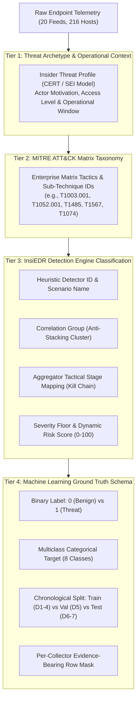
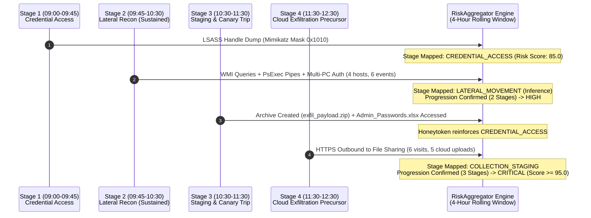

# InsiEDR Threat Scenarios & Classification Taxonomy Specification

**Document Version**: 1.0 (Production Specification)  
**Target Audience**: Security Engineers, SOC Analysts, Machine Learning Engineers, and Detection Researchers  
**Dataset Location**: [`D:\Projects\AISH\Dataset_Simulated\`](file:///D:/Projects/AISH/Dataset_Simulated/)  
**Ground Truth Manifest**: [`D:\Projects\AISH\Dataset_Simulated\simulation_manifest.json`](file:///D:/Projects/AISH/Dataset_Simulated/simulation_manifest.json)  

---

## 1. Executive Summary & Multi-Tier Classification Architecture

InsiEDR models threat behavior through a **4-tier classification framework**. Every simulated attack scenario is mapped across operational, behavioral, heuristic, and statistical machine learning domains to ensure high fidelity from raw endpoint telemetry through to SOC alert triaging.



---

## 2. Multi-Tier Classification Taxonomy Definitions

### Tier 1: Threat Archetype & Operational Context
Categorizes the actor's intent, privilege profile, and modus operandi based on the Carnegie Mellon SEI CERT Insider Threat model:
* **Credential Compromise / Impersonation**: Attacker harvesting credentials from memory to escalate or move laterally.
* **Unauthorized Data Exfiltration (Physical / Cloud)**: Departing or compromised insider copying confidential assets.
* **Hostile IT Sabotage & Destruction**: Disgruntled technical insider deliberately wiping databases and disabling controls.
* **Data Hoarding & Pre-Departure Staging**: Systemic accumulation of intellectual property beyond normal operational needs.
* **Canary / Decoy Interaction**: Adversary or insider inspecting attractive decoy assets.
* **Multi-Stage Advanced Persistent Threat (APT)**: Coordinated, multi-phase kill chain combining multiple tactical primitives.

### Tier 2: MITRE ATT&CK Enterprise Matrix
Standardized cross-industry taxonomy mapping each scenario to official Enterprise Tactics, Technique IDs, and Technical Descriptions.

### Tier 3: InsiEDR Detection Engine Classification
The operational classification produced by the InsiEDR Server detection engine:
1. **Heuristic Scenario ID**: Rule identifier (e.g., `S1_CRED_DUMP`, `S3_PRECURSOR`, `FILE_DELETE`, `HONEYTOKEN`).
2. **Correlation Group**: Non-linear score clustering group (prevents artificial linear score stacking across correlated feeds):
   * `FILE_EXFIL_GROUP`, `DEVICE_USB_GROUP`, `FILE_SABOTAGE_GROUP`, `HONEYTOKEN_GROUP`, `HTTP_PRECURSOR_GROUP`, `LOGON_ASSET_GROUP`.
3. **Severity Rating**: Normalized risk categorization:
   * `LOW` ($0.0 \le \text{Score} < 40.0$)
   * `MEDIUM` ($40.0 \le \text{Score} < 70.0$)
   * `HIGH` ($70.0 \le \text{Score} < 90.0$)
   * `CRITICAL` ($90.0 \le \text{Score} \le 100.0$)
4. **Aggregator Tactical Stage**: The stateful kill-chain stage mapped by `RiskAggregator._map_tactical_stages`:
   * `CREDENTIAL_ACCESS`
   * `LATERAL_MOVEMENT`
   * `EXECUTION_PERSISTENCE`
   * `COLLECTION_STAGING`
   * `EXFILTRATION_SABOTAGE`

### Tier 4: Machine Learning Ground Truth Schema
The supervised and unsupervised targets used for training, cross-validation, and prospective testing:
* **Binary Label**: `0` for benign baseline rows; `1` for rows containing verified injected scenario evidence.
* **Multiclass Target**: Specific categorical class assigned to each threat pattern.
* **Partition Split**: Chronological boundary defining whether the scenario serves as a training primitive, threshold validation baseline, or out-of-time test challenge.

---

## 3. Comprehensive Scenario Classification Profiles

```
┌────────────────────────────────────────────────────────────────────────────────────────┐
│                              7 CORE ATTACK SCENARIOS                                   │
├────────────────────────┬───────────────────────────────────────────────────────────────┤
│ Training Primitives    │ 1. SIM_CREDENTIAL_DUMP     (OS Credential Dumping: LSASS)     │
│ (Days 1 to 4)          │ 2. SIM_USB_PRECURSOR       (Removable Storage Exfil Precursor) │
│                        │ 3. SIM_IT_SABOTAGE         (Data Destruction / IT Sabotage)    │
│                        │ 4. SIM_CLOUD_PRECURSOR     (Cloud Storage / Web Exfil)         │
│                        │ 5. SIM_DATA_HOARDING       (Clipboard & File Staging)          │
├────────────────────────┼───────────────────────────────────────────────────────────────┤
│ Evaluation & Test      │ 6. SIM_HONEYTOKEN_TRIP     (Canary Decoy Interaction)          │
│ (Days 6 and 7)         │ 7. SIM_KILL_CHAIN          (4-Phase Multi-Stage APT Campaign)  │
└────────────────────────┴───────────────────────────────────────────────────────────────┘
```

---

### Scenario 1: `SIM_CREDENTIAL_DUMP`

#### A. Administrative & Target Metadata
* **Scenario ID**: `SIM_CREDENTIAL_DUMP`
* **Target Workstation**: `SOCL2-64` (Agent ID: `AGENT-SOCL2-64`)
* **Target Account**: `Administrator` (High-Privilege Local Account)
* **Active Interval**: `[2026-10-06T10:45:00, 2026-10-06T11:45:00)` (Strict Half-Open)
* **Duration**: 60 minutes (726 rows per active collector feed)

#### B. Classification Taxonomy Mapping
| Classification Tier | Category / Identifier | Technical Specifics |
| :--- | :--- | :--- |
| **Tier 1: Threat Archetype** | **Credential Compromise & Access** | Rogue or compromised administrative user attempting to extract cached credentials from OS process memory. |
| **Tier 2: MITRE ATT&CK** | **Credential Access (TA0006)** | **[T1003.001](https://attack.mitre.org/techniques/T1003/001/)**: OS Credential Dumping: LSASS Memory. |
| **Tier 3: Heuristics Engine** | **Scenario ID**: `S1_CRED_DUMP`<br/>**Scenario Name**: `Credential Access Activity`<br/>**Severity**: `CRITICAL`<br/>**Confidence**: `VERY_HIGH`<br/>**Score Floor**: `100.0` | **Correlation Group**: `FILE_EXFIL_GROUP`<br/>**Aggregator Stage**: `CREDENTIAL_ACCESS`<br/>**Corroboration**: Direct deterministic handle mask & signature match bypasses heuristic discounting. |
| **Tier 4: ML Schema** | **Binary Target**: `1`<br/>**Multiclass Label**: `CREDENTIAL_DUMP`<br/>**Dataset Split**: **Training Set (Day 1)** | **Evidence Rows**: Exactly 726 rows in each of `lsass-monitor`, `process-watcher`, `memory-scanner`, `short-term_edr_feature`. |

#### C. Telemetry Signatures & Evidence
* `lsass-monitor`: `credential_dumping_suspected=True`, `mimikatz_signatures=1`, `suspicious_access_mask="0x1FFFFF"` (`PROCESS_ALL_ACCESS`), `handle_requests=16`, `memory_dump_attempts=2`.
* `process-watcher`: Rogue administrative process targeting `lsass.exe`.
* `memory-scanner`: Unbacked executable memory regions identified in active user space.

---

### Scenario 2: `SIM_USB_PRECURSOR`

#### A. Administrative & Target Metadata
* **Scenario ID**: `SIM_USB_PRECURSOR`
* **Target Workstation**: `DSL-174` (Agent ID: `AGENT-DSL-174`)
* **Target Account**: `DSL-174` (Standard Laboratory User)
* **Active Interval**: `[2026-10-07T08:30:00, 2026-10-07T10:00:00)` (Strict Half-Open)
* **Duration**: 90 minutes (1,072 rows per active collector feed)

#### B. Classification Taxonomy Mapping
| Classification Tier | Category / Identifier | Technical Specifics |
| :--- | :--- | :--- |
| **Tier 1: Threat Archetype** | **Physical Media Exfiltration Precursor** | Insider connecting an unauthorized physical mass-storage peripheral to stage sensitive files for physical removal. |
| **Tier 2: MITRE ATT&CK** | **Exfiltration (TA0010)** | **[T1052.001](https://attack.mitre.org/techniques/T1052/001/)**: Exfiltration Over Physical Medium: Removable Storage. |
| **Tier 3: Heuristics Engine** | **Scenario ID**: `S3_PRECURSOR`<br/>**Scenario Name**: `Unapproved USB Device`<br/>**Severity**: `HIGH`<br/>**Confidence**: `HIGH`<br/>**Score Floor**: `75.0` | **Correlation Group**: `DEVICE_USB_GROUP`<br/>**Aggregator Stage**: `EXFILTRATION_SABOTAGE` (Physical Vector)<br/>**Rule Trigger**: USB device insertion with non-whitelisted Vendor ID / Product ID. |
| **Tier 4: ML Schema** | **Binary Target**: `1`<br/>**Multiclass Label**: `USB_EXFILTRATION_PRECURSOR`<br/>**Dataset Split**: **Training Set (Day 2)** | **Evidence Rows**: Exactly 1,072 rows in each of `devices`, `file-integrity-monitor`, `usn-monitor`, `short-term_edr_feature`. |

#### C. Telemetry Signatures & Evidence
* `devices`: Unapproved USB flash insertion (`vendor_id="1058"`, `product_id="0748"`, Western Digital Storage).
* `file-integrity-monitor`: File copy staging directed to removable drive mount `E:\`.
* `usn-monitor`: Elevated USN journal change records on external volume `E:\`.

---

### Scenario 3: `SIM_IT_SABOTAGE`

#### A. Administrative & Target Metadata
* **Scenario ID**: `SIM_IT_SABOTAGE`
* **Target Workstation**: `DATASL-173` (Agent ID: `AGENT-DATASL-173`)
* **Target Account**: `DSL-173` (Technical / Administrative User)
* **Active Interval**: `[2026-10-07T09:00:00, 2026-10-07T11:00:00)` (Strict Half-Open)
* **Duration**: 120 minutes (1,306 rows per active collector feed)

#### B. Classification Taxonomy Mapping
| Classification Tier | Category / Identifier | Technical Specifics |
| :--- | :--- | :--- |
| **Tier 1: Threat Archetype** | **Hostile IT Sabotage & Data Destruction** | Technical insider deliberately deleting core operational files, backups, and databases while disabling security defenses. |
| **Tier 2: MITRE ATT&CK** | **Impact (TA0040)** /<br/>**Defense Evasion (TA0005)** | **[T1485](https://attack.mitre.org/techniques/T1485/)**: Data Destruction.<br/>**[T1562.001](https://attack.mitre.org/techniques/T1562/001/)**: Impair Defenses: Disable or Modify Tools. |
| **Tier 3: Heuristics Engine** | **Scenario ID**: `FILE_DELETE`<br/>**Scenario Name**: `Mass File Deletion`<br/>**Severity**: `MEDIUM`<br/>**Confidence**: `MEDIUM`<br/>**Score Floor**: `50.0` | **Correlation Group**: `FILE_SABOTAGE_GROUP`<br/>**Aggregator Stage**: `EXECUTION_PERSISTENCE`<br/>**Rule Trigger**: Sampled deletion operations $\ge 10$ (`file_delete_count = 13.0`). |
| **Tier 4: ML Schema** | **Binary Target**: `1`<br/>**Multiclass Label**: `IT_SABOTAGE`<br/>**Dataset Split**: **Training Set (Day 2)** | **Evidence Rows**: Exactly 1,306 rows in each of `file-integrity-monitor`, `process-watcher`, `persistence-monitor`, `short-term_edr_feature`. |

#### C. Telemetry Signatures & Evidence
* `file-integrity-monitor`: Populates all 13 sampled operation slots with `"DELETE"` (`integrity_events_0_op` through `12_op`) targeting `.mdf`, `.bak`, and shadow volumes. Pipeline derives confirmed sampled `file_delete_count = 13.0`.
* `persistence-monitor`: `modifications_detected=True`, command `sc stop WinDefend & sc config WinDefend start= disabled`.
* `process-watcher`: `admin_process_count=3`, `executables_from_temp_folder=2`.

---

### Scenario 4: `SIM_CLOUD_PRECURSOR`

#### A. Administrative & Target Metadata
* **Scenario ID**: `SIM_CLOUD_PRECURSOR`
* **Target Workstation**: `MCALAB1-07` (Agent ID: `AGENT-MCALAB1-07`)
* **Target Account**: `MCAL1-07` (Standard Laboratory Account)
* **Active Interval**: `[2026-10-09T03:15:00, 2026-10-09T04:15:00)` (Strict Half-Open)
* **Duration**: 60 minutes (1,357 rows per active collector feed)

#### B. Classification Taxonomy Mapping
| Classification Tier | Category / Identifier | Technical Specifics |
| :--- | :--- | :--- |
| **Tier 1: Threat Archetype** | **Off-Hours Cloud Exfiltration Precursor** | Insider utilizing off-hours access (03:15 AM) to stage files to unauthorized public cloud storage and file-sharing domains. |
| **Tier 2: MITRE ATT&CK** | **Exfiltration (TA0010)** /<br/>**Defense Evasion (TA0005)** | **[T1567](https://attack.mitre.org/techniques/T1567/)**: Exfiltration Over Web Service.<br/>**[T1078.003](https://attack.mitre.org/techniques/T1078/003/)**: Valid Accounts: Local Accounts (Off-Hours). |
| **Tier 3: Heuristics Engine** | **Scenario ID**: `S4_PRECURSOR`<br/>**Scenario Name**: `File-Sharing Site Visit`<br/>**Severity**: `MEDIUM`<br/>**Confidence**: `HIGH`<br/>**Score Floor**: `45.0` | **Correlation Group**: `HTTP_PRECURSOR_GROUP`<br/>**Aggregator Stage**: `COLLECTION_STAGING`<br/>**Rule Trigger**: Hits on watchlisted file-sharing / cloud-storage domains (`file_sharing_site_visits = 5.0`). |
| **Tier 4: ML Schema** | **Binary Target**: `1`<br/>**Multiclass Label**: `CLOUD_EXFILTRATION_PRECURSOR`<br/>**Dataset Split**: **Training Set (Day 4)** | **Evidence Rows**: Exactly 1,357 rows in each of `http`, `network`, `short-term_edr_feature`. |

#### C. Telemetry Signatures & Evidence
* `http`: `cloud_storage_uploads=4`, `large_uploads=3`, `file_sharing_site_visits=5`, `watchlisted_domain_hits=3`, `post_requests=28`, `http_after_hours=1.0`.
* `network`: Port 443 outbound connections (`outbound_connections=18`, `high_port_traffic=1`).
* `short-term_edr_feature`: Off-hours interactive presence (`off_hours_auth_count=3`).

---

### Scenario 5: `SIM_DATA_HOARDING`

#### A. Administrative & Target Metadata
* **Scenario ID**: `SIM_DATA_HOARDING`
* **Target Workstation**: `SOCL8-53` (Agent ID: `AGENT-SOCL8-53`)
* **Target Account**: `DSL-189` (Standard Laboratory Account)
* **Active Interval**: `[2026-10-09T08:00:00, 2026-10-09T10:00:00)` (Strict Half-Open)
* **Duration**: 120 minutes (1,262 rows per active collector feed)

#### B. Classification Taxonomy Mapping
| Classification Tier | Category / Identifier | Technical Specifics |
| :--- | :--- | :--- |
| **Tier 1: Threat Archetype** | **Data Staging & Clipboard Hoarding** | User systematically copying proprietary documents, harvesting content to clipboard, and building local archives. |
| **Tier 2: MITRE ATT&CK** | **Collection (TA0009)** | **[T1074](https://attack.mitre.org/techniques/T1074/)**: Data Staged.<br/>**[T1115](https://attack.mitre.org/techniques/T1115/)**: Clipboard Data. |
| **Tier 3: Heuristics Engine** | **Scenario ID**: `S2`<br/>**Scenario Name**: `Broad File Collection`<br/>**Severity**: `HIGH`<br/>**Confidence**: `HIGH`<br/>**Score Floor**: `75.0` | **Correlation Group**: `FILE_EXFIL_GROUP`<br/>**Aggregator Stage**: `COLLECTION_STAGING`<br/>**Rule Trigger**: File breadth thresholds (`distinct_files >= 50` and `new_files >= 25`). |
| **Tier 4: ML Schema** | **Binary Target**: `1`<br/>**Multiclass Label**: `DATA_HOARDING`<br/>**Dataset Split**: **Training Set (Day 4)** | **Evidence Rows**: Exactly 1,262 rows in each of `clipboard-monitor`, `file-integrity-monitor`, `activity-monitor`, `short-term_edr_feature`. |

#### C. Telemetry Signatures & Evidence
* `clipboard-monitor`: Abnormal clipboard copy burst (`clipboard_copy_count=48`, sequence index 112).
* `file-integrity-monitor`: Breadth metrics (`daily_unique_filename_count=68.0`, `daily_new_filename_count=35.0`, access entropy 4.85), creation of local container `archive_staged.7z`.
* `activity-monitor`: `is_user_active=True`, `user_idle_seconds=0`.

---

### Scenario 6: `SIM_HONEYTOKEN_TRIP`

#### A. Administrative & Target Metadata
* **Scenario ID**: `SIM_HONEYTOKEN_TRIP`
* **Target Workstation**: `SOCL8-03` (Agent ID: `AGENT-SOCL8-03`)
* **Target Account**: `Administrator` (Early Morning Active Session)
* **Active Interval**: `[2026-10-12T06:00:00, 2026-10-12T07:30:00)` (Strict Half-Open)
* **Duration**: 90 minutes (1,061 rows per active collector feed)

#### B. Classification Taxonomy Mapping
| Classification Tier | Category / Identifier | Technical Specifics |
| :--- | :--- | :--- |
| **Tier 1: Threat Archetype** | **Canary Decoy Interaction / Honeypot Breach** | Adversary or snooping insider inspecting attractive decoy credentials planted as deception canaries. |
| **Tier 2: MITRE ATT&CK** | **Discovery (TA0007)** /<br/>**Credential Access (TA0006)** | **[T1083](https://attack.mitre.org/techniques/T1083/)**: File and Directory Discovery.<br/>**[T1552](https://attack.mitre.org/techniques/T1552/)**: Unsecured Credentials. |
| **Tier 3: Heuristics Engine** | **Scenario ID**: `HONEYTOKEN`<br/>**Scenario Name**: `Honeytoken Access`<br/>**Severity**: `CRITICAL`<br/>**Confidence**: `VERY_HIGH`<br/>**Score Floor**: `100.0` | **Correlation Group**: `HONEYTOKEN_GROUP`<br/>**Aggregator Stage**: `CREDENTIAL_ACCESS`<br/>**Rule Trigger**: `threat_triggered = True` in decoy telemetry. Bypasses contextual discounting. |
| **Tier 4: ML Schema** | **Binary Target**: `1`<br/>**Multiclass Label**: `HONEYTOKEN_TRIP`<br/>**Dataset Split**: **Out-of-Time Test Set (Day 7)** | **Evidence Rows**: Exactly 1,061 rows in each of `decoy-monitor`, `file-integrity-monitor`, `logon`, `short-term_edr_feature`. |

#### C. Telemetry Signatures & Evidence
* `decoy-monitor`: `threat_triggered=True`, `events_recorded=True`, `monitored_decoys="C:\Users\Public\Admin_Passwords.xlsx;C:\Decoys\Financial_Decoy.docx"`.
* `file-integrity-monitor`: Explicit `READ` operation on `Admin_Passwords.xlsx`.
* `logon`: Early-morning interactive logon (`logon_type=2`) accompanied by 3 failed authentication events.

---

### Scenario 7: `SIM_KILL_CHAIN`

#### A. Administrative & Target Metadata
* **Scenario ID**: `SIM_KILL_CHAIN`
* **Target Workstation**: `SOCL4-61` (Agent ID: `AGENT-SOCL4-61`)
* **Target Account**: `admin` (Privileged Local Account)
* **Overall Time Interval**: `[2026-10-12T09:00:00, 2026-10-12T12:30:00)` (3.5 Hours / 210 Minutes)
* **Dataset Partition**: **Out-of-Time Test Set (Day 7)**
* **Temporal Sliding Window Standard**: Evaluated across a rolling 4-hour correlation window.

#### B. Multi-Phase Classification Architecture



| Phase | Time Window `[start, end)` | Active Collectors & Rows | MITRE Mapping | Engine Output & Tactical Classification |
| :--- | :--- | :--- | :--- | :--- |
| **Phase 1: Credential Access** | `09:00:00` to `09:45:00` (45 min) | `lsass-monitor` (540)<br/>`short-term_edr_feature` (540) | [T1003.001](https://attack.mitre.org/techniques/T1003/001/) (LSASS Dump) | **Detector ID**: `S1_CRED_DUMP`<br/>**Aggregator Stage**: `CREDENTIAL_ACCESS`<br/>**Score**: `85.0` (High) |
| **Phase 2: Lateral Reconnaissance (Sustained Campaign)** | `09:45:00` to `10:30:00` (45 min) | `wmi-activity` (540)<br/>`named-pipe-monitor` (540)<br/>`short-term_edr_feature` (540) | [T1047](https://attack.mitre.org/techniques/T1047/) (WMI)<br/>[T1021.002](https://attack.mitre.org/techniques/T1021/002/) (SMB/Named Pipe) | **Detector ID**: `auth_burst` (`MULTI_WORKSTATION_BURST`)<br/>**Aggregator Stage**: `LATERAL_MOVEMENT` (Inference)<br/>**Progression**: Confirmed (2 Stages) |
| **Phase 3: Data Staging & Canary Trip** | `10:30:00` to `11:30:00` (60 min) | `file-integrity-monitor` (698)<br/>`decoy-monitor` (698)<br/>`short-term_edr_feature` (698) | [T1074](https://attack.mitre.org/techniques/T1074/) (Staging)<br/>[T1083](https://attack.mitre.org/techniques/T1083/) (Decoy Discovery) | **Detector ID**: `HONEYTOKEN`<br/>**Aggregator Stage**: `CREDENTIAL_ACCESS` (Decoy reinforces credential access stage) |
| **Phase 4: Cloud Exfiltration Precursor** | `11:30:00` to `12:30:00` (60 min) | `http` (720)<br/>`network` (720)<br/>`short-term_edr_feature` (720) | [T1567](https://attack.mitre.org/techniques/T1567/) (Web Service Exfil) | **Detector ID**: `S4_PRECURSOR`<br/>**Aggregator Stage**: `COLLECTION_STAGING`<br/>**Final Result**: Confirmed 3-Stage Kill Chain $\rightarrow$ `CRITICAL` (Score: `95.0`) |

---

## 4. Master Classification & Comparison Matrix

The table below summarizes all 7 attack scenarios across every classification dimension:

| # | Scenario ID | Multiclass Label | Threat Archetype | MITRE ATT&CK | Heuristic Detection ID | Tactical Stage | Severity & Score Floor | Partition |
| :-: | :--- | :--- | :--- | :--- | :--- | :--- | :-: | :-: |
| **1** | `SIM_CREDENTIAL_DUMP` | `CREDENTIAL_DUMP` | Credential Theft | T1003.001 | `S1_CRED_DUMP` | `CREDENTIAL_ACCESS` | `CRITICAL` (100.0) | Train (D1) |
| **2** | `SIM_USB_PRECURSOR` | `USB_EXFILTRATION_PRECURSOR` | Removable Media Egress | T1052.001 | `S3_PRECURSOR` | `EXFILTRATION_SABOTAGE` | `HIGH` (75.0) | Train (D2) |
| **3** | `SIM_IT_SABOTAGE` | `IT_SABOTAGE` | Data Destruction | T1485 / T1562 | `FILE_DELETE` | `EXECUTION_PERSISTENCE` | `MEDIUM` (50.0) | Train (D2) |
| **4** | `SIM_CLOUD_PRECURSOR` | `CLOUD_EXFILTRATION_PRECURSOR` | Off-Hours Web Exfil | T1567 / T1078 | `S4_PRECURSOR` | `COLLECTION_STAGING` | `MEDIUM` (45.0) | Train (D4) |
| **5** | `SIM_DATA_HOARDING` | `DATA_HOARDING` | Intellectual Property Theft | T1074 / T1115 | `S2` | `COLLECTION_STAGING` | `HIGH` (75.0) | Train (D4) |
| **6** | `SIM_HONEYTOKEN_TRIP` | `HONEYTOKEN_TRIP` | Deception / Canary Trap | T1083 / T1552 | `HONEYTOKEN` | `CREDENTIAL_ACCESS` | `CRITICAL` (100.0) | Test (D7) |
| **7** | `SIM_KILL_CHAIN` | `KILL_CHAIN_APT` | Multi-Stage APT Campaign | T1003/T1021/T1074/T1567 | Multi-Detector Pipeline | 3-Stage Progression | `CRITICAL` (95.0) | Test (D7) |

---

## 5. Architectural & Modeling Notes for Data Scientists

1. **Summary-Feature Telemetry vs. Raw Event Logs**:
   * Telemetry rows represent **periodic summary-feature snapshots** (rolling 300s window aggregations sampled at ~5-second bursts), not raw event logs (e.g. discrete Windows Event Log EID 4624 records).
   * Scalar metrics such as `unique_workstations_300s = 4` convey endpoint volume and breadth; they do not contain destination hostname arrays.
2. **Aggregator Tactical Inferences vs. Detector Output**:
   * `detect_auth_burst` emits `MULTI_WORKSTATION_BURST` under `AUTHENTICATION_ACTIVITY` (an authentication rate/breadth anomaly).
   * It is the **Risk Aggregator** that maps `MULTI_WORKSTATION_BURST` and `unique_workstations_300s >= 3.0` to the tactical stage `LATERAL_MOVEMENT`.
3. **Graph Entity Semantics**:
   * Named pipe strings in `named-pipe-monitor` represent local pipe entities (`Host -> Pipe`), not remote hostnames.
   * Remote IPs in `network` represent destination IP addresses requiring asset-inventory enrichment to map to internal workstation hostnames.
4. **Phase-Aware Positive Labeling**:
   * Rows should only be assigned positive threat labels (`label = 1`) if the specific collector contains active scenario evidence during that time window. Unaltered background rows from a compromised host outside an active phase are benign baseline rows.
