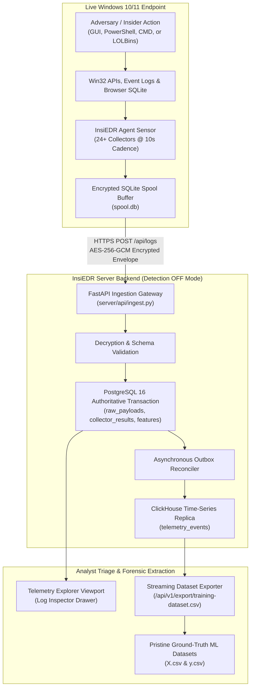

# InsiEDR Insider Threat Scenarios: Master Field Operations & Forensic Handbook

> **Document Version:** 3.1 (Enterprise Production Specification)  
> **Target Audience:** Security Engineers, SOC Analysts, Data Scientists, and Threat Researchers  
> **Operational Mode:** Ingestion-Only Forensics (**Detection Pipeline OFF**)  
> **Associated Repositories:** [`InsiEDR-agent`](file:///d:/Projects/AISH/InsiEDR-agent) & [`InsiEDR_Server`](file:///d:/Projects/AISH/InsiEDR_Server)  

---

## 1. Executive Summary & Operating Philosophy

This handbook serves as the authoritative operational manual for executing, observing, and harvesting **authentic insider threat telemetry** across Windows endpoints monitored by the **InsiEDR** platform.



### The Ingestion-Only Mode (Detection Pipeline OFF)
In standard deployment, InsiEDR's deterministic heuristic engine and machine learning sequence model automatically evaluate incoming telemetry to generate alert badges and calculate dynamic composite risk scores. 

However, during **attack simulation and dataset harvesting**, the detection pipeline is explicitly configured to **OFF** (`INSIEDR_ENABLE_MODEL_PIPELINE=false`):
1. **Unbiased Telemetry Ingestion:** Prevents synthetic alert inflation or server-side discounting from modifying raw metrics.
2. **Pure Forensic Observability:** Shifts evaluation from automated alert popups to manual log inspection using **Telemetry Explorer** and the **Log Inspector Drawer**.
3. **Pristine Ground-Truth Harvesting:** Guarantees that exported datasets contain authentic operating system background noise and genuine attack signatures, completely unpolluted by pre-baked heuristic rules.

---

## 2. 4-Tier Classification Architecture Matrix

Every scenario in this handbook maps directly across the four operational tiers of the InsiEDR ecosystem:

```
Tier 1: CERT Insider Threat Archetype (Actor Motivation & Behavioral Profile)
   └─► Tier 2: MITRE ATT&CK Enterprise Matrix (Tactics & Technique IDs)
         └─► Tier 3: InsiEDR Detector ID & Tactical Aggregator Stage
               └─► Tier 4: Machine Learning Ground-Truth Label & Multiclass Category
```

| # | Scenario Identifier | Tier 1: Threat Archetype | Tier 2: MITRE ATT&CK | Tier 3: Detector & Stage | Tier 4: ML Label & Target | Required Privilege |
| :-: | :--- | :--- | :--- | :--- | :--- | :--- | :---: |
| **S1** | [**`SIM_HONEYTOKEN_TRIP`**](SIM_HONEYTOKEN_TRIP.md) | Canary Decoy Interaction | **T1083 / T1552** | `HONEYTOKEN`<br/>`CREDENTIAL_ACCESS` | `1`<br/>`HONEYTOKEN_TRIP` | Standard User |
| **S2** | [**`SIM_DATA_HOARDING`**](SIM_DATA_HOARDING.md) | Intellectual Property Staging | **T1074 / T1115** | `S2`<br/>`COLLECTION_STAGING` | `1`<br/>`DATA_HOARDING` | Standard User |
| **S3** | [**`SIM_USB_PRECURSOR`**](SIM_USB_PRECURSOR.md) | Physical Media Egress Precursor | **T1052.001** | `S3_PRECURSOR`<br/>`EXFILTRATION_SABOTAGE` | `1`<br/>`USB_EXFILTRATION_PRECURSOR` | Standard User / Admin |
| **S4** | [**`SIM_IT_SABOTAGE`**](SIM_IT_SABOTAGE.md) | Hostile Data Destruction | **T1485 / T1562.001** | `FILE_DELETE`<br/>`EXECUTION_PERSISTENCE` | `1`<br/>`IT_SABOTAGE` | Administrator |
| **S5** | [**`SIM_CLOUD_PRECURSOR`**](SIM_CLOUD_PRECURSOR.md) | Off-Hours Web Exfiltration | **T1567 / T1078.003** | `S4_PRECURSOR`<br/>`COLLECTION_STAGING` | `1`<br/>`CLOUD_EXFILTRATION_PRECURSOR` | Standard User |
| **S6** | [**`SIM_CREDENTIAL_DUMP`**](SIM_CREDENTIAL_DUMP.md) | OS Credential Access (LSASS) | **T1003.001** | `S1_CRED_DUMP`<br/>`CREDENTIAL_ACCESS` | `1`<br/>`CREDENTIAL_DUMP` | Administrator |
| **S7** | [**`SIM_KILL_CHAIN`**](SIM_KILL_CHAIN.md) | Coordinated Multi-Stage Campaign | **T1003/T1047/T1074/T1567** | Multi-Detector Pipeline<br/>4-Stage Progression | `1`<br/>`KILL_CHAIN_APT` | Administrator |

---

## 3. Master Field Guide & Scenario Navigation

Each dedicated scenario document contains an exhaustive 7-section operational specification, complete with verified execution playbooks (GUI, PowerShell, CMD, Python), forensic log inspection workflows, and cleanup scripts.

### Scenario Playbook Index

* [**`SIM_HONEYTOKEN_TRIP.md`**](SIM_HONEYTOKEN_TRIP.md)  
  *Covers unauthorized interaction with planted decoy credential stores (`C:\Users\Public\Admin_Passwords.xlsx`). Explains byte tampering, canary trips, and `threat_triggered` boolean inspection.*
* [**`SIM_DATA_HOARDING.md`**](SIM_DATA_HOARDING.md)  
  *Covers rapid clipboard harvesting bursts, Desktop profile staging, and local compression into `archive_staged.zip`. Details `clipboard_copy_count` polling intervals and filesystem breadth metrics.*
* [**`SIM_USB_PRECURSOR.md`**](SIM_USB_PRECURSOR.md)  
  *Covers physical USB drive connections, event log registration (EID 2003/2102), and removable byte transfer tracking via physical flash drives or the agent's built-in synthetic hook.*
* [**`SIM_IT_SABOTAGE.md`**](SIM_IT_SABOTAGE.md)  
  *Covers mass deletion of database files (`.mdf`, `.ldf`, `.bak`) coupled with security defense evasion in Windows `RunOnce`. Details `file_delete_count` surges and autorun key modification (`added_keys`).*
* [**`SIM_CLOUD_PRECURSOR.md`**](SIM_CLOUD_PRECURSOR.md)  
  *Covers browser history analysis on watchlisted cloud services (Mega.nz, Dropbox, WeTransfer) parsed directly from desktop browser SQLite databases, corroborated by port 443 sockets.*
* [**`SIM_CREDENTIAL_DUMP.md`**](SIM_CREDENTIAL_DUMP.md)  
  *Covers privileged handle requests (`0x1FFFFF` / `0x1010`) against `lsass.exe` using built-in system tools (`comsvcs.dll`), Task Manager GUI, and safe in-memory P/Invoke probes, backed by Windows Audit Policy.*
* [**`SIM_KILL_CHAIN.md`**](SIM_KILL_CHAIN.md)  
  *Covers an end-to-end 4-phase sequential insider attack across a rolling correlation window: Credential Dumping $\rightarrow$ Lateral WMI Reconnaissance $\rightarrow$ Data Staging & Canary Trip $\rightarrow$ Cloud Exfiltration.*

---

## 4. Standard Operating Procedure (SOP) for Running Scenarios

```
[Step 1: Pre-Flight Check] ──► [Step 2: Start Scenario] ──► [Step 3: Execute Trigger]
   • Verify Server is Listening      • Note UTC Start Time (t_start)  • Execute Playbook Vector
   • Verify Agent Tick (10s)         • Tag Isolated Username           (GUI, PowerShell, or CMD)
                                                                            │
                                                                            ▼
[Step 5: Reset & Export]   ◄── [Step 4: Forensic Inspection] ◄─────────────┘
   • Execute Cleanup Script          • Open Telemetry Explorer
   • Verify Baseline Restored        • Filter by Collector
   • Export Scenario Slice (CSV)     • Inspect Raw JSON Drawer
```

### Detailed Operational Guidelines:

#### Step 1: Pre-Flight Verification
* Ensure the InsiEDR Server is active and listening on port `5000`.
* Ensure the InsiEDR Python Agent (`agent/agent.py`) is actively streaming telemetry (`sent=True` every 10 seconds).
* For `SIM_CREDENTIAL_DUMP`, confirm Windows handle auditing is enabled:  
  `auditpol /set /subcategory:"Handle Manipulation" /success:enable`

#### Step 2: Record Execution Window
* Note the exact UTC timestamp before launching the attack:  
  `$tStart = (Get-Date).ToUniversalTime().ToString("yyyy-MM-ddTHH:mm:ssZ")`
* Ensure actions are performed under the designated test user account.

#### Step 3: Execute Chosen Trigger Vector
* Choose any supported trigger method detailed in the scenario guide.

#### Step 4: Forensic Triage in Telemetry Explorer
* Navigate to the **Telemetry Explorer** tab on the InsiEDR Dashboard (`http://localhost:5000/dashboard/`).
* Set Time Range to `15m` and filter by the scenario's primary collector.
* Open the **Log Inspector Drawer** to verify the expected JSON payload fields.

#### Step 5: Post-Execution Sanitization & Dataset Slicing
* Record the completion timestamp ($t_{\text{end}}$).
* Run the dedicated cleanup script in Section 6 of the scenario guide.
* Allow a **60-second cooldown period** before initiating subsequent scenarios.

---

## 5. Machine Learning Dataset Export & Ground-Truth Verification

Following scenario execution, the captured evidence can be exported directly through InsiEDR's REST APIs:

### Exporting via Web API (Requires Operator Authentication):
Query the streaming export endpoint using an active operator Bearer token or session cookie:

```text
GET /api/v1/export/training-dataset.csv?username=InsiderTest&format=csv
Header: Authorization: Bearer <operator_token>
```

### Ground-Truth Labeling Standard:
* **`label = 1`:** Rows falling strictly within the half-open interval $[t_{\text{start}}, t_{\text{end}})$ on the target test account where collector evidence is present.
* **`label = 0`:** All background rows generated outside active attack intervals (representing nominal benign baseline behavior).
