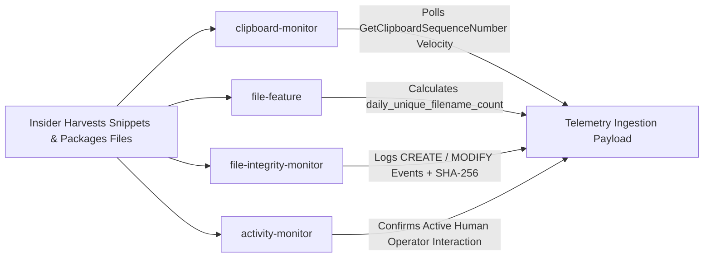

# InsiEDR Scenario Execution & Forensic Guide: SIM_DATA_HOARDING

> **Scenario ID:** `SIM_DATA_HOARDING`  
> **Friendly Name:** Data Staging, Local Compression & Clipboard Harvesting  
> **Target Persona:** Disgruntled Departing Employee / Corporate IP Harvester  
> **MITRE ATT&CK:** [T1074.001](https://attack.mitre.org/techniques/T1074/001/) (Data Staged: Local Data Staging), [T1115](https://attack.mitre.org/techniques/T1115/) (Clipboard Data), & [T1560.001](https://attack.mitre.org/techniques/T1560/001/) (Archive Collected Data: Archive via Utility)  
> **Operating Mode:** Ingestion-Only Forensics (**Detection Pipeline OFF**)  

---

## 1. Quick Reference Card

| Field | Specification |
| :--- | :--- |
| **Difficulty Level** | ⭐ Beginner (Safe, Non-Destructive, Standard Workspace) |
| **Execution Duration** | 3 – 5 minutes |
| **Required Privilege** | Standard User (No Administrator rights required) |
| **Target Operating System** | Windows 10, Windows 11, Windows Server 2016+ |
| **Primary InsiEDR Collectors** | `clipboard-monitor`, `file-feature`, `file-integrity-monitor`, `activity-monitor` |
| **Target Staging Path** | `$HOME\Desktop\StagingVault\` and `archive_staged.zip` |
| **Expected Sensor Signal** | Clipboard copy burst (`clipboard_copy_count >= 20`), unique files touched (`daily_unique_filename_count >= 50`), staging archive created |

> [!IMPORTANT]
> **Filesystem Watch Path Notice:**  
> The InsiEDR agent's filesystem collectors (`file_feature.py` and `file_integrity_monitor.py`) monitor `$HOME` (`C:\Users\<Username>`), specifically `Desktop` and `Documents` by default.  
> **Do not use `C:\Temp` for staging** unless you have explicitly configured the environment variable `INSIEDR_FILE_WATCH_PATHS=C:\Temp`. Using `$HOME\Desktop\StagingVault` guarantees automatic capture without configuration changes.

---

## 2. Threat Profile & Operational Context

### Executive Summary & Operational Metaphor
Consider an employee who has just accepted an offer from a competitor. Before submitting their resignation, they spend their final afternoon browsing through proprietary documents, copying formulas and client lists into their clipboard, and sweeping dozens of files into a local folder on their Desktop, packaging everything into a single `.zip` archive.

Adversaries and rogue insiders almost always stage data locally before attempting exfiltration. Consolidating disparate intelligence into a single compressed staging archive minimizes network footprint and physical transfer time during exfiltration.

### MITRE ATT&CK Alignment

| Dimension | Identifier | Description |
| :--- | :--- | :--- |
| **Tactic** | **TA0009** (Collection) | Gathering data of interest from local systems and the OS clipboard. |
| **Technique** | **[T1115](https://attack.mitre.org/techniques/T1115/)** | **Clipboard Data:** Repeatedly copying sensitive data via the Windows clipboard subsystem. |
| **Tactic** | **TA0009** (Collection) | Staging collected data in a central location prior to transfer. |
| **Technique** | **[T1074.001](https://attack.mitre.org/techniques/T1074/001/)** | **Data Staged (Local Data Staging):** Aggregating files into a staging directory (`Desktop\StagingVault`). |
| **Technique** | **[T1560.001](https://attack.mitre.org/techniques/T1560/001/)** | **Archive Collected Data (Archive via Utility):** Compressing staged data into a `.zip` archive using built-in utilities (`Compress-Archive`, `tar.exe`). |

---

## 3. InsiEDR Telemetry & Sensor Architecture

### Active Collectors & Telemetry Delta



#### 1. `clipboard-monitor` (Harvesting Sensor — `agent/collectors/clipboard_monitor.py`)
* **Underlying Win32 API:** Windows User32 API (`GetClipboardSequenceNumber`).
* **Privacy Guarantee:** InsiEDR measures *velocity and sequence changes*. It **never reads or logs** the actual text or passwords in the clipboard buffer.
* **Polling Mechanics & Velocity Math:**
  The background monitor thread polls the OS sequence number every **500 milliseconds** (`time.sleep(0.5)`). If multiple copy operations happen within a 500ms window, the counter increments once for that window. To register $N$ copy counts, the operations must span across polling cycles (e.g., sleeping ~550ms between bursts).
* **Raw JSON Payload Snapshot (Exact schema logged in `spool.db` and PostgreSQL):**
  ```json
  {
    "collector": "clipboard-monitor",
    "status": "success",
    "collected_at": "2026-10-27T16:45:10.842Z",
    "payload": {
      "clipboard_copy_count": 25,
      "formats_involved": [1, 13, 16],
      "monitor_active": true
    }
  }
  ```

#### 2. `file-feature` (Filesystem Breadth Sensor — `agent/collectors/file_feature.py`)
* **Underlying Engine:** Watchdog file system observer watching `$HOME`.
* **Sensor Baseline vs. Attack Delta:**

| Feature Name | Clean Baseline Value | Active Attack Value | Description |
| :--- | :---: | :---: | :--- |
| `daily_unique_filename_count` | Nominal ($< 15.0$) | **$\ge 50.0$** | High volume of distinct files touched in the watched profile. |
| `daily_new_filename_count` | Nominal ($< 5.0$) | **$\ge 25.0$** | Rapid creation of new files in staging directories. |
| `staging_archive_count` | `0` | **$\ge 1$** | Flagged when `.zip` or `.7z` archives are created. |

#### 3. `file-integrity-monitor` (FIM — `agent/collectors/file_integrity_monitor.py`)
* **Underlying Engine:** Watches `$HOME/Desktop` and `$HOME/Documents` for `CREATE` and `MODIFY` events with SHA-256 hashes.
* **Payload Snapshot:**
  ```json
  {
    "collector": "file-integrity-monitor",
    "status": "success",
    "payload": {
      "events": [
        {"path": "C:\\Users\\Operator\\Desktop\\StagingVault\\Intel_1.docx", "op": "CREATE", "sha256": "e3b0c44..."},
        {"path": "C:\\Users\\Operator\\Desktop\\StagingVault\\archive_staged.zip", "op": "CREATE", "sha256": "4a1f9e2..."}
      ],
      "event_count": 2,
      "watched_paths": ["C:\\Users\\Operator\\Desktop", "C:\\Users\\Operator\\Documents"]
    }
  }
  ```

---

## 4. SOC Analyst Inspection Protocol (Detection Pipeline OFF)

With automated detection rules disabled (`INSIEDR_ENABLE_MODEL_PIPELINE=false`), telemetry flows directly into storage. Verify via **Telemetry Explorer**.

### Telemetry Explorer Inspection Steps:

```
[1. Select Time Range: 15m] ──► [2. Filter Collector: Clipboard Monitor] ──► [3. Inspect Log Drawer (copy_count >= 20)]
                                  │
                                  └──► [4. Switch Collector: File Feature / FIM] ──► [5. Verify unique_files & archive_staged.zip]
```

1. **Access Viewport:** Navigate to the InsiEDR Web Dashboard (`http://localhost:5000/dashboard/`) and select **Telemetry Explorer**.
2. **Set Temporal Range:** Select **`15m`**.
3. **Filter Primary Harvesting Sensor:** In the **Collector** dropdown, select **`Clipboard Monitor`** (`clipboard-monitor`).
4. **Inspect Raw Payload:** Click the latest log row:
   * Verify `"clipboard_copy_count"` shows elevated counts (e.g., $\ge 20$).
   * Verify `"monitor_active": true`.
5. **Cross-Check File Breadth Sensor:** Switch the Collector filter to **`File Feature`** (`file-feature`):
   * Verify `"daily_unique_filename_count"` displays **$\ge 50.0$**.
   * Verify `"daily_new_filename_count"` displays **$\ge 25.0$**.
6. **Cross-Check FIM:** Switch the Collector filter to **`File Integrity (FIM)`** (`file-integrity-monitor`):
   * Confirm the creation of `archive_staged.zip` in the `"events"` list.

---

## 5. Multi-Vector Attack Execution Playbooks

Below are **5 distinct execution playbooks** to simulate data hoarding and staging.

### Vector 1: Manual GUI / Desktop Method (Zero-Code Desktop Workflow)
*Ideal for non-technical evaluators reproducing human behavior.*
1. **Clipboard Harvesting Burst:**
   * Open any browser page, Word document, or text file.
   * Highlight any text string.
   * Press **Ctrl + C** repeatedly with a half-second pause between presses (press 25–30 times over 15 seconds).
2. **File Staging in Desktop Workspace:**
   * Open **File Explorer** (**Windows Key + E**), navigate to your **Desktop**, and create a folder named `StagingVault`.
   * Create or copy 40–50 small `.docx` or `.txt` files into `Desktop\StagingVault`.
   * Press **Ctrl + A** to select all files $\rightarrow$ Right-click $\rightarrow$ **Send to** $\rightarrow$ **Compressed (zipped) folder**.
   * Name the archive `archive_staged.zip`.
*Forensic Outcome:* `clipboard-monitor` captures the copy frequency, `file-feature` logs the unique file burst, and `file-integrity-monitor` hashes the `.zip` archive.

---

### Vector 2: PowerShell Automated Execution (Scripted Reproducibility)
Open a standard PowerShell terminal (Standard User) and run:

```powershell
Write-Host "==========================================================" -ForegroundColor Cyan
Write-Host " EXECUTING SCENARIO: SIM_DATA_HOARDING (PowerShell Vector)" -ForegroundColor Cyan
Write-Host "==========================================================" -ForegroundColor Cyan

# Step 1: Clipboard Velocity Burst (Spaced across 500ms collector polling ticks)
Write-Host "[+] Generating clipboard copy sequence (spaced for 500ms sensor polling)..." -ForegroundColor Yellow
Add-Type -AssemblyName System.Windows.Forms
1..25 | ForEach-Object {
    [System.Windows.Forms.Clipboard]::SetText("CONFIDENTIAL_PROPRIETARY_TOKEN_$_")
    Start-Sleep -Milliseconds 550
}
Write-Host "[✔] 25 clipboard copy cycles generated across collector ticks." -ForegroundColor Green

# Step 2: Stage 50 Documents in User Desktop Staging Directory
$DesktopPath = [Environment]::GetFolderPath("Desktop")
$StagingVault = Join-Path $DesktopPath "StagingVault"
if (-not (Test-Path $StagingVault)) {
    New-Item -Path $StagingVault -ItemType Directory -Force | Out-Null
}

Write-Host "[+] Staging 50 proprietary intelligence files in $StagingVault..." -ForegroundColor Yellow
1..50 | ForEach-Object {
    Set-Content -Path (Join-Path $StagingVault "Intel_Report_$_.docx") -Value "CONFIDENTIAL_FINANCIAL_DATA_$_"
}
Write-Host "[✔] 50 documents staged." -ForegroundColor Green

# Step 3: Compress Staged Documents into a Central Archive
$ZipPath = Join-Path $StagingVault "archive_staged.zip"
Write-Host "[+] Compressing staged documents into: $ZipPath..." -ForegroundColor Yellow
Compress-Archive -Path "$StagingVault\*.docx" -DestinationPath $ZipPath -Force
Write-Host "[✔] Staging archive created successfully!" -ForegroundColor Green

Write-Host "`n[*] Execution finished. Wait 15 to 20 seconds for the InsiEDR agent collection sweep." -ForegroundColor Cyan
```

---

### Vector 3: Classic Windows Command Prompt (`cmd.exe`)
Open Command Prompt (`cmd.exe`) and execute:

```cmd
:: 1. Clipboard bursts via native clip.exe (with 1s pauses for collector polling)
echo [+] Triggering clipboard bursts...
for /L %i in (1,1,20) do (echo SENSITIVE_TOKEN_%i | clip & timeout /t 1 /nobreak >nul)

:: 2. Create staging directory and 50 files on Desktop
mkdir "%USERPROFILE%\Desktop\StagingVault" 2>nul
echo [+] Creating 50 staged documents on Desktop...
for /L %i in (1,1,50) do (echo PROPRIETARY_RECORD_%i > "%USERPROFILE%\Desktop\StagingVault\record_%i.docx")

:: 3. Create compressed archive using native Windows tar
echo [+] Packaging archive using native tar.exe...
tar -cf "%USERPROFILE%\Desktop\StagingVault\archive_staged.zip" -C "%USERPROFILE%\Desktop\StagingVault" *.docx
echo [✔] Data Hoarding completed via cmd.exe!
```

---

### Vector 4: Python Script / Programmatic Trigger
If executing programmatically in a Python environment:

```python
import os
import time
import zipfile
import subprocess
from pathlib import Path

print("[+] Executing SIM_DATA_HOARDING via Python...")

# 1. Clipboard copy burst using native clip.exe spaced for 500ms sensor poll
print("[+] Generating clipboard velocity...")
for i in range(25):
    subprocess.run("clip", input=f"CONFIDENTIAL_SNIPPET_{i}".encode("utf-8"), shell=True)
    time.sleep(0.55)

# 2. File creation in user Desktop staging directory
desktop = Path.home() / "Desktop"
staging_dir = desktop / "StagingVault"
staging_dir.mkdir(parents=True, exist_ok=True)

print(f"[+] Staging 50 documents in {staging_dir}...")
for i in range(50):
    doc_path = staging_dir / f"confidential_doc_{i}.docx"
    doc_path.write_text(f"COMPANY_TRADE_SECRET_PAYLOAD_{i}", encoding="utf-8")

# 3. Create compressed staging zip archive
zip_path = staging_dir / "archive_staged.zip"
print(f"[+] Creating compressed bundle at {zip_path}...")
with zipfile.ZipFile(zip_path, "w", compression=zipfile.ZIP_DEFLATED) as zf:
    for doc in staging_dir.glob("*.docx"):
        zf.write(doc, arcname=doc.name)

print("[✔] Python execution finished. InsiEDR agent will record the delta on next tick.")
```

---

### Vector 5: Multi-Directory Harvester Across Profile
*Simulates an attacker sweeping files across `Documents` and `Desktop` into a central staging archive.*
In PowerShell:

```powershell
$Desktop = [Environment]::GetFolderPath("Desktop")
$StageDir = Join-Path $Desktop "StagingVault"
New-Item -Path $StageDir -ItemType Directory -Force | Out-Null

Write-Host "[+] Simulating document sweeps across user profile..." -ForegroundColor Yellow
1..30 | ForEach-Object {
    Set-Content (Join-Path $StageDir "Customer_PII_$_.csv") "CUSTOMER_SSN_CREDIT_RECORD_$_"
}

# Spaced clipboard copy sequence
1..20 | ForEach-Object {
    [System.Windows.Forms.Clipboard]::SetText("HARVESTED_RECORD_$_")
    Start-Sleep -Milliseconds 550
}

Compress-Archive -Path "$StageDir\*.csv" -DestinationPath "$StageDir\archive_staged.zip" -Force
Write-Host "[✔] Profile harvesting and staging complete!" -ForegroundColor Green
```

---

### Wait for the Agent Sweep:
Wait **15 to 20 seconds** for the agent's 10-second tick to package and transmit telemetry!

---

## 6. Post-Incident Remediation & Baseline Restoration

To clean the host and return the sensor to its pristine baseline state:

```powershell
Write-Host "[+] Restoring baseline: Cleaning up staging artifacts..." -ForegroundColor Yellow

# Step 1: Remove Staging Directory on Desktop
$DesktopPath = [Environment]::GetFolderPath("Desktop")
$StagingVault = Join-Path $DesktopPath "StagingVault"
if (Test-Path $StagingVault) {
    Remove-Item -Path $StagingVault -Recurse -Force
    Write-Host "[✔] Successfully removed $StagingVault." -ForegroundColor Green
}

# Step 2: Clear Clipboard Buffer
Add-Type -AssemblyName System.Windows.Forms
[System.Windows.Forms.Clipboard]::Clear()
Write-Host "[✔] Clipboard buffer cleared." -ForegroundColor Green
Write-Host "[✔] Host returned to pristine baseline state." -ForegroundColor Green
```

---

## 7. Machine Learning Dataset Ground-Truth Specification

When exporting ingested telemetry rows from PostgreSQL (`features` table) or ClickHouse:

### Labeling Standard
* **Evidence-Bearing Slicing:** Rows generated by `clipboard-monitor` and `file-feature` falling strictly within the execution interval $[t_{\text{start}}, t_{\text{end}})$ receive **`ground_truth_label = 1`**.
* **Feature Vector Output:**

| Exported Feature Column | Value During Scenario | Standard Baseline Value | Description |
| :--- | :---: | :---: | :--- |
| **`clipboard_copy_count`** | **$\ge 20.0$** | `0.0` – `2.0` | Primary indicator of clipboard buffer scraping. |
| **`daily_unique_filename_count`** | **$\ge 50.0$** | $< 15.0$ | Reflects abnormal filesystem breadth. |
| **`daily_new_filename_count`** | **$\ge 25.0$** | $< 5.0$ | Reflects mass file creation in staging directories. |
| **`staging_archive_count`** | **$\ge 1$** | `0` | Archive creation flag. |
| **`ground_truth_label`** | **`1`** | `0` | Supervised binary classification ground truth (Threat). |
| **`multiclass_label`** | **`DATA_HOARDING`** | `BENIGN` | Multi-class threat category. |
| **`mitre_technique`** | **`T1074.001 / T1115 / T1560.001`** | `None` | MITRE ATT&CK technique mapping. |
