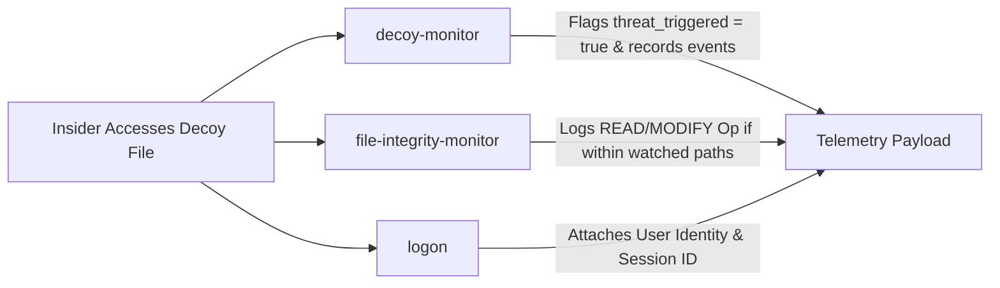

# InsiEDR Scenario Execution & Forensic Guide: SIM_HONEYTOKEN_TRIP

> **Scenario ID:** `SIM_HONEYTOKEN_TRIP`  
> **Friendly Name:** Canary Decoy Interaction & Honeytoken Breach  
> **Target Persona:** Snooping Insider / Rogue Administrative Actor  
> **MITRE ATT&CK:** [T1083](https://attack.mitre.org/techniques/T1083/) (File Discovery) & [T1552](https://attack.mitre.org/techniques/T1552/) (Unsecured Credentials)  
> **Operating Mode:** Ingestion-Only Forensics (**Detection Pipeline OFF**)  

---

## 1. Quick Reference Card

| Field | Specification |
| :--- | :--- |
| **Difficulty Level** | ⭐ Beginner (Safe, Non-Destructive, Instant Trigger) |
| **Execution Duration** | 2 – 5 minutes |
| **Required Privilege** | Standard User or Local Administrator |
| **Target Operating System** | Windows 10, Windows 11, Windows Server 2016+ |
| **Primary InsiEDR Collectors** | `decoy-monitor`, `file-integrity-monitor`, `logon` |
| **Target Honeypot Path** | `C:\Users\Public\Admin_Passwords.xlsx` |
| **Expected Sensor Signal** | `threat_triggered = true`, `events_recorded = true`, size/mtime change in `events` |

---

## 2. Threat Profile & Operational Context

### Executive Summary & Operational Metaphor
Imagine placing a bright red envelope marked **"CONFIDENTIAL: Master Safe Combinations"** inside an unlocked drawer in an office lobby. A legitimate employee performing daily tasks has zero operational reason to open or edit that document. If that envelope is touched, management knows with **100% deterministic certainty** that an unauthorized individual is actively snooping.

In the cybersecurity and EDR domain, this deceptive asset is designated a **Canary Decoy** or **Honeytoken**. During deployment, the InsiEDR agent plants an enticing bait file at:
```text
C:\Users\Public\Admin_Passwords.xlsx
```
Because no legitimate system service or background process ever references this file, any read, write, modify, or rename operation represents a high-confidence indicator of unauthorized discovery or data harvesting.

### MITRE ATT&CK Alignment

| Dimension | Identifier | Description |
| :--- | :--- | :--- |
| **Tactic** | **TA0007** (Discovery) | Adversary enumerates system files to locate accessible credentials. |
| **Technique** | **[T1083](https://attack.mitre.org/techniques/T1083/)** | File and Directory Discovery: searching common shares for sensitive files. |
| **Tactic** | **TA0006** (Credential Access) | Harvesting credentials from insecure local storage. |
| **Technique** | **[T1552](https://attack.mitre.org/techniques/T1552/)** | Unsecured Credentials: examining plaintext password spreadsheets and notes. |

---

## 3. InsiEDR Telemetry & Sensor Architecture

The InsiEDR agent continuously observes the designated honeytoken file via filesystem polling and metadata comparison.

### Active Collectors & Telemetry Delta



#### 1. `decoy-monitor` (Primary Sensor — `agent/collectors/decoy_monitor.py`)
* **Underlying Win32 API:** Windows File System APIs (`stat()`, `GetFileAttributesW`, `CreateFileW`).
* **Sensor Baseline vs. Attack Delta:**

| Feature Name | Clean Baseline Value | Active Attack Value | Description |
| :--- | :---: | :---: | :--- |
| `threat_triggered` | `false` | **`true`** | Core boolean trigger indicating canary file breach. |
| `events_recorded` | `false` | **`true`** | Confirms an access event was registered in the cycle. |
| `monitored_decoys` | `["C:\\Users\\Public\\Admin_Passwords.xlsx"]` | `["C:\\Users\\Public\\Admin_Passwords.xlsx"]` | Array of watched canary paths. |
| `events` | `[]` | `[{"event": "modified_or_accessed", ...}]` | Array containing before/after file size and timestamps. |

* **Raw JSON Payload Snapshot (Exact schema logged in `spool.db` and PostgreSQL `raw_payloads`):**
  ```json
  {
    "collector": "decoy-monitor",
    "status": "success",
    "collected_at": "2026-10-27T16:30:15.120Z",
    "payload": {
      "monitored_decoys": [
        "C:\\Users\\Public\\Admin_Passwords.xlsx"
      ],
      "events": [
        {
          "path": "C:\\Users\\Public\\Admin_Passwords.xlsx",
          "event": "modified_or_accessed",
          "old_mtime": 1729901200.0,
          "new_mtime": 1729901450.0,
          "old_size": 36,
          "new_size": 84
        }
      ],
      "events_recorded": true,
      "threat_triggered": true,
      "threat_events": [
        {
          "path": "C:\\Users\\Public\\Admin_Passwords.xlsx",
          "event": "modified_or_accessed",
          "old_mtime": 1729901200.0,
          "new_mtime": 1729901450.0,
          "old_size": 36,
          "new_size": 84
        }
      ]
    }
  }
  ```

#### 2. `file-integrity-monitor` (Corroborating Sensor)
* **What it captures:** If the decoy is located in or moved into a watched directory (`Desktop` or `Documents`), it computes SHA-256 hashes and captures `CREATE` / `MODIFY` events.

#### 3. `logon` (Contextual Attribution)
* **What it captures:** Binds the physical access event to the active interactive logon session (`username`, `session_id`, `logon_type = 2`).

---

## 4. SOC Analyst Inspection Protocol (Detection Pipeline OFF)

With the automated alert engine disabled (`INSIEDR_ENABLE_MODEL_PIPELINE=false`), telemetry is committed directly to storage without alert popups. You confirm the attack by inspecting **Telemetry Explorer**.

### Telemetry Explorer Inspection Steps:

```
[1. Select Time Range: 15m] ──► [2. Filter Collector: Decoy Canary Monitor] ──► [3. Open Log Inspector Drawer]
```

1. **Access Viewport:** Log in to the InsiEDR Web Dashboard (`http://localhost:5000/dashboard/`) and select the **Telemetry Explorer** tab.
2. **Set Temporal Range:** In the time window selector (top right), choose **`15m`** (or window containing your attack execution).
3. **Filter Collector Domain:** In the **Collector** dropdown menu, select **`Decoy Canary Monitor`** (`decoy-monitor`).
4. **Locate Target Row:** Locate the latest telemetry record with `status: success`. Click the row to open the **Log Inspector Drawer** on the right side of the screen.
5. **Verify Forensic Markers in Raw JSON:**
   * Confirm `"threat_triggered": true` is clearly visible.
   * Confirm `"events_recorded": true`.
   * Expand the `"events"` list: Verify `"event": "modified_or_accessed"` with the updated `new_size` and `new_mtime`.
   * Confirm `"monitored_decoys"` contains `"C:\\Users\\Public\\Admin_Passwords.xlsx"`.

---

## 5. Multi-Vector Attack Execution Playbooks

Below are **5 different vectors** to trigger this scenario on a live Windows machine.

### Vector 1: Manual GUI / Desktop Method (Zero-Code Desktop Workflow)
*Ideal for non-technical evaluators demonstrating real human insider behavior.*
1. Press **Windows Key + E** to launch **File Explorer**.
2. In the address bar, type `C:\Users\Public` and press **Enter**.
3. Verify `Admin_Passwords.xlsx` exists. *(If missing, the InsiEDR agent will automatically seed it, or you can create a blank file named `Admin_Passwords.xlsx`)*.
4. Right-click `Admin_Passwords.xlsx` $\rightarrow$ **Open with** $\rightarrow$ **Notepad** (or Microsoft Excel).
5. Add any text line (e.g., `UNAUTHORIZED_ACCESS_BY_OPERATOR`), then press **Ctrl + S** to save.
6. Close Notepad.
*Forensic Outcome:* InsiEDR's `decoy-monitor` detects the modified file size and timestamp within the next 10-second tick.

---

### Vector 2: PowerShell Automated Execution (Scripted Reproducibility)
Open PowerShell (Standard User or Administrator) and run:

```powershell
Write-Host "==========================================================" -ForegroundColor Cyan
Write-Host " EXECUTING SCENARIO: SIM_HONEYTOKEN_TRIP (PowerShell Vector)" -ForegroundColor Cyan
Write-Host "==========================================================" -ForegroundColor Cyan

# Step 1: Ensure Canary Honeytoken exists
$DecoyPath = "C:\Users\Public\Admin_Passwords.xlsx"
if (-not (Test-Path $DecoyPath)) {
    "CONFIDENTIAL_ENTERPRISE_ROOT_CREDENTIAL_VAULT" | Out-File -FilePath $DecoyPath -Encoding ascii
    Write-Host "[+] Seeded initial Canary Honeytoken at: $DecoyPath" -ForegroundColor Green
}

# Step 2: Simulate Unauthorized Inspection (Read)
Write-Host "[!] Reading decoy content from disk..." -ForegroundColor Yellow
$ReadContent = Get-Content -Path $DecoyPath -Raw

# Step 3: Simulate Unauthorized Tampering (Append)
Write-Host "[!] Appending unauthorized modification string..." -ForegroundColor Yellow
Add-Content -Path $DecoyPath -Value "`n[UNAUTHORIZED_MODIFICATION: $(Get-Date -Format 'yyyy-MM-dd HH:mm:ss')]"

Write-Host "[✔] Honeytoken accessed and modified successfully!" -ForegroundColor Green
Write-Host "[*] Wait 15 seconds for the InsiEDR agent collection tick." -ForegroundColor Cyan
```

---

### Vector 3: Classic Windows Command Prompt (`cmd.exe`)
Open Command Prompt (`cmd.exe`) and execute:

```cmd
:: 1. Read the canary file
type C:\Users\Public\Admin_Passwords.xlsx

:: 2. Tamper with the canary file by appending text
echo [UNAUTHORIZED_ACCESS_VIA_CMD: %DATE% %TIME%] >> C:\Users\Public\Admin_Passwords.xlsx
echo [✔] Honeytoken breached via cmd.exe.
```

---

### Vector 4: Python Script / Programmatic Trigger
If executing programmatically in a Python environment:

```python
import datetime
from pathlib import Path

decoy = Path(r"C:\Users\Public\Admin_Passwords.xlsx")
if not decoy.exists():
    decoy.write_text("CONFIDENTIAL_CREDENTIAL_STORE\n", encoding="ascii")

# 1. Read canary
print(f"[+] Read canary: {decoy.read_text()[:40]}...")

# 2. Tamper canary
with decoy.open("a", encoding="utf-8") as f:
    f.write(f"[TAMPER_PYTHON: {datetime.datetime.now().isoformat()}]\n")

print("[✔] Canary Honeytoken successfully modified via Python.")
```

---

### Vector 5: Simulated Ransomware Extension Renaming / Deletion
*Simulates an encryptor or wiper deleting and replacing or renaming canary files.*
In PowerShell:

```powershell
$Decoy = "C:\Users\Public\Admin_Passwords.xlsx"

# Delete the file (agent detects deletion and auto-recreates it)
Remove-Item -Path $Decoy -Force
Write-Host "[!] Honeytoken deleted! Agent will detect 'deleted_and_recreated' event." -ForegroundColor Red

Start-Sleep -Seconds 15
Write-Host "[✔] Wait for agent to record the deletion event and restore canary." -ForegroundColor Green
```

---

## 6. Post-Incident Remediation & Baseline Restoration

To return the sensor to its pristine baseline state after log verification:

```powershell
# Restore Honeytoken to original clean template
$DecoyPath = "C:\Users\Public\Admin_Passwords.xlsx"
"PK`x03`x04DummyExcelFileContentDoNotDelete" | Set-Content -Path $DecoyPath -Encoding Byte -NoNewline
Write-Host "[✔] Canary Honeytoken restored to clean baseline state." -ForegroundColor Green
```

---

## 7. Machine Learning Dataset Ground-Truth Specification

When exporting ingested telemetry rows from PostgreSQL or ClickHouse for machine learning model training:

### Labeling Standard
* **Evidence-Bearing Slicing:** Rows generated by `decoy-monitor` falling strictly within the execution interval $[t_{\text{start}}, t_{\text{end}})$ receive **`ground_truth_label = 1`**.
* **Feature Vector Output:**

| Exported Feature Column | Value During Scenario | Standard Baseline Value | Description |
| :--- | :---: | :---: | :--- |
| **`threat_triggered`** | **`True`** | `False` | Primary boolean signal indicating canary breach. |
| **`events_recorded`** | **`True`** | `False` | Confirms access event was logged during the interval. |
| **`decoy_access_count`** | **$\ge 1.0$** | `0.0` | Synthesized feature count for model input. |
| **`ground_truth_label`** | **`1`** | `0` | Supervised binary classification ground truth (Threat). |
| **`multiclass_label`** | **`HONEYTOKEN_TRIP`** | `BENIGN` | Multi-class threat category. |
| **`mitre_technique`** | **`T1083 / T1552`** | `None` | MITRE ATT&CK technique mapping. |
