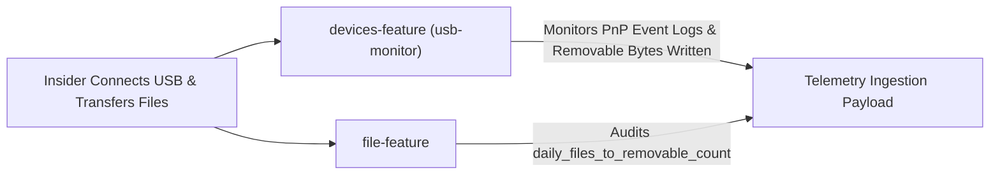

# InsiEDR Scenario Execution & Forensic Guide: SIM_USB_PRECURSOR

> **Scenario ID:** `SIM_USB_PRECURSOR`  
> **Friendly Name:** Unauthorized USB Peripheral Connection & File Staging  
> **Target Persona:** Physical Exfiltrator / Rogue Contractor with External Media  
> **MITRE ATT&CK:** [T1052.001](https://attack.mitre.org/techniques/T1052/001/) (Exfiltration Over Physical Medium: Removable Storage) & [T1200](https://attack.mitre.org/techniques/T1200/) (Hardware Additions: Peripheral Device Insertion)  
> **Operating Mode:** Ingestion-Only Forensics (**Detection Pipeline OFF**)  

---

## 1. Quick Reference Card

| Field | Specification |
| :--- | :--- |
| **Difficulty Level** | ⭐ Beginner (Physical Flash Drive or Agent Synthetic Simulation) |
| **Execution Duration** | 3 – 5 minutes |
| **Required Privilege** | Standard User (for physical USB copy) or Administrator (for diskpart/service configs) |
| **Target Operating System** | Windows 10, Windows 11, Windows Server 2016+ |
| **Primary InsiEDR Collectors** | `devices-feature` (`usb-monitor`), `file-feature` |
| **Target Staging Path** | Removable USB Drive Mount (e.g. `E:\`, `F:\`) |
| **Expected Sensor Signal** | `usb_connect_count >= 1`, `unique_usb_devices >= 1`, `daily_removable_bytes_written > 0` |

> [!CAUTION]
> **Windows Security Warning Regarding Registry HKLM\...\USBSTOR:**  
> Windows kernel ACLs permanently restrict write access to `HKLM\SYSTEM\CurrentControlSet\Enum` to `NT AUTHORITY\SYSTEM`. Even an elevated Administrator PowerShell will fail with `Access is denied` if attempting direct `New-Item` or `reg add` calls against `USBSTOR`.  
> For realistic testing, use **Vector 1 (Physical Flash Drive)** or **Vector 2 (InsiEDR Built-In Synthetic Hook)**.

---

## 2. Threat Profile & Operational Context

### Executive Summary & Operational Metaphor
In high-security enterprise environments, organizations enforce strict Data Loss Prevention (DLP) controls and air-gapped network policies to prevent intellectual property from being transmitted over the Internet. An insider seeking to bypass these network firewalls often resorts to a physical vector: inserting an unapproved, personal USB flash drive or portable external SSD directly into their workstation, dragging and dropping confidential files onto the drive, and physically walking out the front doors.

To detect this threat without burdening workstations with heavy, unstable third-party kernel filter drivers, InsiEDR's `devices-feature` collector monitors Windows event channels (`System` Event IDs 2003/2004/2100/2102, `DriverFrameworks-UserMode`, `Security` Event 6416) and low-level WMI disk performance counters (`Win32_PerfRawData_PerfDisk_LogicalDisk` on `DriveType=2` removable drives).

### MITRE ATT&CK Alignment

| Dimension | Identifier | Description |
| :--- | :--- | :--- |
| **Tactic** | **TA0001** (Initial Access) / **TA0008** (Lateral Movement) | Introducing unauthorized external storage media. |
| **Technique** | **[T1200](https://attack.mitre.org/techniques/T1200/)** | **Hardware Additions:** Connecting an unauthorized USB flash drive or removable storage controller. |
| **Tactic** | **TA0010** (Exfiltration) | Transferring sensitive data over physical media to evade network inspection. |
| **Technique** | **[T1052.001](https://attack.mitre.org/techniques/T1052/001/)** | **Exfiltration Over Physical Medium (Removable Storage):** Copying proprietary records onto removable media. |

---

## 3. InsiEDR Telemetry & Sensor Architecture

### Active Collectors & Telemetry Delta



#### 1. `devices-feature` (Hardware Sensor — `agent/collectors/devices_feature.py`)
* **Underlying Win32 API & Event Logs:** 
  - Windows Event Log (`System` Channel Event IDs `2003` [Connect] and `2102` [Disconnect]).
  - `Microsoft-Windows-DriverFrameworks-UserMode/Operational`.
  - WMI `Win32_LogicalDisk WHERE DriveType=2` combined with `Win32_PerfRawData_PerfDisk_LogicalDisk` to track exact bytes written to removable drives.
* **Sensor Baseline vs. Attack Delta:**

| Feature Name | Clean Baseline Value | Active Attack Value | Description |
| :--- | :---: | :---: | :--- |
| `usb_connect_count` | `0` | **$\ge 1$** | Count of new USB storage connections recorded. |
| `unique_usb_devices` | `0` (or constant) | **Elevated (+1)** | Unique hardware serials / device instance IDs. |
| `daily_device_connect_count` | `0` | **$\ge 1$** | Daily cumulative connection counter. |
| `daily_removable_bytes_written` | `0` | **$> 0$** (e.g. `1500000`) | Exact bytes transferred to removable disk mounts. |

* **Raw JSON Payload Snapshot (Exact schema logged in `spool.db` and PostgreSQL):**
  ```json
  {
    "collector": "devices-feature",
    "status": "success",
    "collected_at": "2026-10-27T16:48:22.310Z",
    "payload": {
      "usb_connect_count": 1,
      "usb_disconnect_count": 0,
      "usb_usage_duration": 45,
      "usb_file_transfer_count": 1,
      "large_usb_transfer": false,
      "unique_usb_devices": 1,
      "daily_device_connect_count": 1,
      "daily_device_usage_flag": 1,
      "daily_removable_bytes_written": 2548000
    }
  }
  ```
  *(Note: `unauthorized_usb_detected` is a server-side heuristic rule evaluated in `heuristics/device_rules.py` based on `usb_connect_count` and device whitelists).*

---

## 4. SOC Analyst Inspection Protocol (Detection Pipeline OFF)

With the automated alert engine disabled (`INSIEDR_ENABLE_MODEL_PIPELINE=false`), telemetry is committed directly to storage. Verify via **Telemetry Explorer**.

### Telemetry Explorer Inspection Steps:

```
[1. Select Time Range: 15m] ──► [2. Filter Collector: Devices / USB] ──► [3. Inspect Log Drawer (usb_connect_count >= 1)]
```

1. **Access Viewport:** Open the InsiEDR Web Dashboard (`http://localhost:5000/dashboard/`) and click **Telemetry Explorer**.
2. **Set Temporal Range:** Select **`15m`**.
3. **Filter Primary Device Sensor:** In the **Collector** dropdown, select **`USB & Devices`** (`devices-feature` / `usb-monitor`).
4. **Inspect Raw Payload:** Click on the most recent log row:
   * Verify `"usb_connect_count"` displays **$\ge 1$**.
   * Verify `"unique_usb_devices"` displays **$\ge 1$**.
   * Verify `"daily_removable_bytes_written"` is greater than `0` (reflecting bytes copied to the thumb drive).

---

## 5. Multi-Vector Attack Execution Playbooks

Below are the **functional execution playbooks** to simulate USB insertion and exfiltration.

### Vector 1: Physical Hardware Insertion (Real USB Flash Drive — Recommended)
*The most realistic physical test — uses any standard USB thumb drive.*
1. Insert any physical USB flash drive (SanDisk, Kingston, etc.) into an available USB port.
2. Note the drive letter assigned by Windows (e.g., `E:\` or `F:\`).
3. Open **File Explorer**, navigate to your **Desktop** or **Documents**, select 20–25 files (approx 2–5 MB total), and drag & drop them directly onto the USB drive letter.
*Forensic Outcome:* Windows generates PnP Event 2003, and WMI records the write bytes to the removable volume.

---

### Vector 2: Agent Built-In Synthetic Hook (Headless CI/CD Simulation)
*The InsiEDR agent includes a built-in simulation hook (`devices_feature.py:46`) designed specifically for testing without physical hardware.*
In PowerShell:

```powershell
Write-Host "==========================================================" -ForegroundColor Cyan
Write-Host " EXECUTING SCENARIO: SIM_USB_PRECURSOR (Agent Synthetic Hook)" -ForegroundColor Cyan
Write-Host "==========================================================" -ForegroundColor Cyan

# Enable synthetic USB telemetry in the agent environment
$env:INSIEDR_ALLOW_SYNTHETIC_COLLECTOR_DATA = "1"
Write-Host "[+] Configured INSIEDR_ALLOW_SYNTHETIC_COLLECTOR_DATA = 1" -ForegroundColor Green
Write-Host "[*] The agent's next collection cycle will synthesize a realistic SanDisk connect event and 150MB transfer." -ForegroundColor Yellow
Write-Host "[*] Wait 15 to 20 seconds for collection." -ForegroundColor Cyan
```

---

### Vector 3: Virtual Disk Mounting via Diskpart (No Hyper-V Required)
*Creates a virtual disk image using native Windows `diskpart` without needing the Hyper-V module:*
Create a file named `create_vdisk.txt`:

```text
create vdisk file="C:\Users\Public\VirtualUSB.vhd" maximum=50 type=expandable
select vdisk file="C:\Users\Public\VirtualUSB.vhd"
attach vdisk
create partition primary
format fs=ntfs quick label="SECURE_USB"
assign letter=R
```

In an **Administrator Command Prompt**:
```cmd
diskpart /s create_vdisk.txt
echo [+] Virtual drive mounted at R:\
for /L %i in (1,1,25) do (echo SENSITIVE_EXFIL_DATA > R:\Confidential_%i.xlsx)
echo [✔] Files staged to virtual disk volume!
```

---

### Vector 4: Python Script / WMI Removable Probe
If executing programmatically in Python:

```python
import os
import shutil
from pathlib import Path

print("[+] Executing SIM_USB_PRECURSOR via Python...")

# Find removable drive letters
import win32file
removable_drives = [
    drive for drive in ["D:\\", "E:\\", "F:\\", "G:\\"]
    if os.path.exists(drive) and win32file.GetDriveType(drive) == win32file.DRIVE_REMOVABLE
]

if removable_drives:
    target_drive = Path(removable_drives[0])
    print(f"[+] Found removable drive at: {target_drive}")
    for i in range(25):
        (target_drive / f"payroll_record_{i}.xlsx").write_text(f"CONFIDENTIAL_PAYROLL_DATA_{i}")
    print("[✔] Staged 25 files to removable drive.")
else:
    print("[!] No physical removable drive mounted. Use Vector 2 (Synthetic Hook) for headless testing.")
```

---

### Wait for the Agent Sweep:
Wait **15 to 20 seconds** for the agent's 10-second tick to sweep the event channels and performance counters!

---

## 6. Post-Incident Remediation & Baseline Restoration

To clean the host and return the sensor to baseline:

```powershell
Write-Host "[+] Restoring baseline: Cleaning up USB simulation..." -ForegroundColor Yellow

# If synthetic hook was used, unset it
Remove-Item Env:\INSIEDR_ALLOW_SYNTHETIC_COLLECTOR_DATA -ErrorAction SilentlyContinue

# If Virtual Disk was mounted via diskpart:
$DismountScript = @"
select vdisk file="C:\Users\Public\VirtualUSB.vhd"
detach vdisk
"@
$DismountScript | Out-File "C:\Users\Public\detach.txt" -Encoding ascii
diskpart /s "C:\Users\Public\detach.txt" 2>$null
Remove-Item "C:\Users\Public\VirtualUSB.vhd" -Force -ErrorAction SilentlyContinue
Remove-Item "C:\Users\Public\detach.txt" -Force -ErrorAction SilentlyContinue

Write-Host "[✔] Host returned to pristine baseline state." -ForegroundColor Green
```

---

## 7. Machine Learning Dataset Ground-Truth Specification

When exporting ingested telemetry rows from PostgreSQL (`features` table) or ClickHouse:

### Labeling Standard
* **Evidence-Bearing Slicing:** Rows generated by `devices-feature` falling strictly within the execution interval $[t_{\text{start}}, t_{\text{end}})$ receive **`ground_truth_label = 1`**.
* **Feature Vector Output:**

| Exported Feature Column | Value During Scenario | Standard Baseline Value | Description |
| :--- | :---: | :---: | :--- |
| **`usb_connect_count`** | **$\ge 1.0$** | `0.0` | Number of distinct USB mass-storage connections. |
| **`unique_usb_devices`** | **$\ge 1$** | `0` | Number of unique USB device identifiers enumerated. |
| **`daily_removable_bytes_written`** | **$> 0$** | `0` | Total bytes written to removable media mounts. |
| **`ground_truth_label`** | **`1`** | `0` | Supervised binary classification ground truth (Threat). |
| **`multiclass_label`** | **`USB_EXFILTRATION_PRECURSOR`** | `BENIGN` | Multi-class threat category. |
| **`mitre_technique`** | **`T1052.001 / T1200`** | `None` | MITRE ATT&CK technique mapping. |
