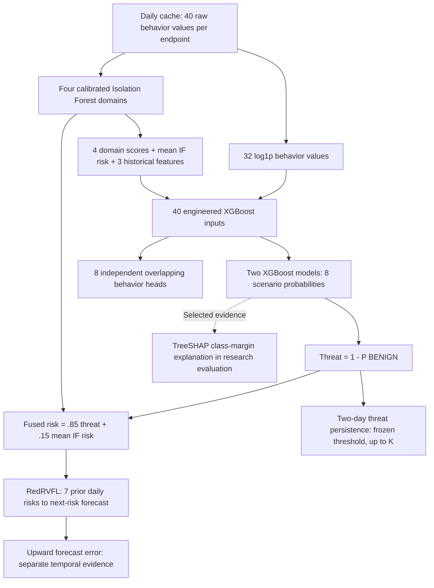

# Model V3 — frozen insider-threat research pipeline

This folder supplies the selected **Model V3** weights, label-free batch inference, input contract, model details and saved synthetic evaluation. It does **not** enable model inference in the server automatically. The existing ingestion, heuristics, baseline detectors and dashboard code are unchanged by this addition.

## Start here

- [Input requirements: exact 40 daily features](INPUT_DATA_REQUIREMENTS.md)
- [Model architecture, training and limitations](MODEL_DETAILS.md)
- [Server integration contract](SERVER_INTEGRATION.md)
- [Actual evaluation and Top-K results](run/RESULTS.md)
- [Production-readiness findings](run/PRODUCTION_READINESS.md)
- [Historical implementation decisions](IMPLEMENTATION_LOG.md)
- [Package provenance and scope](SOURCE_NOTES.md)

## Run the supplied example

Use Python 3.12 in a separate ML environment and the pinned dependencies. Do not replace the server's root dependency files or install a second dependency set into a running server environment without compatibility testing.

```powershell
python -m venv model/.venv
model/.venv/Scripts/python.exe -m pip install -r model/requirements.txt
model/.venv/Scripts/python.exe model/predict.py --features model/examples/X.csv --metadata model/examples/metadata.csv --output model/outputs/example --max-reviews 20
```

On Linux/macOS, use `model/.venv/bin/python` for the corresponding commands. The paths above are relative to the repository root. Run the CLI by file path; `model.predict` is not yet a supported FastAPI integration API.

For actual data, replace the two input files and supply `--as-of YYYY-MM-DD` with the review date. Each row is one endpoint/day; X.csv has exactly 40 ordered raw numeric features, while IDs, dates and coverage flags are separate metadata. Raw collector CSVs require a verified daily aggregation adapter.

The outputs are `daily_predictions.csv`, `host_rankings.csv`, `review_queue.csv`, `summary.json` and descriptive feature-shift statistics. Daily classifier scores need valid input rows; the full operational queue needs seven warmup days plus 15 valid consecutive target days, or **22 complete consecutive days per endpoint** from a cold start.

## Architecture



The final operational review ranking is the V3 persistence extension, rather than the original temporal-error ranking formula. RedRVFL errors remain available as evidence; the original temporal ranking's evaluation is retained. The separately tested anomaly-only referral route is disabled in this frozen release.

## Key saved results

Both cohorts below are generated after fitting/calibration and artifact freezing, but share a synthetic generator family. These are **synthetic host-review metrics**, not real-world accuracy or exact-class accuracy.

| V3 cohort | Reviewed | Attack hosts found | Review precision | Attack-host recall |
|---|---:|---:|---:|---:|
| Standard | 20 | 16/18 | 80.0% | 88.9% |
| Sustained legitimate-activity stress | 20 | 14/18 | 70.0% | 77.8% |

Default K is 20, with an up-to-K queue after the frozen threshold and coverage checks. The system does not fill unused slots. Full daily, scenario, behavior, temporal and K=5/10/15/20/30 metrics are in `run/evaluation.json` and `run/RESULTS.md`.

**Class naming remains imperfect:** exact KILL_CHAIN_APT recall is 0% on the standard cohort and 8% on stress. Scenario probabilities and review flags are investigation hypotheses, not confirmed insiders. No independently labeled real endpoint evaluation or monitored pilot has established production readiness.

`run/pipeline.joblib` and `run/behavior_heads.joblib` are the original frozen V3 files. No retraining or threshold changes are introduced by this publication. Their expected hashes are in the freeze files; `PACKAGE_MANIFEST.json` covers the published files. Load only this project's trusted model artifacts.
